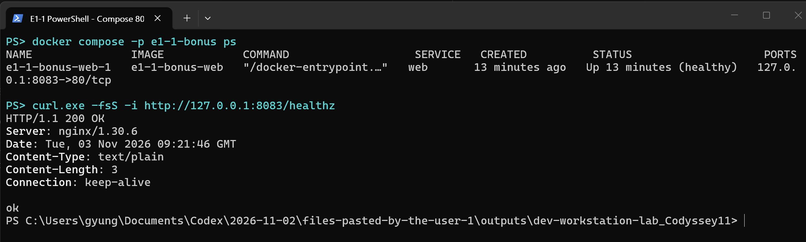

# Codyssey E1-1 · 내 컴퓨터에 개발자용 작업실 꾸미기

Dockerfile과 실행 명령을 공유해 다른 사람도 같은 웹 서버를 띄울 수 있도록 개발 환경을 구성했습니다. Ubuntu 컨테이너에서 파일과 권한을 실습하고, NGINX 컨테이너에서는 웹 접속, HTML 변경 반영, 데이터 보존을 검증했습니다.

| 확인한 것 | 실습 결과 |
|---|---|
| 웹 접속 | PC의 `8080`번을 컨테이너의 `80`번에 연결해 브라우저에서 페이지를 열었습니다. |
| 수정 반영 | HTML을 수정한 뒤 PC 폴더를 연결한 `8081`은 V2, 이미지에 복사된 파일을 읽는 `8082`는 V1을 반환했습니다. |
| 데이터 보존 | 컨테이너를 삭제한 뒤 새 컨테이너에 같은 볼륨을 연결하니 `E1-1-volume-proof`를 다시 읽을 수 있었습니다. |

## 1. 실행 환경과 빠른 실행

| 항목 | 실습 환경 |
|---|---|
| OS·터미널 | Windows 11 · Windows Terminal |
| 셸 | Docker 실행은 PowerShell, 파일 권한은 Ubuntu 24.04 컨테이너의 Bash, 일부 결과 확인은 CMD |
| Docker | Docker Desktop 4.97.0 · CLI/엔진 29.9.2 · Compose v5.6.1 |
| 버전 관리·편집기 | Git 2.52.0.windows.1 · GitHub · VS Code |

Docker Desktop을 켜고 PowerShell에서 저장소를 받은 뒤 **이미지 빌드 → 컨테이너 실행 → 응답 확인** 순서로 진행합니다.

```powershell
git clone https://github.com/gyungmini306-blip/codyssey-E1-1-dev-workstation.git
cd codyssey-E1-1-dev-workstation
docker build -t e1-1-quickstart .
docker run -d --rm --name e1-1-quickstart -p 127.0.0.1:18086:80 e1-1-quickstart
curl.exe -fsS -i --retry 5 --retry-connrefused http://127.0.0.1:18086/healthz
```

성공하면 **HTTP 200과 `ok`**가 표시됩니다. 브라우저에서 `http://localhost:18086/`을 열면 현재 저장소의 V2가 보입니다. 포트가 이미 사용 중이면 실행 명령과 접속 주소의 `18086`을 같은 빈 포트로 바꾸세요. 확인을 마치면 `docker stop e1-1-quickstart`로 종료합니다. Compose 실행은 [보너스 1번](#5-보너스-1번--docker-compose-기초)에서 다룹니다.

## 2. 수행 체크리스트

- [x] 터미널에서 위치 확인, 파일 생성·복사·이동·삭제, 숨김 파일 조회
- [x] 파일과 디렉토리 권한 변경 전후 비교
- [x] Docker 버전·엔진 점검, 이미지·컨테이너·로그·리소스 조회
- [x] `hello-world` 실행, Ubuntu 진입과 `exec`·`attach` 종료 비교
- [x] 커스텀 이미지 빌드·실행과 포트 매핑 접속
- [x] 바인드 마운트 변경 반영과 볼륨 데이터 보존
- [x] Git 설정·커밋·푸시와 VS Code GitHub 연결
- [x] 보너스 1번 · Compose 단일 웹 서버

## 3. 실습과 검증 결과

### 3-1. 터미널과 권한

Ubuntu 컨테이너에서 작업 폴더를 만들고 파일을 복사·이동·삭제했습니다. `/root/e1-1/guided-practice`는 루트부터 시작하는 절대 경로이고, `archive/memo-renamed.txt`는 현재 폴더를 기준으로 찾는 상대 경로입니다.

실제 파일 목록에서 작업과 관련된 행을 발췌했습니다.

```console
$ cp memo.txt memo-copy.txt
$ ls -la
-rw-r--r-- 1 root root   23 Nov  3 00:08 memo-copy.txt
$ mkdir -p archive
$ mv memo-copy.txt archive/memo-renamed.txt
$ ls -la archive
-rw-r--r-- 1 root root   23 Nov  3 00:08 memo-renamed.txt
$ rm archive/memo-renamed.txt
$ ls -la archive
total 8
drwxr-xr-x 2 root root 4096 Nov  3 00:09 .
drwxr-xr-x 3 root root 4096 Nov  3 00:09 ..
```

| 대상 | 변경 명령 | 조회 결과 |
|---|---|---|
| 파일 | `chmod 600 memo.txt` → `chmod 644 memo.txt` | `ls -l memo.txt`에서 `-rw-------` → `-rw-r--r--` |
| 디렉토리 | `chmod 700 permissions-dir` → `chmod 755 permissions-dir` | `ls -ld permissions-dir`에서 `drwx------` → `drwxr-xr-x` |

`r=4`(읽기), `w=2`(쓰기), `x=1`(실행 또는 디렉토리 진입)을 소유자·그룹·기타 사용자 순서로 더합니다. [터미널 전체 명령과 권한 변경 전후 출력](docs/evidence/10-user-terminal.md)


### 3-2. Docker 설치·운영과 셸 종료

| 확인한 것 | 명령과 결과 |
|---|---|
| 설치와 엔진 | `docker --version`은 29.9.2, `docker info`는 `ServerVersion=29.9.2 OSType=linux`를 표시했습니다. |
| 컨테이너 실행 | `docker run --name e1-1-hello hello-world`가 인사말을 출력했고, `docker ps -a`에서 `Exited (0)`을 확인했습니다. |
| 운영 상태 | `docker images`로 이미지 목록을, `docker ps -a`로 컨테이너 상태를 확인했습니다. `docker logs`에 `/healthz`의 HTTP 200이 남았고, `docker stats`에서 조회 당시 메모리 사용량은 8.945MiB였습니다. |
| Ubuntu 셸 종료 | `docker exec`로 연 추가 Bash를 종료해도 컨테이너가 실행 중이었고, `docker attach`로 연결한 주 Bash를 종료하자 상태가 `exited`가 됐습니다. |

[hello-world 실행 출력](docs/evidence/05-hello-world.md) · [Docker 운영과 Ubuntu 셸 로그](docs/evidence/13-user-operations.md)

### 3-3. 커스텀 이미지와 포트 매핑

**웹 서버 베이스 이미지 활용 방식(A)**을 선택했습니다. `nginx:stable-alpine`은 정적 HTML을 제공할 NGINX를 포함합니다. [Dockerfile](Dockerfile)은 [웹 파일](app/)을 NGINX의 문서 폴더에 복사하고, [서버 설정](nginx.conf)으로 페이지 위치와 `/healthz` 응답을 정의합니다. `HEALTHCHECK`로 NGINX가 실제로 응답하는지 점검합니다.

```console
PS> docker build --progress=plain -t codyssey-workstation:1.0 .
#9 naming to docker.io/library/codyssey-workstation:1.0 done
PS> docker run -d --name codyssey-web -p 127.0.0.1:8080:80 codyssey-workstation:1.0
PS> curl.exe -i --max-time 15 http://localhost:8080/healthz
HTTP/1.1 200 OK
ok
```

PC의 `8080`으로 들어온 요청은 컨테이너 안의 `80`으로 전달됩니다. [최초 빌드·실행 기록](docs/evidence/07-web-server.md) · [직접 실행한 이미지 빌드 기록](docs/evidence/11-user-bind.md)

별도 재실습에서는 PowerShell에서 아래 두 줄을 `Dockerfile`로 직접 저장하고, `docker build -t e1-1-replay .`를 실행했습니다. 빌드 출력에 `naming to docker.io/library/e1-1-replay:latest`가 표시됐고, 컨테이너를 실행한 뒤 `localhost:8084`에서 `Hello Docker`를 확인했습니다.

```dockerfile
FROM nginx:stable-alpine
COPY index.html /usr/share/nginx/html/index.html
```

주소창에서 8080과 8081을 확인할 수 있는 [최초 브라우저 접속 증거](docs/evidence/15-browser.md)를 보관했습니다.

### 3-4. 바인드 마운트와 볼륨

| 검증 | 비교 방법 | 결과 |
|---|---|---|
| HTML 수정 반영 | 같은 이미지로 서버 두 개를 띄운 뒤, 8081에만 PC의 `app/` 폴더를 연결했습니다. 두 서버가 V1인 상태에서 PC HTML만 V2로 수정했습니다. | 8081은 V2, 8082는 V1을 반환했습니다. [실행 명령과 수정 전후 응답](docs/evidence/11-user-bind.md) |
| 볼륨 보존 | 이름 있는 볼륨을 `/data`에 연결해 메모를 썼습니다. 기존 컨테이너를 삭제한 뒤 새 컨테이너에 같은 볼륨을 연결했습니다. | 삭제 전후에 `cat /data/memo.txt`로 같은 값 `E1-1-volume-proof`를 읽었습니다. [생성·삭제·재연결 명령과 출력](docs/evidence/12-user-volume.md) |


*당시 실측 화면입니다. 두 `curl.exe` 응답과 마지막 `cat` 출력에서 버전과 볼륨 메모를 확인할 수 있습니다.*

#### 현재 저장소로 HTML 변경을 재현하는 방법

비교에는 버전 번호 대신 **같은 내용에서 시작해 PC 쪽 문구만 바꾸는 방식**을 사용할 수 있습니다. 아래 명령은 PowerShell에서 실행합니다. 별도 Git 작업 폴더를 만들어 제출 파일의 수정본을 보호합니다. `18081`, `18082`가 이미 사용 중이면 다른 빈 호스트 포트로 바꾸고 요청 주소도 맞춥니다.

```powershell
# 저장소 루트에서 실행
$repo = (Get-Location).Path
$lab = Join-Path $repo 'e1-1-mount-demo'
git worktree add --detach $lab HEAD
Set-Location $lab
docker build -t e1-1-mount-demo .
$appPath = (Resolve-Path .\app).Path
docker run -d --name e1-1-demo-bind -p 127.0.0.1:18081:80 --mount "type=bind,source=$appPath,target=/usr/share/nginx/html,readonly" e1-1-mount-demo
docker run -d --name e1-1-demo-copy -p 127.0.0.1:18082:80 e1-1-mount-demo

# 수정 전 두 응답 확인
curl.exe -fsS http://127.0.0.1:18081/ | Select-String SIMPLE_PAGE
curl.exe -fsS http://127.0.0.1:18082/ | Select-String SIMPLE_PAGE

# PC 쪽 HTML만 수정하고 같은 두 주소를 다시 조회
$htmlPath = (Resolve-Path .\app\index.html).Path
$html = [IO.File]::ReadAllText($htmlPath)
[IO.File]::WriteAllText($htmlPath, $html.Replace('id="mount-marker" data-version="SIMPLE_PAGE_V2"', 'id="mount-marker" data-version="SIMPLE_PAGE_HOST_EDIT"').Replace('페이지 버전: 2', 'PC에서 수정한 페이지'))
curl.exe -fsS http://127.0.0.1:18081/ | Select-String SIMPLE_PAGE
curl.exe -fsS http://127.0.0.1:18082/ | Select-String SIMPLE_PAGE

# 실습용 컨테이너와 작업 폴더 정리
docker rm -f e1-1-demo-bind e1-1-demo-copy
git restore --worktree -- app/index.html
Set-Location $repo
git worktree remove $lab
```

이 절차를 별도 작업 폴더에서 다시 실행한 결과입니다. 두 서버는 같은 이미지로 시작했고 HTML 수정 후에는 재빌드 없이 응답을 확인했습니다.

| 주소 | 수정 전 응답 표식 | 수정 후 응답 표식 |
|---|---|---|
| `localhost:18081` · PC 폴더 연결 | `SIMPLE_PAGE_V2` | `SIMPLE_PAGE_HOST_EDIT` |
| `localhost:18082` · 이미지에 복사 | `SIMPLE_PAGE_V2` | `SIMPLE_PAGE_V2` |

#### 볼륨 보존 재현

PowerShell에서 **볼륨 생성 → 메모 저장·조회 → 기존 컨테이너 삭제 → 같은 볼륨 재연결 → 새 컨테이너에서 조회** 순서로 실행합니다. 아래 이름이 이미 사용 중이면 실습용 이름을 바꿔 실행하세요.

```powershell
docker volume create e1-1-demo-data
docker run -d --name e1-1-demo-before --mount "type=volume,source=e1-1-demo-data,target=/data" ubuntu:24.04 sleep infinity
docker exec e1-1-demo-before sh -c 'echo E1-1-volume-proof > /data/memo.txt'
docker exec e1-1-demo-before cat /data/memo.txt
docker rm -f e1-1-demo-before

docker run -d --name e1-1-demo-after --mount "type=volume,source=e1-1-demo-data,target=/data" ubuntu:24.04 sleep infinity
docker exec e1-1-demo-after cat /data/memo.txt
```

두 조회에서 모두 `E1-1-volume-proof`가 나오면 컨테이너 교체 후에도 데이터가 유지된 것입니다. 실습이 끝나면 `docker rm -f e1-1-demo-after`로 정리합니다. 실습 메모까지 지우려면 `docker volume rm e1-1-demo-data`를 실행합니다.

#### 화면 디자인 참고

아래 캡처는 V1과 V2의 디자인을 보여줍니다. 바인드 마운트의 수정 반영 여부는 위 8081·8082 응답 기록에서 확인할 수 있습니다.

| V1 · 어두운 기본 화면 | V2 · 밝은 화면과 보라색 버전 표시 |
|---|---|
|  |  |
| `localhost:18080` · 디자인 확인용 V1 | `localhost:8081` · 바인드 마운트 서버 |

### 3-5. Git과 GitHub·VS Code 연결

Git으로 HTML 수정 이력을 내 PC에 커밋하고, GitHub에 푸시해 소스와 실습 결과를 공유했습니다. `git config --local --list`에서 사용자 이름과 기본 브랜치 `main`을 확인했습니다. `git push`의 `58c49d9..d580e49  main -> main` 출력에서 수정 커밋이 원격에 올라간 것을 확인했습니다. [Git 설정·커밋·푸시 출력](docs/evidence/14-user-git.md)


*계정 메뉴에 `gyungmini306-blip (GitHub)`이 표시됩니다.*

## 4. 문제 해결

| 문제 | 원인 가설과 확인 | 해결 결과 |
|---|---|---|
| `ls- la`로 파일 목록을 보려다 실패 | 공백 위치가 틀려 셸이 `ls-`를 명령 이름으로 읽었다고 판단했습니다. 실제로 `bash: ls-: command not found`가 출력됐습니다. | `ls -la`로 수정하니 숨김 파일을 포함한 목록이 나왔습니다. |
| 바인드 마운트 서버가 시작되지 않음 | `--mount` 인수가 빠졌다고 판단했습니다. Docker가 `flag needs an argument: --mount`를 출력했습니다. | 마운트 설정과 이미지 이름을 한 줄에 넣어 다시 실행했고, `docker ps`와 HTTP 응답으로 확인했습니다. |

### 포트 충돌 실측

`docker ps`와 `netstat -ano`에서 기존 Compose 서버가 `8083`을 사용 중임을 확인했습니다. 같은 호스트 포트로 새 컨테이너를 실행하자 `port is already allocated` 오류가 났고, 호스트 포트를 `18085`로 바꾸자 `/healthz`에서 **HTTP 200과 `ok`**를 받았습니다. [점유 확인·실행 실패·재실행 출력](docs/evidence/18-port-conflict.md)

검증 주소는 로컬 PC로 제한했습니다. 로그와 캡처는 명령과 결과가 함께 보이는 자료를 사용하며, 인증 정보는 공개 문서에서 제외합니다.

## 5. 보너스 1번 · Docker Compose 기초

[compose.yaml](compose.yaml)에 웹 서버 한 개를 정의했습니다. `services.web`은 실행할 서비스, `build: .`은 현재 폴더의 Dockerfile, `ports`는 **PC의 8083 → 컨테이너의 80** 연결을 뜻합니다. 설정을 파일에 남겨 다른 사람도 같은 옵션으로 서버를 실행할 수 있습니다.

| 검증 | 실제 결과 |
|---|---|
| `docker compose -p e1-1-bonus up -d --build --wait` | 웹 서버가 `healthy` 상태로 실행됐습니다. |
| `curl.exe -fsS -i http://127.0.0.1:8083/healthz` | `HTTP/1.1 200 OK`와 `ok`를 받았습니다. |
| `docker compose -p e1-1-bonus down` | 종료 실습에서 컨테이너를 제거했고, 이후 `ps -a` 목록에 컨테이너가 없었습니다. |



[Compose 시작·상태 조회·응답·종료 출력](docs/evidence/16-compose-bonus.md)
