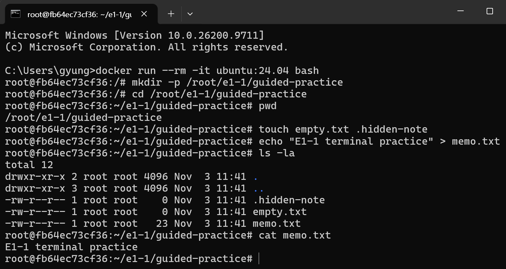
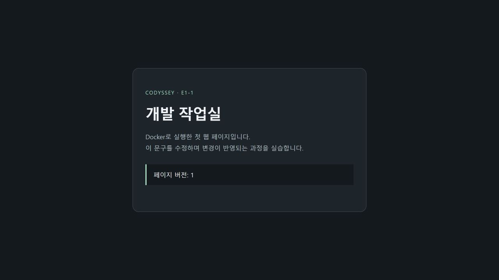
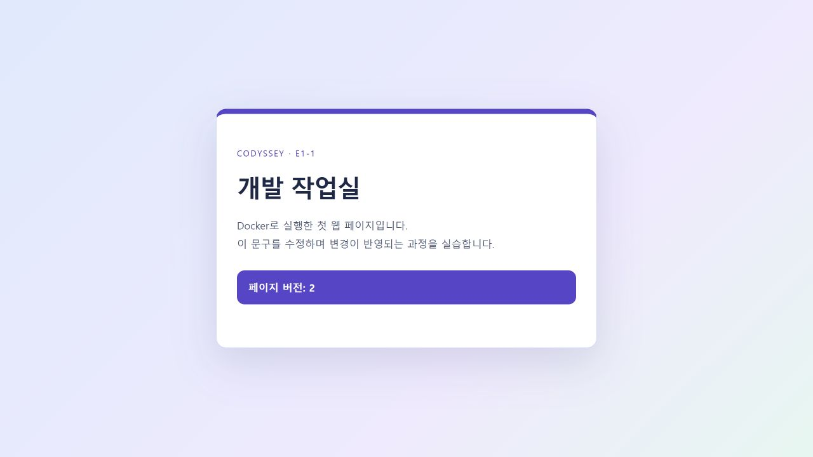

# Codyssey E1-1 · 내 컴퓨터에 개발자용 작업실 꾸미기

## 1. 프로젝트 개요

다른 사람도 같은 웹 서버를 실행할 수 있도록 개발 환경을 구성했습니다. 먼저 Ubuntu의 Bash에서 파일과 권한을 다뤘습니다. 그다음 Dockerfile로 NGINX 웹 서버를 만들고, PC에서 접속해 HTML 변경이 반영되는지 확인했습니다. 별도의 Ubuntu 컨테이너에서는 볼륨에 쓴 데이터가 컨테이너 교체 후에도 남는지 확인했습니다. 소스와 실습 기록은 Git으로 관리하고 GitHub에 공유했습니다. 다른 사람도 저장소를 받아 [빌드·실행 절차](#6-커스텀-웹-서버-이미지와-포트-매핑)부터 재현할 수 있습니다.

## 2. 실행 환경과 저장소 구성

| 항목 | 실제 실습 환경 |
|---|---|
| OS · 터미널 | Windows 11 · Windows Terminal |
| 셸 | Windows PowerShell 5.1, 일부 확인은 CMD, Linux 실습은 Ubuntu 24.04의 Bash |
| Docker | Docker Desktop 4.97.0 · CLI/엔진 29.9.2 · Linux 컨테이너 모드 · Compose v5.6.1 |
| Git · 편집기 | Git 2.52.0.windows.1 · VS Code |

| 경로 | 역할 |
|---|---|
| [app/index.html](app/index.html) | 웹 서버가 제공하는 정적 HTML |
| [Dockerfile](Dockerfile) · [nginx.conf](nginx.conf) | 이미지 구성과 NGINX 수신 포트·응답 설정 |
| [docs/evidence/](docs/evidence/) | 실습 로그와 캡처. 각 항목에서 해당 기록을 연결합니다. |
| [compose.yaml](compose.yaml) | 보너스 과제의 단일 웹 서비스 설정 |

Docker 명령은 Docker Desktop을 실행한 뒤 PowerShell에서 입력합니다. 파일과 권한 명령은 Ubuntu 컨테이너의 Bash에서 실행합니다. 아래 실제 출력은 관련 줄을 발췌했고, 재현 명령은 별도로 표시했습니다.

## 3. 수행 체크리스트

- [x] 터미널 조작 · [명령과 출력](docs/evidence/10-user-terminal.md)
- [x] 파일·디렉터리 권한 변경 · [권한 전후 비교](#4-터미널과-권한-실습)
- [x] Docker 엔진 점검과 운영 · [목록·로그·리소스 기록](docs/evidence/13-user-operations.md)
- [x] hello-world와 Ubuntu 실습 · [실행과 셸 종료 결과](#5-docker-점검과-운영)
- [x] 커스텀 이미지 빌드·실행 · [실제 빌드 및 실행 기록](docs/evidence/07-web-server.md)
- [x] 포트 매핑 접속 · [명령과 HTTP 응답](#6-커스텀-웹-서버-이미지와-포트-매핑)
- [x] 바인드 마운트와 볼륨 영속성 · [수정·삭제 전후 비교](#7-바인드-마운트와-볼륨-영속성)
- [x] Git 설정과 GitHub 푸시 · [마스킹한 설정과 푸시 결과](#8-git-설정과-github-연동)
- [x] VS Code GitHub 로그인 · [계정 메뉴 캡처](docs/evidence/14-vscode-github.png)
- [ ] VS Code에서 해당 저장소까지 연결된 화면 · [제출 전 보완](#9-트러블슈팅과-제출-전-보완-항목)

## 4. 터미널과 권한 실습

Ubuntu 컨테이너에서 작업 폴더와 메모를 만들었습니다. 원본을 남겨 둔 채 복사본만 옮기고 삭제하기 위해 `cp`로 복사하고, `mv`로 위치와 이름을 바꾼 뒤 `rm`으로 지웠습니다. 기존 `e1-1-ubuntu`가 실행 중이면 PowerShell에서 `docker exec -it e1-1-ubuntu bash`로 들어갑니다. 새 환경에서는 `docker run --rm -it ubuntu:24.04 bash`로 시작할 수 있습니다.

**실행 명령과 실제 출력**

```console
$ mkdir -p /root/e1-1/guided-practice
$ cd /root/e1-1/guided-practice
$ pwd
/root/e1-1/guided-practice
$ touch empty.txt .hidden-note
$ echo "E1-1 terminal practice" > memo.txt
$ ls -la
-rw-r--r-- 1 root root    0 Nov  3 00:05 .hidden-note
-rw-r--r-- 1 root root    0 Nov  3 00:05 empty.txt
-rw-r--r-- 1 root root   23 Nov  3 00:05 memo.txt
$ cat memo.txt
E1-1 terminal practice
$ cp memo.txt memo-copy.txt
$ mkdir -p archive
$ mv memo-copy.txt archive/memo-renamed.txt
$ cd archive
$ ls -la
-rw-r--r-- 1 root root   23 Nov  3 00:08 memo-renamed.txt
$ cd ..
$ rm archive/memo-renamed.txt
$ ls -la archive
total 8
drwxr-xr-x 2 root root 4096 Nov  3 00:09 .
drwxr-xr-x 3 root root 4096 Nov  3 00:09 ..
$ rmdir archive
```

`/root/e1-1/guided-practice`는 루트부터 찾는 절대 경로이고, `archive/memo-renamed.txt`는 현재 폴더를 기준으로 찾는 상대 경로입니다. 목록에서 빈 파일 두 개의 크기가 0이고, 복사본을 지운 뒤 `archive`에 파일이 남지 않은 것을 확인했습니다.



재실습 화면입니다. `pwd`로 작업 위치를 확인했고, `ls -la`에서 두 빈 파일을, `cat memo.txt`에서 저장한 문구를 확인했습니다.


재실습 화면입니다. 이동 뒤에는 `archive`에 `memo-renamed.txt`가 보이고, 삭제 뒤에는 `.`과 `..`만 남았습니다. 마지막 목록에는 원본 `memo.txt`가 남아 있습니다.

**권한 변경과 실제 출력.** 소유자만 사용할 수 있게 설정한 뒤 그룹과 다른 사용자에게 어떤 권한이 추가되는지 확인했습니다. 같은 작업 폴더에서 `chmod`로 권한을 바꾸고, 파일은 `ls -l`, 디렉터리 자체는 `ls -ld`로 조회했습니다.

```console
$ mkdir -p permissions-dir
$ chmod 600 memo.txt
$ chmod 700 permissions-dir
$ ls -l memo.txt
-rw------- 1 root root 23 Nov  3 00:05 memo.txt
$ ls -ld permissions-dir
drwx------ 2 root root 4096 Nov  3 00:12 permissions-dir
$ chmod 644 memo.txt
$ chmod 755 permissions-dir
$ ls -l memo.txt
-rw-r--r-- 1 root root 23 Nov  3 00:05 memo.txt
$ ls -ld permissions-dir
drwxr-xr-x 2 root root 4096 Nov  3 00:12 permissions-dir
```

| 권한 | 일반 파일 | 디렉터리 |
|---|---|---|
| `r` = 4 | 내용 읽기 | 이름 목록 읽기 |
| `w` = 2 | 내용 수정 | 항목 생성·삭제·이름 변경에 필요하며 일반적으로 `x`도 필요 |
| `x` = 1 | 프로그램으로 실행 | 디렉터리 진입과 경로 탐색 |

숫자는 소유자·그룹·기타 사용자 순서입니다. `644`는 `rw-r--r--`, `755`는 `rwxr-xr-x`입니다. 위 실습에서는 권한 비트 변경을 확인했습니다. [터미널 전체 기록](docs/evidence/10-user-terminal.md)


CMD에서 Ubuntu 컨테이너의 숨김 파일과 최종 권한, 메모 내용을 다시 확인한 화면입니다.

## 5. Docker 점검과 운영

웹 서버를 만들기 전에 Docker가 컨테이너를 실행할 수 있는지 확인했습니다. PowerShell에서 `docker info`로 엔진 응답을 확인하고 `hello-world`를 실행했습니다. 이후 목록으로 실행·종료 상태를, 로그로 서버 응답을, `docker stats`로 리소스 사용량을 확인했습니다. 운영 명령에 사용한 컨테이너는 해당 실습에서 미리 실행했습니다.

```console
PS> docker --version
Docker version 29.9.2, build a82e528
PS> docker info --format 'ServerVersion={{.ServerVersion}} OSType={{.OSType}}'
ServerVersion=29.9.2 OSType=linux
PS> docker run --name e1-1-hello hello-world
Hello from Docker!
PS> docker images codyssey-workstation
codyssey-workstation:student-1
PS> docker ps -a
… hello-world … Exited (0) … e1-1-hello
PS> docker logs --tail 10 e1-1-bind-guide
… "GET /healthz HTTP/1.1" 200 …
PS> docker stats --no-stream e1-1-bind-guide
… e1-1-bind-guide   0.00%   8.945MiB / 7.527GiB …
PS> docker stop e1-1-volume-before
e1-1-volume-before
```

이미지 자동 다운로드 및 실행 기록은 [hello-world 로그](docs/evidence/05-hello-world.md), 전체 운영 출력은 [Docker 운영 로그](docs/evidence/13-user-operations.md), 중지와 삭제 확인은 [볼륨 실습 로그](docs/evidence/12-user-volume.md)에 있습니다.

**Ubuntu의 셸과 컨테이너 수명.** `docker run -dit --name e1-1-shell-guide ubuntu:24.04 bash`로 Bash를 주 프로세스로 시작했습니다. 추가 Bash에서 나갈 때와 주 Bash를 종료할 때의 차이를 비교했습니다.

```console
PS> docker exec -it e1-1-shell-guide bash
$ echo "additional shell opened by exec"
additional shell opened by exec
$ exit
PS> docker inspect e1-1-shell-guide --format '{{.State.Running}}'
true
PS> docker attach e1-1-shell-guide
$ exit
PS> docker inspect e1-1-shell-guide --format '{{.State.Status}}'
exited
```

추가 Bash를 종료한 뒤에는 실행 상태가 `true`였고, 주 Bash를 종료하자 `exited`로 바뀌었습니다. `attach` 연결만 분리했을 때는 주 Bash가 계속 실행됐습니다. [셸 실습 원본](docs/evidence/13-user-operations.md)

## 6. 커스텀 웹 서버 이미지와 포트 매핑

웹페이지를 컨테이너로 제공하기 위해 `nginx:stable-alpine`을 바탕으로 이미지를 만들었습니다. 이 이미지에 NGINX가 들어 있어 실습용 HTML과 서버 설정을 추가할 수 있었습니다. [Dockerfile](Dockerfile)의 `COPY`로 페이지와 서버 설정을 넣고, `LABEL`로 이미지 용도를 기록했습니다. `EXPOSE 80`은 이미지가 사용하는 포트를 명시하고, `HEALTHCHECK`는 내부에서 `/healthz` 응답을 점검합니다. 실제 수신 포트는 [nginx.conf](nginx.conf)의 `listen 80`으로 설정합니다.

**재현 명령.** 저장소를 내려받고 `Dockerfile`이 있는 루트에서 PowerShell로 실행합니다.

```powershell
git clone https://github.com/gyungmini306-blip/codyssey-E1-1-dev-workstation.git
cd codyssey-E1-1-dev-workstation
docker build -t e1-1-quickstart .
docker run -d --rm --name e1-1-quickstart -p 127.0.0.1:18086:80 e1-1-quickstart
curl.exe -fsS -i --retry 5 --retry-connrefused http://127.0.0.1:18086/healthz
```

PC의 `18086`을 컨테이너의 `80`에 연결합니다. 브라우저에서는 `http://localhost:18086/`을 엽니다. 호스트 포트가 사용 중이면 실행 명령과 접속 주소를 같은 빈 포트로 바꿉니다. 끝나면 `docker stop e1-1-quickstart`로 종료합니다.

**실제 확인 결과.** 빠른 실행 검증에서 `18086`의 `/healthz`는 HTTP 200과 `ok`를 반환했고, 루트 페이지의 V2 표식도 확인했습니다. 최초 실습에서는 아래와 같이 PC의 `8080`으로 같은 내부 포트에 접속했습니다.

```console
PS> docker build --progress=plain -t codyssey-workstation:1.0 .
#9 naming to docker.io/library/codyssey-workstation:1.0 done
PS> docker run -d --name codyssey-web -p 127.0.0.1:8080:80 codyssey-workstation:1.0
PS> curl.exe -i --max-time 15 http://localhost:8080/healthz
HTTP/1.1 200 OK
ok
```

[최초 빌드·실행·HTTP 기록](docs/evidence/07-web-server.md) · [사용자 직접 빌드 기록](docs/evidence/11-user-bind.md). 주소창과 응답이 보이는 기존 캡처는 확인했으며, 공개 제출용 마스킹은 [보완 항목](#9-트러블슈팅과-제출-전-보완-항목)에 적었습니다.

**웹 화면 참고.** 이후 별도로 촬영한 V1과 V2의 디자인입니다. 실제 바인드 마운트 비교는 7절의 8081·8082 응답 기록에 있습니다.

| V1 · 어두운 화면 | V2 · 밝은 화면 |
|---|---|
|  |  |

## 7. 바인드 마운트와 볼륨 영속성

### HTML 수정 반영

PC에서 HTML을 수정하면 서버 응답이 바뀌는지 확인했습니다. 연결 방식의 차이를 비교하기 위해 저장소 루트에서 같은 이미지로 서버를 두 개 실행하고, `8081`에만 PC의 `app/` 폴더를 읽기 전용으로 연결했습니다.

```powershell
docker build --progress=plain -t codyssey-workstation:student-1 .
docker run -d --name e1-1-copy-guide -p 127.0.0.1:8082:80 codyssey-workstation:student-1
$appPath = (Resolve-Path .\app).Path
docker run -d --name e1-1-bind-guide -p 127.0.0.1:8081:80 --mount "type=bind,source=$appPath,target=/usr/share/nginx/html,readonly" codyssey-workstation:student-1
curl.exe -s --max-time 10 http://localhost:8081/ | Select-String 'SIMPLE_PAGE'
curl.exe -s --max-time 10 http://localhost:8082/ | Select-String 'SIMPLE_PAGE'
```

**실제 결과.** 위 명령은 당시 실행 순서입니다. 당시 두 서버는 V1에서 시작했습니다. PC의 `app/index.html`을 V2로 저장하고 같은 두 요청을 다시 보냈습니다. 현재 저장소로 재현하면 두 서버가 V2로 시작하므로, 파일의 버전 표식과 문구를 다른 값으로 바꿔 비교하면 됩니다.

```text
                수정 전             수정 후
8081 (연결)     SIMPLE_PAGE_V1      SIMPLE_PAGE_V2
8082 (복사)     SIMPLE_PAGE_V1      SIMPLE_PAGE_V1
```


[HTML 변경과 두 서버의 HTTP 응답 원본](docs/evidence/11-user-bind.md#11-f-재빌드컨테이너-재생성-없이-수정-후-비교-성공)

### 컨테이너 교체 후 데이터 확인

컨테이너를 교체한 뒤에도 같은 메모를 읽을 수 있는지 확인했습니다. 이를 위해 PowerShell에서 이름 있는 볼륨을 만들었습니다. 첫 Ubuntu 컨테이너에 연결해 메모를 쓴 뒤, 컨테이너만 삭제하고 같은 볼륨을 새 Ubuntu 컨테이너에 연결했습니다. 재현 시 기존 데이터를 건드리지 않도록 새 실습용 볼륨과 컨테이너 이름을 정해 아래 명령에 일관되게 적용합니다.

```console
PS> docker volume create e1-1-user-data
e1-1-user-data
PS> $volumeMount = "type=volume,source=e1-1-user-data,target=/data"
PS> docker run -d --name e1-1-volume-before --mount $volumeMount ubuntu:24.04 sleep infinity
PS> docker exec e1-1-volume-before sh -c 'echo E1-1-volume-proof > /data/memo.txt'
PS> docker exec e1-1-volume-before cat /data/memo.txt
E1-1-volume-proof
PS> docker stop e1-1-volume-before
e1-1-volume-before
PS> docker rm e1-1-volume-before
e1-1-volume-before
PS> docker run -d --name e1-1-volume-after --mount $volumeMount ubuntu:24.04 sleep infinity
PS> docker exec e1-1-volume-after cat /data/memo.txt
E1-1-volume-proof
```

새 컨테이너에서 메모를 다시 쓰지 않고도 같은 `E1-1-volume-proof`를 읽었습니다. [볼륨 생성·중지·삭제·재연결 전체 기록](docs/evidence/12-user-volume.md)

## 8. Git 설정과 GitHub 연동

HTML 수정 이력을 남기고 공유하기 위해 Git으로 커밋한 뒤 GitHub에 푸시했습니다. 저장소 루트에서 작성자 설정과 기본 브랜치를 확인하고, 현재 브랜치는 별도 명령으로 조회했습니다. Git은 PC에서 변경 이력을 기록하고, GitHub는 푸시한 이력을 원격에서 공유합니다. 아래는 `git config --list`에 로컬 범위를 지정해 조회한 실제 출력의 마스킹 발췌입니다.

```console
CMD> git config --local --list
init.defaultbranch=main
user.email=[마스킹]
user.name=[마스킹]
PS> git --no-pager branch --show-current
main
PS> git push
   58c49d9..d580e49  main -> main
```

푸시 출력에서 HTML 수정 커밋이 원격 `main`에 올라간 것을 확인했습니다. VS Code 계정 메뉴에서는 GitHub 로그인 상태를 확인했습니다.


## 9. 트러블슈팅과 제출 전 보완 항목

| 문제 | 원인 가설 | 확인 방법과 결과 | 해결 또는 대안 |
|---|---|---|---|
| Docker 명령은 실행됐지만 엔진에 연결할 수 없음 | Docker Desktop 엔진이 아직 시작되지 않았거나 Windows 기능 변경 후 재시작이 필요했을 수 있음 | `docker --version`은 출력됐지만 `docker info`는 `docker_engine` 파이프에 연결하지 못했습니다. Windows의 `RebootPending`도 `True`였습니다. [설치·오류 기록](docs/evidence/02-installation.md) | Windows 재시작 후 `docker info`에서 `ServerVersion=29.9.2 OSType=linux`를 확인했습니다. `hello-world`도 `Exited (0)`으로 정상 종료했습니다. [재시작 후 확인](docs/evidence/05-hello-world.md) |
| 새 컨테이너가 호스트 포트 8083을 사용하지 못함 | 기존 서비스가 같은 포트를 점유했을 수 있음 | `docker ps`와 `netstat -ano`에서 점유를 확인했고, 같은 포트에 실행하자 `port is already allocated` 출력 | 빈 포트 18085로 실행해 HTTP 200과 `ok`를 확인함. [기록](docs/evidence/18-port-conflict.md) |

**제출 전 보완**

- **공개용 브라우저 캡처.** 기존 화면에서 주소창의 `8080`, `8081`과 페이지 응답을 확인했습니다. 개인 이름과 북마크가 보이는 원본은 이 README의 첨부에서 제외했습니다. 주소와 응답을 남기고 개인 표시를 가린 캡처로 교체할 수 있습니다.
- **VS Code 저장소 연결 화면 · 증거 미확인.** GitHub 로그인 캡처와 터미널 푸시 기록은 확보했습니다. VS Code에서 과제 폴더를 연 뒤 Source Control과 GitHub Pull Requests 뷰에 이 저장소가 표시되는 화면이 있으면, VS Code 안에서의 저장소 연결도 직접 확인할 수 있습니다.

## 10. 보너스 1번 · Docker Compose 기초

웹 서버 한 개를 같은 설정으로 다시 띄울 수 있도록 Docker Compose로 실행했습니다. 빌드와 포트 옵션을 함께 공유하기 위해 [compose.yaml](compose.yaml)에 단일 `web` 서비스의 빌드 위치와 `127.0.0.1:8083:80` 포트 매핑을 기록했습니다. Docker Desktop이 켜진 상태에서 저장소 루트의 PowerShell로 실행했습니다.

```console
PS> docker compose -p e1-1-bonus up -d --build --wait
Container e1-1-bonus-web-1 Healthy
PS> curl.exe -fsS -i http://127.0.0.1:8083/healthz
HTTP/1.1 200 OK
ok
PS> docker compose -p e1-1-bonus down
Container e1-1-bonus-web-1 Removed
```

설정 파일로 빌드와 실행이 재현됐고, `down` 이후에는 프로젝트 컨테이너가 목록에 남지 않았습니다. [Compose 실행·응답·종료 전체 기록](docs/evidence/16-compose-bonus.md)


CMD에서 기존 PowerShell 실습 로그를 연 화면입니다. `GET /healthz`의 200 응답과 종료 후 비어 있는 컨테이너 목록을 확인할 수 있습니다.
