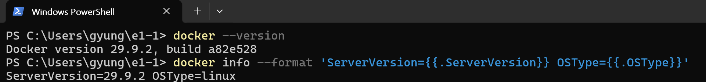
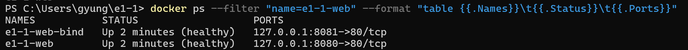
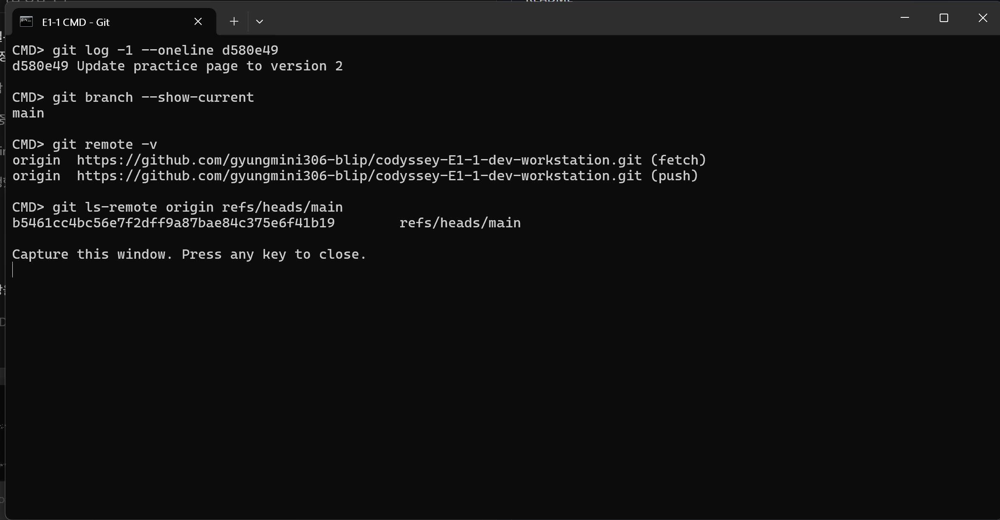

# Codyssey E1-1 · 내 컴퓨터에 개발자용 작업실 꾸미기

## 1. 프로젝트 개요

다른 사람도 같은 웹 서버를 실행할 수 있도록 개발 환경을 구성했습니다. 먼저 Ubuntu의 Bash에서 파일과 권한을 다뤘습니다. 그다음 Dockerfile로 NGINX 웹 서버를 만들고, PC에서 접속해 HTML 변경이 반영되는지 확인했습니다. 별도의 Ubuntu 컨테이너에서는 볼륨에 쓴 데이터가 컨테이너 교체 후에도 남는지 확인했습니다. 소스와 실습 기록은 Git으로 관리하고 GitHub에 공유했습니다. 6절의 명령으로 저장소를 내려받아 웹 서버를 실행할 수 있습니다.

## 2. 실행 환경과 저장소 구성

| 항목 | 실제 실습 환경 |
|---|---|
| OS · 터미널 | Windows 11 · Windows Terminal |
| 셸 | Windows PowerShell 5.1, 일부 확인은 CMD, Linux 실습은 Ubuntu 24.04의 Bash |
| Docker | Docker Desktop 4.97.0 · CLI/엔진 29.9.2 · Linux 컨테이너 모드 · Compose v5.6.1 |
| Git · 편집기 | Git 2.52.0.windows.1 · VS Code |

| 경로 | 역할 |
|---|---|
| [app/index.html](app/index.html) | 웹 서버가 제공하는 정적 HTML |
| [Dockerfile](Dockerfile) · [nginx.conf](nginx.conf) | 이미지 구성과 NGINX 수신 포트·응답 설정 |
| [docs/evidence/](docs/evidence/) | 실습 로그와 캡처. 각 항목에서 해당 기록을 연결합니다. |
| [compose.yaml](compose.yaml) | 보너스 과제의 단일 웹 서비스 설정 |

웹 콘텐츠는 `app/`, 실행 설정은 저장소 루트, 검증 기록은 `docs/evidence/`에 두었습니다. HTML을 수정할 위치와 서버 실행 설정, 확인 결과를 구분해 찾기 위한 구성입니다.

Docker 명령은 Docker Desktop을 실행한 뒤 PowerShell에서 입력합니다. 파일과 권한 명령은 Ubuntu 컨테이너의 Bash에서 실행합니다. 아래 명령은 한 줄씩 복사해 실행할 수 있습니다. PowerShell과 Ubuntu Bash 표시를 구분해서 사용합니다. 명령 실행 결과는 캡처와 원본 로그에서 확인합니다.

## 3. 수행 체크리스트

- [x] 터미널 조작 · [명령과 출력](docs/evidence/10-user-terminal.md)
- [x] 파일·디렉터리 권한 변경 · [권한 전후 비교](#4-터미널과-권한-실습)
- [x] Docker 엔진 점검과 운영 · [목록·로그·리소스 기록](docs/evidence/13-user-operations.md)
- [x] hello-world와 Ubuntu 실습 · [실행과 셸 종료 결과](#5-docker-점검과-운영)
- [x] 커스텀 이미지 빌드·실행 · [빌드·실행 명령과 사용자 캡처](#6-커스텀-웹-서버-이미지와-포트-매핑)
- [x] 포트 매핑 접속 · [명령과 HTTP 응답](#6-커스텀-웹-서버-이미지와-포트-매핑)
- [x] 바인드 마운트와 볼륨 영속성 · [수정·삭제 전후 비교](#7-바인드-마운트와-볼륨-영속성)
- [x] Git 설정과 GitHub 푸시 · [마스킹한 설정과 푸시 결과](#8-git-설정과-github-연동)
- [x] VS Code GitHub 로그인 · [계정 메뉴 캡처](docs/evidence/14-vscode-github.png)
- [x] VS Code에서 과제 저장소 연결 확인 · [소스 제어와 GitHub 화면](#8-git-설정과-github-연동)

이미지로 확인한 핵심 결과를 본문에도 텍스트로 발췌했습니다. 반복 목록·긴 ID·진행률은 줄였으며, 아래 링크에서 명령과 전체 기록을 확인할 수 있습니다.

| 검증 항목 | 확인한 실제 결과 | 텍스트 증거 |
|---|---|---|
| 파일 생성·복사·이동·삭제 | 복사본 생성·이동 후 삭제, 원본 메모 유지 | [터미널 출력](docs/evidence/10-user-terminal.md) |
| 파일·디렉터리 권한 | 파일과 디렉터리 각각의 변경 전후 권한 확인 | [권한 출력](docs/evidence/10-user-terminal.md#10-c-파일과-디렉토리-권한-변경-전후) |
| 이미지 빌드 | 사용자 빌드 로그의 태그 지정과 `DONE` | [사용자 빌드 출력](docs/evidence/11-user-bind.md#11-b-사용자-직접-이미지-빌드) |
| 포트 접속·서버 운영 | HTTP 200·`ok`, `healthy`, CPU·메모리 조회 | [접속 결과](#6-커스텀-웹-서버-이미지와-포트-매핑) · [운영 출력](docs/evidence/32-user-web-operations.md) |

## 4. 터미널과 권한 실습

Ubuntu 컨테이너에서 작업 폴더와 메모를 만들었습니다. 원본을 남겨 둔 채 복사본만 옮기고 삭제하기 위해 `cp`로 복사하고, `mv`로 위치와 이름을 바꾼 뒤 `rm`으로 지웠습니다. 기존 `e1-1-ubuntu`가 실행 중이면 PowerShell에서 `docker exec -it e1-1-ubuntu bash`로 들어갑니다. 새 환경에서는 `docker run --rm -it ubuntu:24.04 bash`로 시작할 수 있습니다.

### 작업 위치와 파일 목록


`pwd`에 작업 경로가 표시되고, `ls -la`에는 숨김 파일인 `.hidden-note`와 빈 파일인 `empty.txt`가 보입니다. `cat memo.txt`로 저장한 문구를 확인했습니다.

**위 캡처의 실제 출력 발췌.** 목록에서는 파일 세 행만 옮겼습니다.

```text
$ pwd
/root/e1-1/guided-practice
$ ls -la
-rw-r--r-- 1 root root    0 Nov  3 11:41 .hidden-note
-rw-r--r-- 1 root root    0 Nov  3 11:41 empty.txt
-rw-r--r-- 1 root root   23 Nov  3 11:41 memo.txt
$ cat memo.txt
E1-1 terminal practice
```

처음 실행하는 경우 PowerShell에서 Ubuntu 컨테이너와 Bash를 시작합니다. 아래 명령과 기존 컨테이너 진입 명령 중 현재 상태에 맞는 하나를 사용합니다.

```powershell
docker run --rm -it ubuntu:24.04 bash
```

기존 `e1-1-ubuntu` 컨테이너가 실행 중이라면 대신 아래 명령으로 추가 Bash를 엽니다.

```powershell
docker exec -it e1-1-ubuntu bash
```

이후 4절의 명령은 Ubuntu Bash에서 순서대로 실행합니다.

실습 폴더를 만듭니다.

```bash
mkdir -p /root/e1-1/guided-practice
```

만든 폴더로 이동합니다.

```bash
cd /root/e1-1/guided-practice
```

현재 위치를 확인합니다.

```bash
pwd
```

빈 파일과 숨김 파일을 만듭니다.

```bash
touch empty.txt .hidden-note
```

메모를 파일에 저장합니다.

```bash
echo "E1-1 terminal practice" > memo.txt
```

숨김 파일까지 상세 조회합니다.

```bash
ls -la
```

저장한 메모를 읽습니다.

```bash
cat memo.txt
```

### 복사본 이동과 삭제


`mv` 뒤에는 `archive` 안에 `memo-renamed.txt`가 보입니다. 복사본과 빈 폴더를 지운 뒤 마지막 목록에서 원본 `memo.txt`가 남은 것을 확인했습니다.

**위 캡처의 명령·출력 발췌.** `ls -la`의 반복 행은 줄였습니다. 삭제 직후 `archive`에는 `.`과 `..`만 남았습니다.

```text
$ cp memo.txt memo-copy.txt
$ ls -l memo-copy.txt
-rw-r--r-- 1 root root 23 Nov  3 11:43 memo-copy.txt
$ mkdir -p archive
$ mv memo-copy.txt archive/memo-renamed.txt
$ cd archive
$ ls -la
-rw-r--r-- 1 root root 23 Nov  3 11:43 memo-renamed.txt
$ cd ..
$ rm archive/memo-renamed.txt
$ ls -la archive
total 8
drwxr-xr-x 2 root root 4096 Nov  3 11:43 .
drwxr-xr-x 3 root root 4096 Nov  3 11:43 ..
$ rmdir archive
```

메모를 복사합니다.

```bash
cp memo.txt memo-copy.txt
```

복사본을 둘 폴더를 만듭니다.

```bash
mkdir -p archive
```

복사본을 옮기면서 이름을 바꿉니다.

```bash
mv memo-copy.txt archive/memo-renamed.txt
```

옮긴 파일이 있는지 확인합니다.

```bash
ls -la archive
```

복사본을 삭제합니다.

```bash
rm archive/memo-renamed.txt
```

비어 있는지 확인합니다.

```bash
ls -la archive
```

빈 폴더를 삭제합니다.

```bash
rmdir archive
```

원본이 남았는지 확인합니다.

```bash
ls -la
```

`/root/e1-1/guided-practice`는 루트부터 찾는 절대 경로이고, `archive/memo-renamed.txt`는 현재 폴더를 기준으로 찾는 상대 경로입니다. 목록에서 빈 파일 두 개의 크기가 0이고, 복사본을 지운 뒤 `archive`에 파일이 남지 않은 것을 확인했습니다.

### 파일과 디렉터리 권한 변경 전후


`chmod` 실행 뒤, 파일은 `644 → 600`, 폴더는 `755 → 700`이 되어 그룹과 기타 사용자의 권한이 사라졌습니다.

**위 캡처의 변경 전후.** 캡처에서는 `practice/memo.txt`와 `practice`를 사용했습니다. 아래 실행 안내에서는 같은 권한 변경을 현재 실습 폴더의 `memo.txt`와 `permissions-dir`에 적용합니다.

```text
$ ls -l practice/memo.txt
-rw-r--r-- 1 root root 0 Nov  3 09:59 practice/memo.txt
$ chmod 600 practice/memo.txt
$ ls -l practice/memo.txt
-rw------- 1 root root 0 Nov  3 09:59 practice/memo.txt
```

```text
$ ls -ld practice
drwxr-xr-x 2 root root 4096 Nov  3 09:57 practice
$ chmod 700 practice
$ ls -ld practice
drwx------ 2 root root 4096 Nov  3 09:57 practice
```

파일의 현재 권한을 확인합니다.

```bash
ls -l memo.txt
```

파일을 소유자만 읽고 쓸 수 있도록 바꿉니다.

```bash
chmod 600 memo.txt
```

변경된 파일 권한을 확인합니다.

```bash
ls -l memo.txt
```

권한 실습용 폴더를 만듭니다.

```bash
mkdir -p permissions-dir
```

폴더 자체의 권한을 확인합니다.

```bash
ls -ld permissions-dir
```

폴더를 소유자만 사용할 수 있도록 바꿉니다.

```bash
chmod 700 permissions-dir
```

변경된 폴더 권한을 확인합니다.

```bash
ls -ld permissions-dir
```

`ls -l`로 파일을, `ls -ld`로 디렉터리 자체를 조회했습니다. 각각 권한을 변경한 뒤 다시 조회해 전후를 비교했습니다.

| 권한 | 일반 파일 | 디렉터리 |
|---|---|---|
| `r` = 4 | 내용 읽기 | 이름 목록 읽기 |
| `w` = 2 | 내용 수정 | 항목 생성·삭제·이름 변경에 필요하며 일반적으로 `x`도 필요 |
| `x` = 1 | 프로그램으로 실행 | 디렉터리 진입과 경로 탐색 |

숫자는 소유자·그룹·기타 사용자 순서입니다. `644`는 `rw-r--r--`, `755`는 `rwxr-xr-x`입니다. 위 캡처에서 권한 변경 전후를 확인할 수 있습니다. 과제에서 요구하는 명령·출력 텍스트는 [원본 실습 로그](docs/evidence/10-user-terminal.md)에 보관했습니다.

4절이 끝나면 Ubuntu Bash에서 아래 명령으로 나와 PowerShell로 돌아옵니다. 위의 `--rm`으로 시작한 임시 컨테이너는 이때 삭제되며, 그 안의 실습 파일도 함께 삭제됩니다.

```bash
exit
```

## 5. Docker 점검과 운영

### hello-world 실행 확인


위 캡처에서 `docker run`의 `Hello from Docker!`와 `docker ps -a`의 `Exited (0)`을 확인했습니다. 컨테이너 안의 프로그램이 메시지를 출력한 뒤 정상 종료했습니다.

[hello-world 실행 원본 로그](docs/evidence/05-hello-world.md)

PowerShell에서 테스트 컨테이너를 실행합니다. 같은 이름의 종료된 컨테이너가 남아 있다면 삭제하거나 다른 이름으로 실행합니다.

```powershell
docker run --name e1-1-hello hello-world
```


테스트 컨테이너의 종료 상태를 확인합니다.

```powershell
docker ps -a --filter "name=e1-1-hello"
```

실행에 사용한 이미지가 PC에 있는지 확인합니다.

```powershell
docker image ls hello-world
```

### Docker 버전과 엔진 연결 확인



Docker Desktop을 시작한 뒤 버전과 엔진 응답을 확인했습니다. `ServerVersion=29.9.2 OSType=linux`가 나와 엔진 연결 성공을 확인했습니다.

PowerShell에서 Docker 명령 도구의 버전을 확인합니다.

```powershell
docker --version
```

Docker 엔진 응답을 확인합니다.

```powershell
docker info --format 'ServerVersion={{.ServerVersion}} OSType={{.OSType}}'
```


### Ubuntu의 셸과 컨테이너 수명

추가 Bash를 종료한 뒤에는 컨테이너가 계속 실행됐고, 주 Bash를 종료하자 컨테이너도 종료됐습니다. 연결만 분리했을 때는 주 Bash가 계속 실행됐습니다. [사용자가 실행한 exec·attach 명령과 상태 출력](docs/evidence/13-user-operations.md)

## 6. 커스텀 웹 서버 이미지와 포트 매핑

**이미지 빌드 결과.** 사용자가 빌드 확인용 태그 `build-check`로 실행한 캡처입니다. 중간 다운로드·해시 출력은 생략하고, 같은 원본에서 두 구간을 잘랐습니다.


**위 캡처의 실제 출력 발췌.** 빌드가 끝나 `FINISHED`가 표시됐습니다.

```text
PS> docker build -t e1-1-web:build-check .
[+] Building 12.4s (9/9) FINISHED
```

**생성된 이미지 확인.** 목록에 `e1-1-web:build-check`가 표시됐습니다.


```text
PS> docker image ls e1-1-web:build-check
IMAGE                  ID             DISK USAGE   CONTENT SIZE
e1-1-web:build-check    8dafd1b2588d   92.8MB       26.1MB
```

다운로드·해시를 포함한 기록은 [전체 캡처](docs/evidence/31-user-build-full.png)에 보관했습니다. 별도 사용자 빌드의 단계별 텍스트 기록도 [실제 빌드 로그](docs/evidence/11-user-bind.md#11-b-사용자-직접-이미지-빌드)와 [전체 출력](docs/evidence/user-student-build.log)에서 확인할 수 있습니다. 이 별도 기록은 당시 태그인 `codyssey-workstation:student-1`을 사용합니다.

NGINX로 제 HTML을 제공하기 위해 [Dockerfile](Dockerfile)에 베이스 이미지 `nginx:stable-alpine`을 지정했습니다. `COPY`로 HTML과 서버 설정을 이미지에 넣고, `LABEL`로 이미지 용도를 기록했습니다. `EXPOSE 80`은 컨테이너가 사용할 포트를 표시하고, 실제 수신 포트는 [nginx.conf](nginx.conf)의 `listen 80`에서 정합니다. `HEALTHCHECK`는 컨테이너 내부에서 `/healthz`에 요청을 보내 NGINX 응답을 점검합니다.

**NGINX는 언제 설치했나요?** `nginx:stable-alpine`은 NGINX가 이미 설치된 공식 이미지입니다. `FROM`으로 이 이미지를 기반으로 삼았기 때문에 별도의 NGINX 설치 명령이 필요하지 않았습니다. 여기에 우리 HTML과 설정을 복사해 커스텀 이미지를 만들었습니다. 컨테이너 실행 시 사용할 NGINX 시작 명령도 기반 이미지에서 이어받습니다.

흐름은 **Dockerfile과 HTML → `docker build`로 이미지 생성 → `docker run`으로 그 이미지에서 컨테이너 생성·실행**입니다. HTML을 수정하는 것만으로 기존 이미지가 바뀌지는 않습니다.

Docker Desktop을 켜고 PowerShell에서 저장소를 내려받습니다. 이미 내려받았다면 기존 저장소 폴더로 이동한 뒤 빌드부터 실행합니다.

저장소를 내려받습니다.

```powershell
git clone https://github.com/gyungmini306-blip/codyssey-E1-1-dev-workstation.git e1-1
```

저장소 루트로 이동합니다.

```powershell
cd e1-1
```

NGINX와 HTML을 담은 이미지를 만듭니다.

```powershell
docker build -t e1-1-web:v1 .
```

이미지에서 웹 서버를 실행하고 PC의 8080을 컨테이너의 80에 연결합니다. NGINX는 컨테이너 안의 80번에서 요청을 기다리므로, PC의 브라우저가 접근할 입구를 `-p`로 연결합니다. `127.0.0.1`로 지정해 이 PC에서 접속하도록 했습니다.

```powershell
docker run -d --name e1-1-web -p 127.0.0.1:8080:80 e1-1-web:v1
```

PC에서 웹 서버 응답을 확인합니다.

```powershell
curl.exe -i http://127.0.0.1:8080/healthz
```

**접속 결과 · PC 8080 → 컨테이너 80.** `docker build`로 만든 이미지에서 컨테이너를 실행했고, PC에서 보낸 상태 확인 요청에 NGINX가 정상 응답했습니다. 사용자 제공 출력에서 HTTP 200과 `ok`를 확인했습니다. 브라우저에서 `http://localhost:8080/`을 열어 웹페이지도 확인했습니다. 7절의 수정 전 캡처에서 주소창과 페이지를 함께 확인할 수 있습니다.

**사용자가 제공한 실제 응답 발췌.** 2026-11-04 실습에서 받은 헤더 중 상태·서버·본문만 남겼습니다.

```text
PS> curl.exe -i http://127.0.0.1:8080/healthz
HTTP/1.1 200 OK
Server: nginx/1.30.6

ok
```

**포트 매핑이 필요한 이유.** 이번처럼 기본 브리지 네트워크로 실행한 컨테이너는 각각 별도의 **네트워크 네임스페이스**를 사용합니다. 이는 네트워크 인터페이스·IP 주소·포트 공간을 분리하는 Linux 기능입니다. 따라서 PC의 8080번과 컨테이너의 80번은 서로 다른 공간의 포트입니다. `-p 127.0.0.1:8080:80`은 PC의 8080번으로 들어온 요청을 컨테이너의 80번으로 전달하도록 설정하는 포트 포워딩입니다. 같은 이유로 7절의 두 NGINX는 각 컨테이너 안에서 모두 80번을 사용하고, PC에서는 8080·8081로 구분해 접속할 수 있습니다.

`v1`은 이미지에 붙인 태그입니다. 브라우저의 페이지 버전은 HTML 안의 문구로 결정됩니다. `8080`이 이미 사용 중이면 실행 명령과 접속 주소에 같은 빈 포트를 지정합니다.

### 실행한 웹 서버의 이미지·로그·자원 확인


위 캡처에서 `e1-1-web`은 `e1-1-web:v1` 이미지로 실행 중이며, `healthy` 상태와 `8080 → 80` 연결을 확인했습니다. 목록의 `build-check`는 별도로 빌드한 이미지 태그입니다. 로그의 `Wget` 요청은 자동 상태 점검이며, `/healthz` 응답은 세 줄 모두 `200`이었습니다. 조회 당시 CPU는 `0.00%`, 메모리는 `11.33 MiB`였습니다.

아래 명령은 이 절에서 `e1-1-web`을 만든 뒤 PowerShell에서 실행합니다. 서버의 실행 상태와 정상 응답, 자원 사용량을 확인하기 위해 조회했습니다. [캡처의 명령과 실제 출력](docs/evidence/32-user-web-operations.md)

종료된 웹 서버 컨테이너를 다시 시작할 때 사용합니다.

```powershell
docker start e1-1-web
```

웹 서버 이미지를 조회합니다.

```powershell
docker image ls e1-1-web
```

웹 서버 하나의 실행 상태와 포트 연결을 조회합니다.

```powershell
docker ps --filter "name=^/e1-1-web$"
```

서버가 받은 최근 요청을 조회합니다.

```powershell
docker logs --tail 3 e1-1-web
```

웹 서버의 자원 사용량을 한 번 조회합니다.

```powershell
docker stats --no-stream e1-1-web
```

## 7. 바인드 마운트와 볼륨 영속성

### HTML 수정 반영

**수정 전.** 왼쪽 `8080`과 오른쪽 `8081` 모두 페이지 버전 2를 반환했습니다.


**수정 후.** 같은 순서로, 왼쪽 `8080`은 버전 2를 유지했고 오른쪽 `8081`에만 버전 3이 표시됐습니다.


**두 컨테이너의 포트 연결.** 같은 이름으로 시작하는 두 서버를 조회한 화면입니다. `8080`과 `8081`이 각각 별도의 컨테이너 `80`번에 연결돼 있습니다.



PC에서 수정한 파일이 어느 서버에 반영되는지 비교했습니다. `8080` 서버를 그대로 둔 상태에서, 저장소 루트의 PowerShell로 **같은 이미지**를 쓰는 두 번째 서버를 실행했습니다. `8081`에만 PC의 `app/` 폴더를 NGINX의 웹 폴더에 읽기 전용으로 연결했습니다.

연결할 PC 폴더의 전체 경로를 구합니다.

```powershell
$appPath = (Resolve-Path .\app).Path
```

폴더 연결 설정을 저장합니다.

```powershell
$mountSpec = "type=bind,source=$appPath,target=/usr/share/nginx/html,readonly"
```

같은 이미지로 바인드 마운트 서버를 실행합니다.

```powershell
docker run -d --name e1-1-web-bind -p 127.0.0.1:8081:80 --mount $mountSpec e1-1-web:v1
```

두 페이지가 버전 2인 것을 확인한 뒤, PC의 `app/index.html`을 열고 화면에 표시되는 `페이지 버전: 2` 문구를 `페이지 버전: 3 (바인드 입니다.)`로 바꾼 뒤 저장했습니다. 이미지를 다시 빌드하거나 컨테이너를 다시 시작하지 않고, 두 페이지를 새로고침했습니다.

| 서버 | 읽는 파일 | 수정 전 | 수정 후 |
|---|---|---|---|
| `8080` | 빌드할 때 이미지에 복사해 둔 HTML | 버전 2 | **버전 2 유지** |
| `8081` | 바인드 마운트로 연결한 PC의 HTML | 버전 2 | **버전 3으로 변경** |

### 컨테이너 교체 후 데이터 확인

컨테이너를 삭제한 뒤에도 메모가 남는지 확인했습니다. PowerShell에서 볼륨을 생성하고 첫 컨테이너에 연결해 메모를 저장했습니다. 그 컨테이너를 삭제한 뒤 새 컨테이너에 같은 볼륨을 연결했습니다.

아래는 같은 결과를 확인하는 실행 순서입니다. 처음 컨테이너의 `cat`과 새 컨테이너의 `cat` 출력을 비교합니다. 이름이 이미 사용 중이면 새 실습용 이름으로 바꿉니다.

이름 있는 볼륨을 만듭니다.

```powershell
docker volume create e1-1-replay-data
```

첫 컨테이너에 볼륨을 연결합니다.

```powershell
docker run -d --name e1-1-volume-before --mount "type=volume,source=e1-1-replay-data,target=/data" ubuntu:24.04 sleep infinity
```

볼륨에 메모를 저장합니다.

```powershell
docker exec e1-1-volume-before sh -c 'echo E1-1-volume-proof > /data/memo.txt'
```

삭제 전 메모를 읽습니다.

```powershell
docker exec e1-1-volume-before cat /data/memo.txt
```

첫 컨테이너를 멈춥니다.

```powershell
docker stop e1-1-volume-before
```

첫 컨테이너를 삭제합니다.

```powershell
docker rm e1-1-volume-before
```

컨테이너를 삭제한 뒤에도 볼륨이 남았는지 확인합니다.

```powershell
docker volume ls --filter "name=e1-1-replay-data"
```

새 컨테이너에 같은 볼륨을 연결합니다.

```powershell
docker run -d --name e1-1-volume-after --mount "type=volume,source=e1-1-replay-data,target=/data" ubuntu:24.04 sleep infinity
```

새 컨테이너에서 같은 메모를 읽습니다.

```powershell
docker exec e1-1-volume-after cat /data/memo.txt
```

**실제 결과.** 기존 컨테이너를 삭제한 뒤에도 볼륨이 목록에 남았고, 새 컨테이너에서는 메모를 다시 쓰지 않고도 같은 내용을 읽었습니다. [사용자가 제공한 볼륨 명령과 원본 출력](docs/evidence/12-user-volume.md)

| 확인 시점 | 실제 메모 출력 |
|---|---|
| 첫 컨테이너에서 삭제 전 조회 | `E1-1-volume-proof` |
| 새 컨테이너에 같은 볼륨 연결 후 조회 | `E1-1-volume-proof` |

## 8. Git 설정과 GitHub 연동

HTML 수정 이력을 남기고 공유하기 위해 Git으로 커밋한 뒤 GitHub에 푸시했습니다. 저장소 루트에서 작성자 설정과 기본 브랜치를 확인하고, 현재 브랜치는 별도 명령으로 조회했습니다. Git은 PC에서 변경 이력을 기록하고, GitHub는 푸시한 이력을 원격에서 공유합니다. 작성자 설정, 브랜치와 푸시 결과는 [사용자 원본 로그](docs/evidence/14-user-git.md)에 있습니다.



화면에서 HTML 수정 커밋 `d580e49`, 현재 브랜치 `main`과 과제 저장소의 원격 주소를 확인할 수 있습니다.

푸시 출력에서 HTML 수정 커밋이 원격 `main`에 올라간 것을 확인했습니다. VS Code 계정 메뉴에서는 GitHub 로그인 상태를 확인했습니다.


**VS Code의 과제 저장소 연결을 확인했습니다.** 저장소 폴더를 열었을 때 소스 제어에 `main` 브랜치와 실제 커밋 이력이 표시됐습니다. README 안의 과제 저장소 주소와 창 제목을 함께 확인할 수 있습니다.


GitHub Pull Requests 뷰에서도 현재 브랜치의 목록이 열렸습니다. 화면의 “이 범주의 끌어오기 요청 0개”는 해당 범주에 Pull Request가 없다는 뜻입니다. 원격 주소는 위의 사용자 CMD 캡처에서 확인할 수 있습니다.


저장소 루트의 PowerShell에서 로컬 Git 설정을 확인합니다. 공개할 출력에서는 개인 이메일을 가립니다.

```powershell
git config --local --list
```

현재 브랜치를 확인합니다.

```powershell
git --no-pager branch --show-current
```

원격 저장소 주소를 확인합니다.

```powershell
git --no-pager remote -v
```

7절에서 수정한 HTML의 변경 내용을 확인합니다.

```powershell
git --no-pager diff -- app/index.html
```

확인한 HTML 변경을 커밋 대상으로 고릅니다.

```powershell
git add -- app/index.html
```

변경 이력을 PC에 기록합니다.

```powershell
git commit -m "Record bind mount practice"
```

로컬과 원격 브랜치의 상태를 확인합니다.

```powershell
git status -sb
```

검토를 마친 제출용 커밋을 GitHub에 보낼 때 실행합니다.

```powershell
git push
```

## 9. 트러블슈팅

| 문제 | 원인 가설 | 확인 방법과 결과 | 해결 또는 대안 |
|---|---|---|---|
| Docker 명령은 실행됐지만 엔진에 연결할 수 없음 | Docker Desktop 엔진이 시작되지 않았을 수 있음 | 사용자 화면에서 `docker --version`은 출력됐지만 `docker info`와 `docker ps`는 `dockerDesktopLinuxEngine` 파이프에 연결하지 못했습니다. | Docker Desktop을 시작한 뒤 사용자가 같은 명령을 다시 실행하자 서버 버전과 컨테이너 목록이 출력됐습니다. [사용자 전후 캡처와 출력](docs/evidence/27-docker-engine.md) |
| 새 컨테이너가 호스트 포트 8083을 사용하지 못함 | 기존 서비스가 같은 포트를 점유했을 수 있음 | `docker ps`와 `netstat -ano`에서 점유를 확인했고, 같은 포트에 실행하자 `port is already allocated` 출력 | 빈 포트 18085로 실행해 HTTP 200과 `ok`를 확인함. [기록](docs/evidence/18-port-conflict.md) |

**엔진 연결 실패 화면.** Docker 버전은 조회됐지만 엔진을 사용하는 두 명령은 실패했습니다. 해결 후 화면은 5절의 ‘Docker 버전과 엔진 연결 확인’ 캡처에서 확인할 수 있습니다.


## 10. 보너스 1번 · Docker Compose 기초


**Compose는 Docker의 빌드·실행 설정을 파일로 저장하고 적용하는 도구입니다.** 앞에서는 이미지 빌드와 컨테이너 실행 명령에 옵션을 직접 적었습니다. 이번에는 같은 서버를 반복해서 띄우고 다른 사람에게 실행 설정을 공유하기 위해, 빌드 위치와 포트 연결을 `compose.yaml`에 적었습니다.

**Dockerfile과 Compose 파일을 함께 사용합니다.** 두 파일은 같은 저장소 폴더에 있습니다.

| 파일 | 이 실습에서 정한 내용 |
|---|---|
| `Dockerfile` | 이미지에 넣을 NGINX·HTML·서버 설정·상태 점검 |
| `compose.yaml` | 빌드할 폴더, 실행할 서비스, PC와 컨테이너의 포트 연결 |

**① [Dockerfile](Dockerfile) — 이미지를 어떻게 만들지 정합니다.** 아래는 저장소의 실제 파일 내용입니다.

```dockerfile
FROM nginx:stable-alpine

LABEL org.opencontainers.image.title="Codyssey E1-1 Workstation Lab"
LABEL org.opencontainers.image.description="A personal development workstation practice server"

COPY nginx.conf /etc/nginx/conf.d/default.conf
COPY app/ /usr/share/nginx/html/

EXPOSE 80
HEALTHCHECK --interval=10s --timeout=3s --start-period=5s --retries=3 \
    CMD wget -q -O /dev/null http://127.0.0.1/healthz || exit 1
```

`FROM`은 NGINX가 설치된 기반 이미지를 선택하고, 두 `COPY`는 서버 설정과 웹페이지를 추가합니다. `HEALTHCHECK`는 NGINX가 응답하는지 점검합니다. `EXPOSE 80`만으로 PC의 포트가 연결되지는 않으므로 아래 Compose 파일에 포트 연결도 적었습니다.

**② [compose.yaml](compose.yaml) — 그 이미지로 웹 서버 하나를 실행할 설정을 정합니다.**

```yaml
services:
  web:
    build: .
    ports:
      - "127.0.0.1:8083:80"
```

| 설정 | 의미 |
|---|---|
| `services.web` | web이라는 웹 서버 서비스 한 개 |
| `build: .` | Compose 파일이 있는 폴더를 빌드 대상으로 삼고, 그 안의 Dockerfile 사용 |
| `127.0.0.1:8083:80` | 내 PC의 8083번을 컨테이너의 80번에 연결 |

**③ 아래 `up -d --build --wait` 명령으로 두 파일의 설정을 적용합니다.** Compose가 `build: .`을 읽어 Dockerfile로 이미지를 빌드하고, 그 이미지로 `web` 컨테이너를 생성·실행하며 PC의 8083번을 연결합니다. `--wait`는 상태 점검을 통과할 때까지 기다립니다. 파일을 작성하기만 하면 서버가 켜지는 것은 아니므로 실행 명령도 필요합니다.

**사용자가 직접 실행해 확인한 결과입니다.**

| 수행한 일 | 실제 확인 결과 |
|---|---|
| Compose 설정으로 빌드·실행 | 이미지 Built, 컨테이너 Healthy |
| PC의 8083으로 상태 확인 요청 | HTTP 200 OK와 ok |
| Compose 프로젝트 종료 | 컨테이너와 네트워크 Removed |

[사용자가 제공한 Compose 명령과 출력](docs/evidence/26-user-compose.md)

Docker Desktop을 켠 상태에서 저장소 루트의 PowerShell로 아래 명령을 실행합니다.

저장소 루트의 PowerShell에서 설정 파일을 읽어 빌드하고 실행합니다.

```powershell
docker compose -p e1-1-replay up -d --build --wait
```

PC의 8083으로 상태 확인 요청을 보냅니다.

```powershell
curl.exe -i http://127.0.0.1:8083/healthz
```

같은 프로젝트의 컨테이너와 네트워크를 정리합니다.

```powershell
docker compose -p e1-1-replay down
```

이 캡처는 사용자가 CMD에서 기존 PowerShell 로그를 열어 본 화면입니다. 상태 확인 요청의 200 응답과 컨테이너 제거 결과를 확인할 수 있습니다.

**실행 → 접속 → 정리**를 확인했습니다. `up`으로 설정을 적용하니 상태 점검을 통과했고, PC의 `8083`에서 정상 응답을 받았습니다. `down` 후에는 Compose가 만든 컨테이너와 네트워크가 제거됐습니다. [사용자 실행 로그](docs/evidence/26-user-compose.md)
