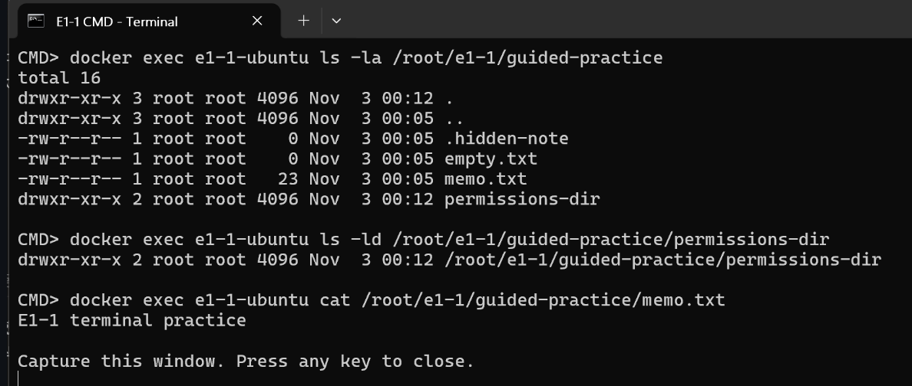
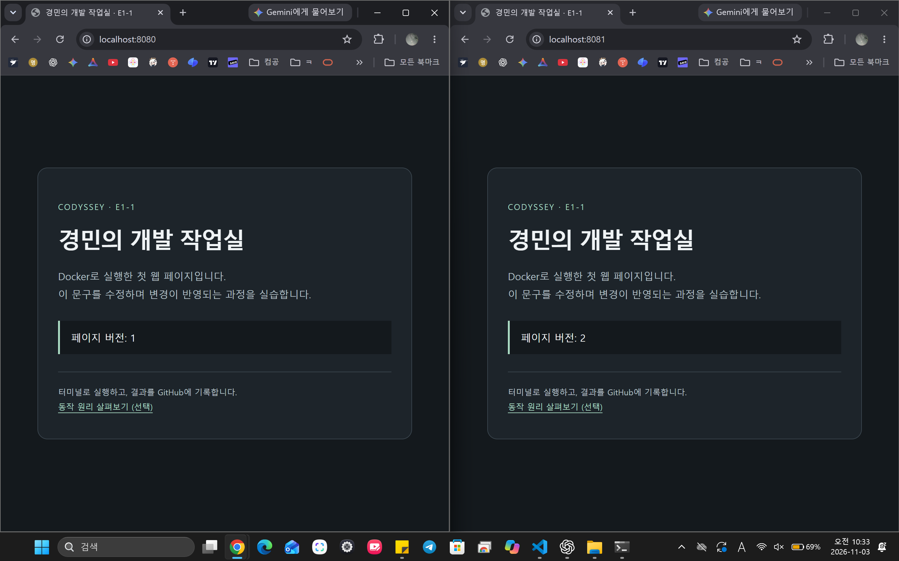
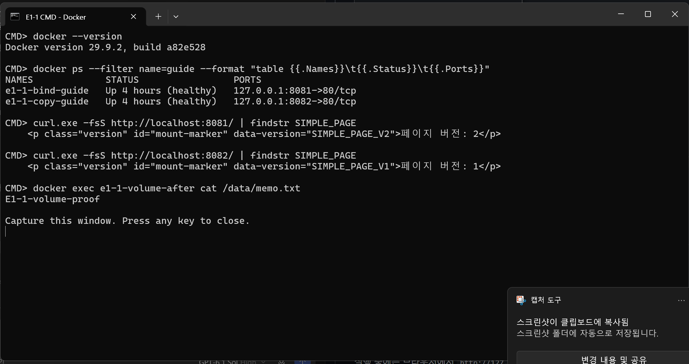
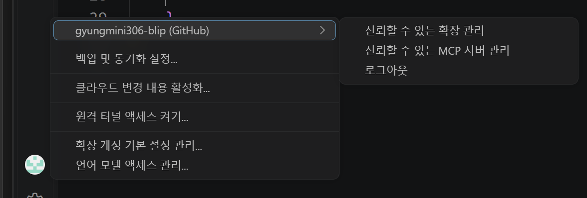

# Codyssey E1-1 · 내 컴퓨터에 개발자용 작업실 꾸미기

## 1. 과제 목적과 핵심 결과

터미널에서 파일과 권한을 다루고, Docker로 웹 서버를 띄웠습니다. 다른 사람도 같은 소스와 명령으로 실행할 수 있도록 Dockerfile, 실행 방법, 실제 검증 결과를 GitHub에 정리했습니다.

- **접속** — 내 PC의 `8080`번을 컨테이너의 `80`번에 연결해 브라우저에서 웹페이지를 열었습니다.
- **수정 반영** — VS Code에서 HTML을 V2로 바꾸자 PC 파일을 연결한 `8081`은 V2를, 이미지에 복사한 파일을 읽는 `8082`는 V1을 반환했습니다.
- **데이터 보존** — 기존 컨테이너를 삭제하고 새 컨테이너에 같은 볼륨을 연결하니 `E1-1-volume-proof` 메모를 다시 읽을 수 있었습니다.

## 2. 실행 환경과 빠른 실행

| 항목 | 실습 환경 |
|---|---|
| OS·터미널 | Windows · Windows Terminal |
| 셸 | Docker 명령은 주로 PowerShell, 파일·권한 실습은 Ubuntu 컨테이너의 Bash, 완료 상태 재확인은 CMD |
| Docker | Docker Desktop 4.97.0 · Docker 엔진 29.9.2 · Compose v5.6.1 |
| Git·편집기 | Git 2.52.0.windows.1 · VS Code |

Docker Desktop을 켜고 아래 명령을 실행합니다.

```powershell
git clone https://github.com/gyungmini306-blip/codyssey-E1-1-dev-workstation.git
cd codyssey-E1-1-dev-workstation
docker compose -p e1-1-bonus up -d --build --wait
curl.exe -fsS -i http://127.0.0.1:8083/healthz
```

### 실제 실행 결과

실습 당시 PowerShell 출력에서 핵심 줄만 발췌했습니다.

```console
PS> docker compose -p e1-1-bonus up -d --build --wait
Image e1-1-bonus-web Built
Container e1-1-bonus-web-1 Healthy

PS> curl.exe -fsS -i http://127.0.0.1:8083/healthz
HTTP/1.1 200 OK
ok
```

`Built`는 이미지가 만들어졌고, `Healthy`는 컨테이너의 상태 확인을 통과했다는 뜻입니다. `200 OK`와 응답 본문의 `ok`는 내 PC에서 `8083`번으로 보낸 요청에 서버가 응답했음을 보여줍니다.

브라우저에서 `http://localhost:8083/`을 엽니다. 확인이 끝나면 `docker compose -p e1-1-bonus down`으로 종료합니다. `8083`은 빠른 실행에 쓰는 포트이고, 아래의 `8080`~`8082`는 원래 실습에 사용한 포트입니다.

## 3. 실습과 검증 결과

| 확인하려는 내용 | 어디에서 볼 수 있나 |
|---|---|
| 파일을 만들고 옮겼는지, 권한이 바뀌었는지 | [3-1. 터미널과 파일 권한](#3-1-터미널과-파일-권한) |
| Docker가 실행되고 웹 서버에 접속되는지 | [3-2. Docker 설치와 운영](#3-2-docker-설치와-운영) · [3-3. Dockerfile 빌드와 웹 접속](#3-3-dockerfile-빌드와-웹-접속) |
| HTML 수정이 반영되고, 서버를 지워도 메모가 남는지 | [3-4. HTML 수정 반영 비교](#3-4-html-수정-반영-비교) · [3-5. 볼륨 데이터 보존](#3-5-볼륨-데이터-보존) |
| GitHub에 변경 이력이 올라갔는지 | [3-6. Git·GitHub와 VS Code 연결](#3-6-gitgithub와-vs-code-연결) |

- [x] 터미널 파일 조작과 파일·폴더 권한 변경
- [x] Docker 설치·엔진 점검과 이미지·컨테이너 운영
- [x] Dockerfile 빌드와 포트 매핑을 통한 웹 접속
- [x] 바인드 마운트와 이미지에 복사한 파일의 수정 반영 비교
- [x] 컨테이너 삭제 후 같은 볼륨의 데이터 확인
- [x] Git 설정·커밋·푸시와 VS Code GitHub 연결

아래 기록은 실습 당시 명령과 출력에서 판단에 필요한 부분만 발췌한 것입니다.

### 3-1. 터미널과 파일 권한

서버를 관리하려면 현재 위치와 파일을 확인하고, 누가 읽거나 쓸 수 있는지 알아야 합니다. Ubuntu 컨테이너에 들어가 폴더를 만들고 파일을 생성·복사·이동·삭제했습니다.

```console
PS> docker exec -it e1-1-ubuntu bash
$ cd /root/e1-1/guided-practice
$ pwd
/root/e1-1/guided-practice
$ cat memo.txt
E1-1 terminal practice
```

| 작업 | 실행한 명령 | 확인한 결과 |
|---|---|---|
| 폴더 생성과 이동 | `mkdir -p /root/e1-1/guided-practice`, `cd /root/e1-1/guided-practice`, `pwd` | 현재 위치가 `/root/e1-1/guided-practice`로 표시됐습니다. |
| 파일 생성과 조회 | `touch empty.txt .hidden-note`, `echo "E1-1 terminal practice" > memo.txt`, `ls -la`, `cat memo.txt` | 빈 파일과 숨김 파일이 목록에 보였고, 메모에는 `E1-1 terminal practice`가 들어 있었습니다. |
| 복사와 이름 변경 | `cp memo.txt memo-copy.txt`, `mkdir -p archive`, `mv memo-copy.txt archive/memo-renamed.txt` | `ls -la archive`에 `memo-renamed.txt`가 표시됐습니다. |
| 삭제 | `rm archive/memo-renamed.txt`, `rmdir archive` | 마지막 `ls -la`에서 `archive`가 사라졌고 원본 `memo.txt`는 남았습니다. |

`/root/e1-1/guided-practice`는 루트부터 시작하는 **절대 경로**입니다. `archive/memo-renamed.txt`는 현재 폴더를 기준으로 찾는 **상대 경로**입니다.

권한은 `chmod`로 바꾸고 `ls -l memo.txt`와 `ls -ld permissions-dir`로 확인했습니다. 아래는 출력의 권한 부분만 발췌한 것입니다.

| 대상 | 첫 설정과 출력 | 변경 후 설정과 출력 |
|---|---|---|
| 파일 | `chmod 600 memo.txt` → `-rw-------` | `chmod 644 memo.txt` → `-rw-r--r--` |
| 폴더 | `chmod 700 permissions-dir` → `drwx------` | `chmod 755 permissions-dir` → `drwxr-xr-x` |

`r`은 읽기(4), `w`는 쓰기(2), `x`는 실행 또는 폴더 진입(1)입니다. `644`는 소유자에게 읽기·쓰기, 나머지에게 읽기 권한을 줍니다. 폴더의 `755`는 소유자에게 읽기·쓰기·진입, 나머지에게 읽기·진입 권한을 줍니다.



*`ls -la` 아래에서 `memo.txt`와 `permissions-dir`의 최종 권한을, `cat` 아래에서 메모 내용을 확인할 수 있습니다.*

### 3-2. Docker 설치와 운영

Docker가 실제로 컨테이너를 실행하는지 확인하기 위해 엔진 정보를 조회하고 `hello-world`를 실행했습니다. Ubuntu 컨테이너에서는 셸 명령을 실행하고, 추가로 연 Bash와 컨테이너의 주 Bash를 종료했을 때 상태가 어떻게 달라지는지 확인했습니다.

| 확인 항목 | 실행한 명령 | 실제 결과 |
|---|---|---|
| CLI와 엔진 | `docker --version`, `docker info --format 'ServerVersion={{.ServerVersion}} OSType={{.OSType}}'` | CLI `29.9.2`, 엔진 `ServerVersion=29.9.2 OSType=linux` |
| 첫 컨테이너 | `docker run --name e1-1-hello hello-world`, `docker ps -a` | `Hello from Docker!` 출력 후 `Exited (0)` |
| 이미지 목록 | `docker images codyssey-workstation` | 실습용 이미지 `codyssey-workstation:student-1` 확인 |
| 서버 운영 | `docker logs --tail 10 e1-1-bind-guide`, `docker stats --no-stream e1-1-bind-guide` | `/healthz` 요청이 `200`으로 처리됐고 메모리 사용량은 조회 당시 `8.945MiB` |
| 셸 종료 | `docker exec -it e1-1-shell-guide bash`, `docker attach e1-1-shell-guide` | `exec`로 연 Bash를 종료한 뒤에는 `true`, `attach`로 연결한 주 Bash를 종료한 뒤에는 `exited` |

### 3-3. Dockerfile 빌드와 웹 접속

HTML을 브라우저에 보내줄 서버로 NGINX를 사용했습니다. Dockerfile은 `nginx:stable-alpine`에서 시작해 `app/`의 웹 파일과 `nginx.conf`를 복사합니다. `HEALTHCHECK`는 `/healthz`가 응답하는지 확인합니다.

`docker build`로 만든 **이미지**에는 서버를 시작하는 데 필요한 프로그램과 파일이 들어 있습니다. `docker run`으로 그 이미지에서 **컨테이너**를 띄우면 NGINX가 실행됩니다. `8080:80`은 PC의 `8080`번에 들어온 요청을 컨테이너 안 NGINX의 `80`번으로 전달합니다.

아래는 최초 서버를 구성할 때의 실행 기록입니다. 빌드 출력의 `naming to`는 이미지에 이름이 붙었음을, HTTP `200 OK`는 실행한 서버에 요청이 도달했음을 보여줍니다.

```console
PS> docker build --progress=plain -t codyssey-workstation:1.0 .
#9 naming to docker.io/library/codyssey-workstation:1.0 done
#9 DONE 1.2s
PS> docker run -d --name codyssey-web -p 127.0.0.1:8080:80 codyssey-workstation:1.0
PS> docker inspect codyssey-web --format '{{.State.Health.Status}}'
healthy
PS> curl.exe -i --max-time 15 http://localhost:8080/healthz
HTTP/1.1 200 OK
ok
```



*주소창과 페이지 버전을 함께 보면 왼쪽은 기존 서버 `8080`의 V1, 오른쪽은 PC 파일을 연결한 `8081`의 V2입니다.*

### 3-4. HTML 수정 반영 비교

PC의 HTML을 고쳤을 때 서버에 바로 반영되는지 확인하려고, **같은 이미지**에서 두 서버를 띄우고 파일을 읽는 방식만 다르게 했습니다. 두 서버 모두 컨테이너 안에서는 `80`번으로 요청을 받습니다.

```powershell
PS> docker run -d --name e1-1-copy-guide -p 127.0.0.1:8082:80 codyssey-workstation:student-1
PS> $appPath = (Resolve-Path .\app).Path
PS> docker run -d --name e1-1-bind-guide -p 127.0.0.1:8081:80 --mount "type=bind,source=$appPath,target=/usr/share/nginx/html,readonly" codyssey-workstation:student-1
```

| 서버 | HTML을 읽는 곳 | 수정 전 | VS Code에서 V2로 수정한 뒤 |
|---|---|---|---|
| `8081` | 바인드 마운트로 연결한 PC의 `app/` 폴더 | V1 | **V2** |
| `8082` | 빌드할 때 이미지에 복사한 파일 | V1 | **V1** |

수정 전에는 두 주소에서 같은 V1 표시가 나왔습니다. 아래는 당시 응답에서 버전 표시가 있는 줄을 발췌한 것입니다.

```console
PS> curl.exe -s --max-time 10 http://localhost:8081/ | Select-String 'SIMPLE_PAGE'
    <p class="version" id="mount-marker" data-version="SIMPLE_PAGE_V1">
PS> curl.exe -s --max-time 10 http://localhost:8082/ | Select-String 'SIMPLE_PAGE'
    <p class="version" id="mount-marker" data-version="SIMPLE_PAGE_V1">
```



*두 `curl.exe` 명령 아래의 `SIMPLE_PAGE_V2`와 `SIMPLE_PAGE_V1`이 수정 후 결과입니다. 맨 아래 `cat` 출력은 다음 볼륨 실습에서 다시 읽은 메모입니다.*

### 3-5. 볼륨 데이터 보존

기존 컨테이너에서 저장한 메모를 새 컨테이너에서도 읽을 수 있는지 확인했습니다. **볼륨**은 게임의 세이브 폴더처럼 컨테이너와 별도로 데이터를 보관하는 공간입니다.

```console
PS> docker volume create e1-1-user-data
e1-1-user-data
PS> $volumeMount = "type=volume,source=e1-1-user-data,target=/data"
PS> docker run -d --name e1-1-volume-before --mount $volumeMount ubuntu:24.04 sleep infinity
PS> docker exec e1-1-volume-before sh -c 'echo E1-1-volume-proof > /data/memo.txt'
PS> docker exec e1-1-volume-before cat /data/memo.txt
E1-1-volume-proof

PS> docker stop e1-1-volume-before
PS> docker rm e1-1-volume-before
e1-1-volume-before
PS> docker volume ls --filter name=e1-1-user-data
DRIVER    VOLUME NAME
local     e1-1-user-data
PS> docker run -d --name e1-1-volume-after --mount $volumeMount ubuntu:24.04 sleep infinity
PS> docker exec e1-1-volume-after cat /data/memo.txt
E1-1-volume-proof
```

기존 컨테이너를 삭제하기 전과 새 컨테이너를 띄운 뒤에 같은 값이 나왔습니다. 새 컨테이너가 같은 볼륨을 연결해 기존 메모를 읽은 결과입니다.

### 3-6. Git·GitHub와 VS Code 연결

VS Code에서 HTML을 V2로 수정한 뒤 **Git으로 내 PC에 변경을 커밋**하고, **GitHub에 푸시해 공유**했습니다. 로컬 웹페이지가 V1과 V2로 다르게 보인 이유는 위에서 비교한 HTML 파일의 연결 방식입니다.

```console
CMD> git config --local --list
remote.origin.url=https://github.com/gyungmini306-blip/codyssey-E1-1-dev-workstation.git
init.defaultbranch=main
user.name=gyungmini306-blip

PS> git commit -m "Update practice page to version 2"
[main d580e49] Update practice page to version 2
PS> git push
   58c49d9..d580e49  main -> main
```



*VS Code 계정 메뉴에서 `gyungmini306-blip (GitHub)`이 표시된 것을 확인했습니다.*

## 4. 문제 해결

| 문제 | 원인 가설과 확인 | 해결 결과 |
|---|---|---|
| `ls- la`로 파일 목록을 보려다 실패 | 공백 위치가 잘못돼 셸이 `ls-`를 명령 이름으로 읽었다고 봤습니다. 출력은 `bash: ls-: command not found`였습니다. | `ls -la`로 수정하니 숨김 파일을 포함한 목록이 나왔습니다. |
| 바인드 마운트 서버 실행 실패 | `--mount` 뒤에 연결 설정이 빠졌다고 봤습니다. Docker가 `flag needs an argument: --mount`를 출력했습니다. | 마운트 설정과 이미지 이름을 같은 명령에 넣어 다시 실행했습니다. `docker ps`에서 서버가 실행 중인 것을 확인했고 `curl`로 응답을 받았습니다. |

## 5. 보너스 1번 · Docker Compose 기초

빌드 위치와 포트를 `compose.yaml`에 적어 두면, 매번 `docker run`에 같은 옵션을 입력할 필요 없이 웹 서버를 다시 띄울 수 있습니다. `services.web`은 웹 서버 하나를 정의하고, `build: .`은 현재 폴더의 Dockerfile을 사용합니다. `ports`는 PC의 `8083`번을 컨테이너의 `80`번에 연결합니다.

```yaml
services:
  web:
    build: .
    ports:
      - "127.0.0.1:8083:80"
```

```console
PS> docker compose -p e1-1-bonus up -d --build --wait
Container e1-1-bonus-web-1 Healthy
PS> curl.exe -fsS -i http://127.0.0.1:8083/healthz
HTTP/1.1 200 OK
PS> docker compose -p e1-1-bonus down
Container e1-1-bonus-web-1 Removed
```

`200 OK`로 PC에서 서버에 접속할 수 있음을 확인했습니다. 종료 후 `docker compose -p e1-1-bonus ps -a`에는 표 제목만 남아 프로젝트의 컨테이너가 정리된 것을 확인했습니다.
