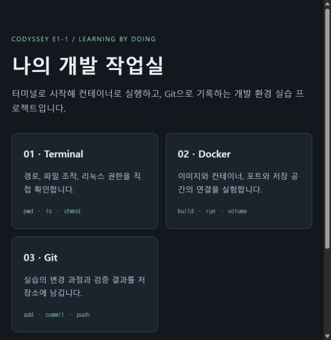
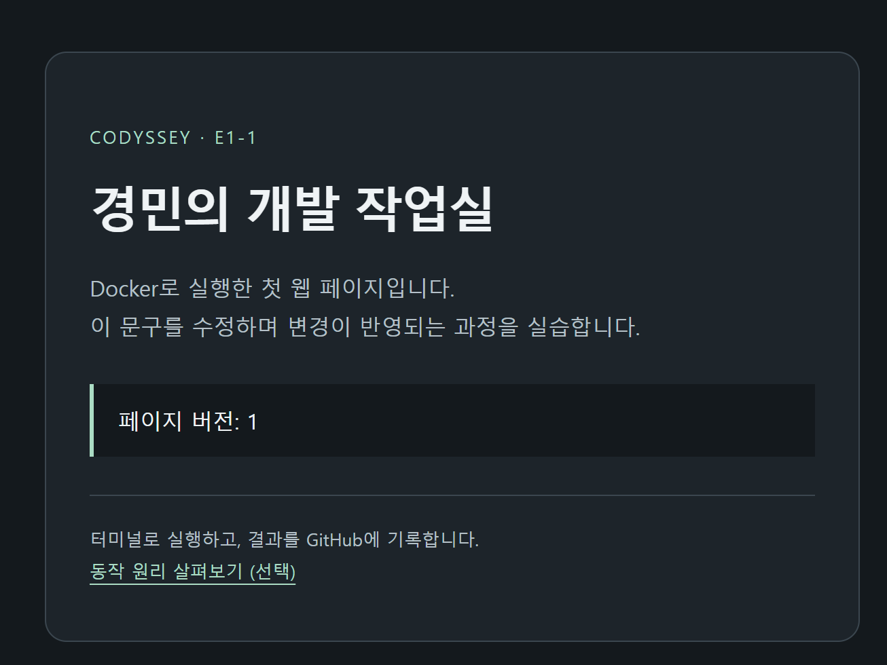

# E1-1 · 개발 작업실

Windows에서 Docker와 Git으로 웹 서버 실행 환경을 구성했습니다. 다른 사람도 같은 소스와 명령으로 실행할 수 있도록 Dockerfile, Compose 설정과 검증 결과를 남겼습니다.


## 빠른 실행

Docker Desktop을 켜고 CMD에서 실행합니다.

```cmd
git clone https://github.com/gyungmini306-blip/codyssey-E1-1-dev-workstation.git
cd codyssey-E1-1-dev-workstation
docker compose -p e1-1-bonus up -d --build --wait
curl.exe -i http://127.0.0.1:8083/healthz
```

브라우저에서 `http://localhost:8083/`을 열 수 있습니다. 확인이 끝나면 `docker compose -p e1-1-bonus down`으로 종료합니다.

## 1. 왜 이 작업을 했나

다른 PC에서도 웹 서버를 띄우려면 코드와 함께 빌드 방법, 포트, 저장 방식이 필요합니다. 이 실습에서는 실행 설정을 파일에 남기고 실제 명령과 출력으로 동작을 확인했습니다.

## 2. 실행 환경과 구성

| 항목 | 실습 환경 |
|---|---|
| OS·셸 | Windows · PowerShell/CMD · Ubuntu 컨테이너의 Bash |
| Docker | Desktop 4.97.0 · Docker CLI/엔진 29.9.2 · Compose v5.6.1 |
| Git | 2.52.0.windows.1 · GitHub · VS Code |

권한 실습은 Ubuntu 컨테이너 안에서 했습니다. 웹 서버는 NGINX 베이스 이미지를 사용하고, Dockerfile에서 HTML과 NGINX 설정을 복사했습니다. Compose에는 같은 Dockerfile의 빌드 위치와 포트 연결을 적어 한 명령으로 실행할 수 있게 했습니다.

## 3. 수행 체크리스트

- [x] 터미널 기본 조작: 현재 위치, 숨김 파일, 이동, 생성, 복사, 이름 변경, 삭제, 내용 확인, 빈 파일
- [x] 파일과 디렉토리 각각의 리눅스 권한 변경 전후 비교
- [x] Docker 버전 및 데몬 점검
- [x] 이미지 다운로드와 목록, 컨테이너 실행·중지·목록·로그·리소스 확인
- [x] hello-world 실행
- [x] Ubuntu 컨테이너에서 명령 실행 및 attach/exec/종료 차이 관찰
- [x] Dockerfile 커스텀 이미지 빌드 및 실행
- [x] 포트 매핑 HTTP 접속 검증
- [x] 주소창을 포함한 브라우저 증거
- [x] 바인드 마운트의 호스트 파일 변경 전후 비교
- [x] 컨테이너 삭제 전후 Docker 볼륨 데이터 보존 확인
- [x] Git 사용자 정보·기본 브랜치 및 로컬 커밋 확인
- [x] GitHub 업로드 및 원격 커밋 일치 검증
- [x] VS Code GitHub 연동 증거
- [x] 실제 문제의 원인 가설·확인·해결을 기록한 트러블슈팅 2건
- [x] 보너스 Docker Compose 단일 서비스

## 4. 수행 로그와 증거

### 4-1. 터미널과 파일 권한

Ubuntu 컨테이너에서 파일을 생성·복사·이동·삭제했습니다. 권한 변경은 `chmod`를 실행한 뒤 파일과 폴더 자체를 각각 조회해 확인했습니다.

```console
$ chmod 644 memo.txt
$ chmod 755 permissions-dir
$ ls -l memo.txt
-rw-r--r-- 1 root root 23 Nov  3 00:05 memo.txt
$ ls -ld permissions-dir
drwxr-xr-x 2 root root 4096 Nov  3 00:12 permissions-dir
```

<details>
<summary>실제 명령·출력 및 추가 캡처</summary>

실습일: 2026-11-03 (Asia/Seoul). 사용자가 직접 실행해 채팅으로 제공한 실제 명령과 출력이다. Windows 사용자 홈 경로는 생략했다. 보조 도구는 이 기록을 문서로 정리했다.

## 10-A. 컨테이너 진입, 폴더·파일 생성, 내용 확인

```console
PS> docker exec -it e1-1-ubuntu bash
root@9e28c1505a09:/# mkdir -p /root/e1-1/guided-practice
root@9e28c1505a09:/# cd /root/e1-1/guided-practice
root@9e28c1505a09:~/e1-1/guided-practice# pwd
/root/e1-1/guided-practice
root@9e28c1505a09:~/e1-1/guided-practice# touch empty.txt .hidden-note
root@9e28c1505a09:~/e1-1/guided-practice# echo "E1-1 terminal practice" > memo.txt
root@9e28c1505a09:~/e1-1/guided-practice# ls -la
total 12
drwxr-xr-x 2 root root 4096 Nov  3 00:05 .
drwxr-xr-x 3 root root 4096 Nov  3 00:05 ..
-rw-r--r-- 1 root root    0 Nov  3 00:05 .hidden-note
-rw-r--r-- 1 root root    0 Nov  3 00:05 empty.txt
-rw-r--r-- 1 root root   23 Nov  3 00:05 memo.txt
root@9e28c1505a09:~/e1-1/guided-practice# cat memo.txt
E1-1 terminal practice
```

## 관찰 및 해석

- pwd가 /root/e1-1/guided-practice를 출력해 이동한 위치를 확인했다.
- .hidden-note와 empty.txt는 크기 0인 빈 파일이다. -a 옵션으로 숨김 파일도 목록에 나타났다.
- memo.txt의 크기는 23바이트이고, cat으로 저장한 문장이 읽혔다. echo가 덧붙인 줄바꿈도 파일 내용에 포함된다.
- 프롬프트의 물결표(~)는 현재 사용자인 root의 홈 경로 /root를 줄여 표시한 것이다.

## 10-B. 복사, 이동·이름 변경, 삭제

같은 Ubuntu 컨테이너에서 사용자가 이어서 실행했다. 아래에서는 반복되는 프롬프트를 `$`로 줄였으며, 명령과 출력은 사용자가 제공한 기록이다. 시작 위치는 /root/e1-1/guided-practice다.

```console
$ cp memo.txt memo-copy.txt
$ ls -la
total 16
drwxr-xr-x 2 root root 4096 Nov  3 00:08 .
drwxr-xr-x 3 root root 4096 Nov  3 00:05 ..
-rw-r--r-- 1 root root    0 Nov  3 00:05 .hidden-note
-rw-r--r-- 1 root root    0 Nov  3 00:05 empty.txt
-rw-r--r-- 1 root root   23 Nov  3 00:08 memo-copy.txt
-rw-r--r-- 1 root root   23 Nov  3 00:05 memo.txt
$ mkdir -p archive
$ ls- la
bash: ls-: command not found
$ ls -la
total 20
drwxr-xr-x 3 root root 4096 Nov  3 00:08 .
drwxr-xr-x 3 root root 4096 Nov  3 00:05 ..
-rw-r--r-- 1 root root    0 Nov  3 00:05 .hidden-note
drwxr-xr-x 2 root root 4096 Nov  3 00:08 archive
-rw-r--r-- 1 root root    0 Nov  3 00:05 empty.txt
-rw-r--r-- 1 root root   23 Nov  3 00:08 memo-copy.txt
-rw-r--r-- 1 root root   23 Nov  3 00:05 memo.txt
$ mv memo-copy.txt archive/memo-renamed.txt
$ ls -la
total 16
drwxr-xr-x 3 root root 4096 Nov  3 00:09 .
drwxr-xr-x 3 root root 4096 Nov  3 00:05 ..
-rw-r--r-- 1 root root    0 Nov  3 00:05 .hidden-note
drwxr-xr-x 2 root root 4096 Nov  3 00:09 archive
-rw-r--r-- 1 root root    0 Nov  3 00:05 empty.txt
-rw-r--r-- 1 root root   23 Nov  3 00:05 memo.txt
$ cd archive
$ ls -la
total 12
drwxr-xr-x 2 root root 4096 Nov  3 00:09 .
drwxr-xr-x 3 root root 4096 Nov  3 00:09 ..
-rw-r--r-- 1 root root   23 Nov  3 00:08 memo-renamed.txt
$ cd ..
$ ls -la archive
total 12
drwxr-xr-x 2 root root 4096 Nov  3 00:09 .
drwxr-xr-x 3 root root 4096 Nov  3 00:09 ..
-rw-r--r-- 1 root root   23 Nov  3 00:08 memo-renamed.txt
$ rm archive/memo-renamed.txt
$ ls -la archive
total 8
drwxr-xr-x 2 root root 4096 Nov  3 00:09 .
drwxr-xr-x 3 root root 4096 Nov  3 00:09 ..
$ rmdir archive
$ ls -la
total 12
drwxr-xr-x 2 root root 4096 Nov  3 00:09 .
drwxr-xr-x 3 root root 4096 Nov  3 00:05 ..
-rw-r--r-- 1 root root    0 Nov  3 00:05 .hidden-note
-rw-r--r-- 1 root root    0 Nov  3 00:05 empty.txt
-rw-r--r-- 1 root root   23 Nov  3 00:05 memo.txt
```

### 관찰

- cp 후 원본과 복사본이 각각 23바이트로 존재했다.
- mv로 복사본을 archive 안으로 옮기고 memo-renamed.txt로 이름을 변경했다. 부모 폴더에서 복사본이 사라지고 archive 안에서 바뀐 이름을 확인했다.
- cd archive와 cd ..로 하위 폴더와 부모 폴더를 상대 경로로 이동했다.
- rm 후 archive 안에는 실제 파일이 남지 않았고, rmdir로 빈 폴더를 삭제했다.
- 마지막 목록에는 원본 memo.txt와 두 빈 파일만 남았다.
- 잘못 입력한 ls- la와 이를 ls -la로 수정한 실제 오류·해결도 보존했다.

## 10-C. 파일과 디렉토리 권한 변경 전후

사용자가 같은 Ubuntu 실습 폴더에서 직접 실행했다. 프롬프트는 `$`로 축약했다.

```console
$ mkdir -p permissions-dir
$ chmod 600 memo.txt
$ chmod 700 permissions-dir
$ ls -l memo.txt
-rw------- 1 root root 23 Nov  3 00:05 memo.txt
$ ls -ld permissions-dir
drwx------ 2 root root 4096 Nov  3 00:12 permissions-dir
$ chmod 644 memo.txt
$ chmod 755 permissions-dir
$ ls -l memo.txt
-rw-r--r-- 1 root root 23 Nov  3 00:05 memo.txt
$ ls -ld permissions-dir
drwxr-xr-x 2 root root 4096 Nov  3 00:12 permissions-dir
```

### 전후 비교

| 대상 | 변경 전 | 변경 후 | 실제 변화 |
|---|---|---|---|
| memo.txt | 600 / rw------- | 644 / rw-r--r-- | 그룹·기타 사용자에게 읽기 추가 |
| permissions-dir | 700 / rwx------ | 755 / rwxr-xr-x | 그룹·기타 사용자에게 읽기·진입 추가 |

파일과 디렉토리 각각에 대해 변경 전후가 실제 출력으로 확인됐다. 현재 root 계정이므로 이 결과는 권한 비트 변경의 증거이며 일반 사용자 접근 거부를 검증한 것은 아니다.

출력 맨 앞의 `-`는 일반 파일, `d`는 디렉토리를 나타낸다. 그 뒤 아홉 글자가 권한이다. `ls -l 디렉토리`는 디렉토리 안의 항목을 상세 조회하고, `ls -ld 디렉토리`는 해당 디렉토리 자체를 상세 조회한다. -d 옵션이 종류 표시 d를 만들어 내는 것은 아니다.

## 10-D. Windows에서 기존 Ubuntu 컨테이너 실행 상태 확인

사용자가 Windows PowerShell에서 직접 확인한 결과다.

```powershell
PS> docker inspect e1-1-ubuntu --format '{{.State.Running}}'
true
```

Windows로 돌아온 뒤에도 원래 Ubuntu 컨테이너가 실행 중임을 확인했다. 사용자 메시지에 exit 입력 행 자체는 포함되지 않았으므로 그 행을 실행 로그에 추가하지 않았다. 주 프로세스에 attach한 뒤 종료하는 경우와의 전체 비교는 후속 실습으로 남겨 둔다.

## 현재 수행 상태

- 완료: 컨테이너 exec 진입, 현재 위치·숨김 목록 확인, 폴더·파일 생성, 파일 내용 저장·읽기, 폴더 이동, 복사, 이동·이름 변경, 파일·빈 폴더 삭제, 파일 600→644와 디렉토리 700→755 권한 전후 비교.
- 아직 이 기록에 없는 항목: 위치 이동 후 절대 경로로 같은 파일 읽기 추가 실험, attach/detach 및 주 프로세스 종료와의 비교.

터미널 기본 조작과 파일·디렉토리 권한 변경의 필수 항목은 실제 출력으로 확인했다. 컨테이너 종료 방식의 전체 비교는 후속 실습에서 별도로 확인한다.


</details>

### 4-2. Docker 설치와 첫 실행

Docker 엔진이 실제로 이미지를 실행할 수 있는지 확인했습니다. `docker run --name e1-1-hello hello-world`에서 `Hello from Docker!`가 출력됐고, `docker ps -a`에서 종료 코드 `0`을 확인했습니다.

<details>
<summary>실제 명령·출력 및 추가 캡처</summary>

확인일: 2026-11-02 (Asia/Seoul).

## 사용자가 직접 실행한 결과

아래 명령과 출력은 사용자가 Windows PowerShell에서 실행해 채팅으로 제공한 실제 기록입니다. 개인 홈 경로는 생략했고, hello-world 설명문의 중간 부분은 발췌했습니다.

```powershell
PS> docker run --name e1-1-hello hello-world
Unable to find image 'hello-world:latest' locally
latest: Pulling from library/hello-world
4f55086f7dd0: Pull complete
d5e71e642bf5: Download complete
Digest: sha256:c567b231f65614688711a75f31518a064258a51d442117a3e771a3a8fdba78ef
Status: Downloaded newer image for hello-world:latest

Hello from Docker!
This message shows that your installation appears to be working correctly.
[이후 안내문 생략]

PS> docker ps
CONTAINER ID   IMAGE     COMMAND   CREATED   STATUS    PORTS     NAMES

PS> docker ps -a
CONTAINER ID   IMAGE         COMMAND    CREATED          STATUS                      PORTS     NAMES
30df56aa1c4b   hello-world   "/hello"   11 seconds ago   Exited (0) 10 seconds ago             e1-1-hello
```

## 추가 실제 점검

다음은 보조 도구로 직접 실행해 교차 확인한 결과입니다.

```powershell
PS> docker info --format 'ServerVersion={{.ServerVersion}} OSType={{.OSType}}'
ServerVersion=29.9.2 OSType=linux

PS> docker images --digests hello-world
REPOSITORY    TAG       DIGEST                                                                    IMAGE ID       CREATED        SIZE
hello-world   latest    sha256:c567b231f65614688711a75f31518a064258a51d442117a3e771a3a8fdba78ef   c567b231f656   7 months ago   25.9kB

PS> docker inspect e1-1-hello --format '{{.Id}} {{.Config.Image}} {{.State.Status}} exit={{.State.ExitCode}}'
30df56aa1c4ba9ddcb044cafdd8542b172a1b4b9a1ffefaf6277678ba2db12d4 hello-world exited exit=0
```

## 관찰 및 해석

- 최초 실행 시 로컬에 이미지가 없어 Docker Hub에서 다운로드했다.
- 이미지로 컨테이너를 생성하고 `/hello` 프로그램을 실행했다.
- 프로그램은 메시지 출력 후 종료했다. `Exited (0)`의 0은 정상 종료 코드다.
- `docker ps`는 실행 중인 컨테이너만 표시하므로 목록이 비어 있다.
- `docker ps -a`는 종료된 컨테이너도 표시하므로 `e1-1-hello`가 남아 있다.
- 컨테이너 종료는 컨테이너 삭제나 이미지 삭제와 다르다.
- 재시작 전 발생했던 엔진 연결 실패는 현재 Server 응답과 실제 컨테이너 실행 성공으로 해결을 확인했다.

</details>

### 4-3. 컨테이너 운영과 셸 종료

`docker images`, `docker ps -a`, `docker logs`, `docker stats`로 실행 상태를 확인했습니다. `exec`로 추가한 Bash를 종료했을 때는 컨테이너가 계속 실행됐고, 주 Bash를 종료했을 때는 `exited`로 바뀌었습니다.

<details>
<summary>실제 명령·출력 및 추가 캡처</summary>

실습일: 2026-11-03 (Asia/Seoul). 사용자가 직접 실행해 제공한 실제 명령과 출력이다. 반복되는 Windows 개인 경로와 프롬프트는 축약했다. 보조 도구는 이 기록을 문서화했다.

## 13-A. Docker 버전과 엔진 점검

```powershell
PS> docker --version
Docker version 29.9.2, build a82e528
PS> docker info --format 'ServerVersion={{.ServerVersion}} OSType={{.OSType}}'
ServerVersion=29.9.2 OSType=linux
```

클라이언트 버전뿐 아니라 엔진의 ServerVersion과 Linux 컨테이너 실행 환경도 응답했다.

## 13-B. 이미지 목록

사용자의 터미널에서 표시된 열과 줄바꿈을 보존했다.

```powershell
PS> docker images codyssey-workstation
                                                    i Info →   U  In Use
IMAGE                   ID             DISK USAGE   CONTENT SIZE   EXTRA
codyssey-workstation:1.0
                        47411e29e641       92.7MB         26.1MB    U
codyssey-workstation:2.0
                        8c59d743332c       92.8MB         26.1MB
codyssey-workstation:3.0
                        7ec0b8a7ebd6       92.8MB         26.1MB    U
codyssey-workstation:student-1
                        03847c26e8e8       92.8MB         26.1MB    U
```

사용자 직접 빌드한 student-1을 포함해 실습 과정의 이미지가 존재한다.

## 13-C. 컨테이너 전체 목록

```powershell
PS> docker ps -a
CONTAINER ID   IMAGE                            COMMAND                  CREATED          STATUS                    PORTS                    NAMES
91ff958c97f5   ubuntu:24.04                     "sleep infinity"         2 minutes ago    Up 2 minutes                                       e1-1-volume-after
9fdf6ee013be   codyssey-workstation:student-1   "/docker-entrypoint.…"   15 minutes ago   Up 15 minutes (healthy)   127.0.0.1:8081->80/tcp   e1-1-bind-guide
5e144b9a442f   codyssey-workstation:student-1   "/docker-entrypoint.…"   16 minutes ago   Up 16 minutes (healthy)   127.0.0.1:8082->80/tcp   e1-1-copy-guide
998efe0a81d8   codyssey-workstation:3.0         "/docker-entrypoint.…"   19 hours ago     Up 19 hours (healthy)     127.0.0.1:8080->80/tcp   codyssey-web
eed7564ae9ed   codyssey-workstation:1.0         "/docker-entrypoint.…"   21 hours ago     Exited (0) 20 hours ago                            codyssey-web-v1
9e28c1505a09   ubuntu:24.04                     "bash"                   21 hours ago     Up 21 hours                                        e1-1-ubuntu
30df56aa1c4b   hello-world                      "/hello"                 21 hours ago     Exited (0) 21 hours ago                            e1-1-hello
```

ps -a에는 종료된 hello-world와 이전 웹 컨테이너도 표시된다. 실행 중인 것과 종료된 것, 동일 이미지로 만든 별도 컨테이너를 구분해 확인했다.

## 13-D. 서버 로그

```powershell
PS> docker logs --tail 10 e1-1-bind-guide
127.0.0.1 - - [03/Nov/2026:00:37:26 +0000] "GET /healthz HTTP/1.1" 200 3 "-" "Wget" "-"
127.0.0.1 - - [03/Nov/2026:00:37:36 +0000] "GET /healthz HTTP/1.1" 200 3 "-" "Wget" "-"
127.0.0.1 - - [03/Nov/2026:00:37:46 +0000] "GET /healthz HTTP/1.1" 200 3 "-" "Wget" "-"
127.0.0.1 - - [03/Nov/2026:00:37:56 +0000] "GET /healthz HTTP/1.1" 200 3 "-" "Wget" "-"
127.0.0.1 - - [03/Nov/2026:00:38:06 +0000] "GET /healthz HTTP/1.1" 200 3 "-" "Wget" "-"
127.0.0.1 - - [03/Nov/2026:00:38:16 +0000] "GET /healthz HTTP/1.1" 200 3 "-" "Wget" "-"
127.0.0.1 - - [03/Nov/2026:00:38:26 +0000] "GET /healthz HTTP/1.1" 200 3 "-" "Wget" "-"
127.0.0.1 - - [03/Nov/2026:00:38:37 +0000] "GET /healthz HTTP/1.1" 200 3 "-" "Wget" "-"
127.0.0.1 - - [03/Nov/2026:00:38:47 +0000] "GET /healthz HTTP/1.1" 200 3 "-" "Wget" "-"
127.0.0.1 - - [03/Nov/2026:00:38:57 +0000] "GET /healthz HTTP/1.1" 200 3 "-" "Wget" "-"
```

Dockerfile의 HEALTHCHECK가 wget으로 /healthz를 요청했고 HTTP 200을 받았다. 이 발췌는 자동 점검 로그이며 브라우저 접속 캡처를 대신하지 않는다. 로그의 +0000은 UTC이며 문서의 실습일 기준 시간대는 Asia/Seoul이다.

## 13-E. 리소스 사용량

```powershell
PS> docker stats --no-stream e1-1-bind-guide
CONTAINER ID   NAME              CPU %     MEM USAGE / LIMIT     MEM %     NET I/O           BLOCK I/O        PIDS
9fdf6ee013be   e1-1-bind-guide   0.00%     8.945MiB / 7.527GiB   0.12%     16.7kB / 72.2kB   868kB / 8.19kB   9
```

해당 시점의 CPU·메모리·입출력·프로세스 수를 확인했다. 수치는 실행 시점에 따라 달라진다.

## 13-F. exec의 추가 Bash 종료 후 컨테이너 유지

사용자가 별도 실습 컨테이너에서 직접 실행한 기록이다. Ubuntu 터미널에 여러 줄을 입력하면서 표시된 입력·출력 순서를 보존했다. 이후 Docker가 출력한 일반 Debug 기능 안내는 생략했다.

```console
PS> docker run -dit --name e1-1-shell-guide ubuntu:24.04 bash
be12c0450ba9f86acf1ba8fc5634f202f9d306755471fb446ef1dbd156c2e05c
PS> docker exec -it e1-1-shell-guide bash
root@be12c0450ba9:/# echo "additional shell opened by exec"
exit
additional shell opened by exec
exit
PS> docker inspect e1-1-shell-guide --format '{{.State.Running}}'
true
```

- run -dit로 생성한 원래 Bash가 컨테이너의 주 프로세스다.
- exec는 별도의 추가 Bash를 생성했다.
- 추가 Bash에서 exit한 뒤에도 State.Running이 true다. 추가 셸의 종료와 컨테이너 주 프로세스의 종료가 다름을 확인했다.

## 13-G. attach 연결 후 분리해도 컨테이너 유지

사용자가 같은 e1-1-shell-guide에 직접 연결하고 분리한 결과다.

```console
PS> docker attach e1-1-shell-guide
root@be12c0450ba9:/# echo "main shell connected by attach"
main shell connected by attach
root@be12c0450ba9:/# read escape sequence
PS> docker inspect e1-1-shell-guide --format '{{.State.Running}}'
true
```

read escape sequence는 사용자가 입력한 Bash 명령이 아니라 Docker 클라이언트가 분리 키 입력을 감지한 안내다. 연결을 분리한 뒤에도 State.Running이 true여서 원래 Bash가 계속 실행 중임을 확인했다.

## 13-H. attach로 연결한 주 프로세스 종료

```console
PS> docker attach e1-1-shell-guide
root@be12c0450ba9:/# exit
exit
PS> docker inspect e1-1-shell-guide --format '{{.State.Status}}'
exited
```

이번에는 주 프로세스인 원래 Bash를 종료했으므로 컨테이너의 상태도 exited가 되었다.

## 비교 결과

| 사용자 직접 수행한 작업 | 실제 확인 값 | 해석 |
|---|---|---|
| exec로 연 추가 Bash에서 exit | Running=true | 추가 프로세스만 종료, 주 Bash 유지 |
| attach 연결에서 분리 키 사용 | Running=true | 터미널 연결만 분리, 주 Bash 유지 |
| attach로 연결한 주 Bash에서 exit | Status=exited | 주 프로세스 종료로 컨테이너 종료 |

## 현재 수행 상태

사용자 직접 Docker 운영 명령과 Ubuntu의 exec/attach/분리/종료 차이 관찰을 완료했다. 위 표는 예상이 아니라 사용자가 제공한 실제 명령·출력에 근거한다.

</details>

### 4-4. 커스텀 웹 서버와 포트 연결

NGINX 베이스에 HTML과 서버 설정을 담아 이미지를 빌드했습니다. PC의 `8080`을 컨테이너의 `80`에 연결한 뒤 브라우저에서 응답을 확인했습니다. 맨 위 브라우저 캡처에서 `8080` 화면을 볼 수 있습니다.

<details>
<summary>실제 명령·출력 및 추가 캡처</summary>

> 이 문서는 최초 V1 이미지와 컨테이너의 검증 기록이다. 현재는 원리 설명 페이지 V2를 제공하며, 최신 상태와 빌드 기록은 를 참고한다.

검증일: 2026-11-02 (Asia/Seoul). 아래는 보조 도구가 사용자 PC에서 실제 실행한 명령과 출력이다. 사용자가 직접 실행한 실습과 구분해 기록한다. 명령은 저장소 루트의 PowerShell에서 실행했으며 Docker CLI는 설치된 실행 파일의 절대 경로로 호출했다. 아래에서는 읽기 쉽게 `docker`로 표기한다.

## 이미지 빌드

```powershell
PS> docker build --progress=plain -t codyssey-workstation:1.0 .
[다운로드 진행 표시 등 중간 출력 생략]
#7 [2/3] COPY nginx.conf /etc/nginx/conf.d/default.conf
#7 DONE 0.1s
#8 [3/3] COPY app/ /usr/share/nginx/html/
#8 DONE 0.0s
#9 naming to docker.io/library/codyssey-workstation:1.0 done
#9 DONE 1.2s
```

. 베이스 이미지는 `nginx:stable-alpine`이며 빌드 시 확인한 digest는 `sha256:0e52bd054126cdc040b1276c0af347aeb02a41b9cfe305d6094767ac30e97949`이다. 태그는 갱신될 수 있어 당시 식별 정보를 함께 기록했다.

```powershell
PS> docker image inspect codyssey-workstation:1.0 --format '{{.Id}}'
sha256:47411e29e6415f3247a900b62b65791832a11e1056782e6753264040aadf402c
```

Dockerfile의 `COPY`가 NGINX 이미지에 우리 HTML과 설정을 추가한다. `docker build`는 이 정의대로 이미지를 만들고 `codyssey-workstation:1.0`이라는 태그를 붙인다.

## 컨테이너 실행 및 상태

```powershell
PS> docker run -d --name codyssey-web -p 127.0.0.1:8080:80 codyssey-workstation:1.0
eed7564ae9ed46f40f1881785db85794623b222c3935d314769f93532e5097ef

PS> docker ps --filter name=codyssey-web
CONTAINER ID   IMAGE                      COMMAND                  CREATED          STATUS                    PORTS                    NAMES
eed7564ae9ed   codyssey-workstation:1.0   "/docker-entrypoint.…"   34 seconds ago   Up 33 seconds (healthy)   127.0.0.1:8080->80/tcp   codyssey-web

PS> docker inspect codyssey-web --format '{{.State.Health.Status}}'
healthy
```

`-d`는 터미널을 점유하지 않고 백그라운드에서 실행한다. 호스트의 로컬 8080 포트를 컨테이너의 80 포트에 연결했다. 실행 중인 NGINX가 HTTP 요청을 계속 기다리므로 hello-world처럼 바로 종료되지 않는다.

## HTTP 접속 검증

실제 응답의 헤더와 핵심 본문만 발췌했다.

```powershell
PS> curl.exe -i --max-time 15 http://localhost:8080/
HTTP/1.1 200 OK
Server: nginx/1.30.6
Date: Mon, 02 Nov 2026 03:59:14 GMT
Content-Type: text/html
Content-Length: 2229
[나머지 헤더 및 HTML 중간 부분 생략]
  <title>Codyssey E1-1 · Dev Workstation Lab</title>
    <h1>나의 개발 작업실</h1>
    <p class="marker" id="mount-marker">콘텐츠 버전: WORKSTATION_V1</p>

PS> curl.exe -i --max-time 15 http://localhost:8080/healthz
HTTP/1.1 200 OK
Server: nginx/1.30.6
Date: Mon, 02 Nov 2026 03:59:15 GMT
Content-Type: text/plain
Content-Length: 3
Connection: keep-alive

ok
```

HTTP 200과 프로젝트 HTML 응답을 통해 호스트 포트에서 컨테이너 웹 서버까지 연결됨을 확인했다. 주소창을 포함한 브라우저 캡처는 추가 수집 대상이다.

## 브라우저 화면 확인

내장 브라우저에서 `http://localhost:8080/`을 열고 제목 `Codyssey E1-1 · Dev Workstation Lab`, 본문 `나의 개발 작업실`, Terminal/Docker/Git 카드를 확인했다. 아래는 실제 브라우저 뷰포트 캡처다. 이 이미지는 주소창을 포함하지 않으므로 과제의 주소창 포함 캡처는 별도로 남겨야 한다.



## 운영 명령

```powershell
PS> docker stats --no-stream codyssey-web
CONTAINER ID   NAME           CPU %     MEM USAGE / LIMIT     MEM %     NET I/O          BLOCK I/O     PIDS
eed7564ae9ed   codyssey-web   0.00%     8.711MiB / 7.527GiB   0.11%     1.95kB / 3.4kB   0B / 8.19kB   9

PS> docker logs --tail 12 codyssey-web
[시작 로그 및 반복 상태 점검 출력 생략]
172.17.0.1 - - [02/Nov/2026:03:59:14 +0000] "GET / HTTP/1.1" 200 2229 "-" "curl/8.21.0" "-"
172.17.0.1 - - [02/Nov/2026:03:59:15 +0000] "GET /healthz HTTP/1.1" 200 3 "-" "curl/8.21.0" "-"
```

이 컨테이너는 브라우저 관찰을 위해 실행 상태로 유지한다. 파일 변경 반영, 볼륨 영속성, 중지·재시작 비교는 후속 실습에서 별도로 검증한다.

</details>

### 4-5. HTML 수정 반영

같은 이미지에서 띄운 두 서버는 처음에 모두 V1을 반환했습니다. PC의 HTML만 수정하자 연결된 파일을 읽는 **8081은 V2**, 빌드할 때 복사한 파일을 읽는 **8082는 V1**을 반환했습니다.


<details>
<summary>실제 명령·출력 및 추가 캡처</summary>

실습일: 2026-11-03 (Asia/Seoul). 사용자가 직접 실행해 제공한 실제 명령과 출력이다. 반복되는 Windows 개인 경로·프롬프트는 줄였고, 긴 줄의 화면 줄바꿈은 읽기 쉽게 정리했다. 보조 도구는 받은 결과를 문서화했다.

## 11-A. Dockerfile과 현재 소스 확인

PowerShell에서 기존 로컬 저장소 루트로 이동한 뒤 실행했다. 이 PC의 폴더명은 dev-workstation-lab_Codyssey11이며, 원격 저장소 이름과 다르다.

```powershell
PS> Get-Content .\Dockerfile
FROM nginx:stable-alpine

LABEL org.opencontainers.image.title="Codyssey E1-1 Workstation Lab"
LABEL org.opencontainers.image.description="A personal development workstation practice server"

COPY nginx.conf /etc/nginx/conf.d/default.conf
COPY app/ /usr/share/nginx/html/

EXPOSE 80
HEALTHCHECK --interval=10s --timeout=3s --start-period=5s --retries=3 \
    CMD wget -q -O /dev/null http://127.0.0.1/healthz || exit 1

PS> Select-String -LiteralPath .\app\index.html -Pattern 'SIMPLE_PAGE'
app\index.html:27:    <p class="version" id="mount-marker" data-version="SIMPLE_PAGE_V1">페이지 버전: 1</p>
```

V1 HTML을 빌드 재료로 사용했음을 확인했다. 이 조회는 호스트 파일 내용 확인이며, 아직 바인드 마운트 검증 결과는 아니다.

## 11-B. 사용자 직접 이미지 빌드

```powershell
PS> docker build --progress=plain -t codyssey-workstation:student-1 .
[중간 출력 생략, 전체 출력은 아래 로그 링크 참고]
#7 [2/3] COPY nginx.conf /etc/nginx/conf.d/default.conf
#7 CACHED
#8 [3/3] COPY app/ /usr/share/nginx/html/
#8 CACHED
#9 naming to docker.io/library/codyssey-workstation:student-1 done
#9 unpacking to docker.io/library/codyssey-workstation:student-1 done
#9 DONE 0.1s
```

.

- 베이스 이미지: nginx:stable-alpine, digest `sha256:0e52bd054126cdc040b1276c0af347aeb02a41b9cfe305d6094767ac30e97949`.
- 결과 태그: codyssey-workstation:student-1.
- 실제 빌드 출력의 manifest list: `sha256:03847c26e8e83398a7c3f265fefa6a22a0a1f8353a4da63fdd059baf00134f30`.
- CACHED는 같은 입력의 이전 빌드 결과를 재사용했음을 뜻한다. 오류가 아니다. 최종 태그 지정과 내보내기 완료를 확인했다.

## 11-C. COPY/bind 컨테이너 생성과 입력 오류 해결

다음은 사용자 제공 명령과 핵심 출력의 발췌다. 오류 뒤 Docker가 표시한 일반 도움말은 생략했다.

```powershell
PS> docker run -d --name e1-1-copy-guide -p 127.0.0.1:8082:80 codyssey-workstation:student-1
5e144b9a442f062a6bc7e4a0130863bb85866f327bc17a38ea88642c5c038665

PS> $appPath = (Resolve-Path .\app).Path
PS> docker run -d --name e1-1-bind-guide -p 127.0.0.1:8081:80 ==mount
docker: invalid reference format

PS> docker run -d --name e1-1-bind-guide -p 127.0.0.1:8081:80 --mount
flag needs an argument: --mount

PS> "type=bind,source=$appPath,target=/usr/share/nginx/html,readonly" codyssey-workstation:student-1
식 또는 문에서 예기치 않은 'codyssey-workstation:student-1' 토큰입니다.
[ParserError / UnexpectedToken: 위치 표시 등 중간 출력 생략]

PS> $appPath = (Resolve-Path .\app).Path
PS> docker run -d --name e1-1-bind-guide -p 127.0.0.1:8081:80 --mount "type=bind,source=$appPath,target=/usr/share/nginx/html,readonly" codyssey-workstation:student-1
9fdf6ee013be8740e6d2e557f52e9ece75de503524217568cef9416bb83ff45d

PS> docker ps --filter name=guide
CONTAINER ID   IMAGE                            COMMAND                   CREATED              STATUS                        PORTS                    NAMES
9fdf6ee013be   codyssey-workstation:student-1   "/docker-entrypoint.…"   15 seconds ago       Up 14 seconds (healthy)       127.0.0.1:8081->80/tcp   e1-1-bind-guide
5e144b9a442f   codyssey-workstation:student-1   "/docker-entrypoint.…"   About a minute ago   Up About a minute (healthy)   127.0.0.1:8082->80/tcp   e1-1-copy-guide
```

--mount 철자와 인자 누락, 명령을 두 번으로 나눠 입력한 오류를 거쳐 전체 명령을 한 번에 입력해 해결했다. 최종 실행에서는 두 서버 모두 healthy이며, 각각 8081/8082 포트가 컨테이너의 80으로 연결되었다.

## 11-D. 수정 전 응답과 한글 표시 문제

사용자 직접 실행한 결과다. 깨진 문자는 당시 출력을 그대로 기록했고, 화면 줄바꿈은 정리했다.

```powershell
PS> curl.exe -s --max-time 10 http://localhost:8081/ | Select-String 'SIMPLE_PAGE'
    <p class="version" id="mount-marker" data-version="SIMPLE_PAGE_V1">
?섏씠吏 踰꾩쟾: 1</p>

PS> curl.exe -s --max-time 10 http://localhost:8082/ | Select-String 'SIMPLE_PAGE'
    <p class="version" id="mount-marker" data-version="SIMPLE_PAGE_V1">
?섏씠吏 踰꾩쟾: 1</p>
```

두 응답 모두 ASCII 식별자 SIMPLE_PAGE_V1을 확인했다. 아직 호스트 파일을 수정하지 않은 기준 결과다.

보조 도구가 원본 HTTP 바이트를 별도로 UTF-8로 읽고 호스트 파일과 비교한 실제 결과:

```text
8081: HTTP 200; UTF-8 decode OK; source matches=True
<p class="version" id="mount-marker" data-version="SIMPLE_PAGE_V1">페이지 버전: 1</p>
8082: HTTP 200; UTF-8 decode OK; source matches=True
<p class="version" id="mount-marker" data-version="SIMPLE_PAGE_V1">페이지 버전: 1</p>
```

HTML 원본과 서버 응답의 UTF-8 내용은 정상이다. 사용자 PowerShell의 외부 명령 출력 해석 과정에서 인코딩이 맞지 않는 것으로 판단했다. 별도의 Windows PowerShell에서 `[Console]::OutputEncoding = [System.Text.Encoding]::UTF8`을 적용한 뒤 같은 curl 파이프라인을 실행해 한글이 정상 표시됨을 확인했다. 이는 보조 도구의 검증이며 사용자 세션에 적용한 결과는 아직 받지 않았다.

## 11-E. 사용자 세션의 출력 설정 수정 및 HTML 편집

사용자가 제공한 실제 명령과 핵심 출력이다. 설정 명령 뒤에 다음 명령 이름 code를 붙여 입력한 첫 시도는 실패했고, 두 명령을 나눠 입력해 해결했다.

```powershell
PS> [Console]::OutputEncoding = [System.Text.Encoding]::UTF8code
"OutputEncoding"을(를) 설정하는 동안 예외가 발생했습니다. "값은 null일 수 없습니다.
매개 변수 이름: value"
[위치 표시 및 부가 예외 정보 생략]

PS> [Console]::OutputEncoding = [System.Text.Encoding]::UTF8
PS> code .\app\index.html
```

보조 도구가 저장소의 실제 git diff로 확인한 사용자 수정은 다음 한 줄이다. 파일을 새로 덮어쓰거나 대신 수정하지 않았다.

```diff
-    <p class="version" id="mount-marker" data-version="SIMPLE_PAGE_V1">페이지 버전: 1</p>
+    <p class="version" id="mount-marker" data-version="SIMPLE_PAGE_V2">페이지 버전: 2</p>
```

## 11-F. 재빌드·컨테이너 재생성 없이 수정 후 비교 성공

사용자가 이어서 실행해 제공한 결과다. 화면의 긴 줄 줄바꿈은 정리했다.

```powershell
PS> curl.exe -s --max-time 10 http://localhost:8081/ | Select-String 'SIMPLE_PAGE'
    <p class="version" id="mount-marker" data-version="SIMPLE_PAGE_V2">
페이지 버전: 2</p>

PS> curl.exe -s --max-time 10 http://localhost:8082/ | Select-String 'SIMPLE_PAGE'
    <p class="version" id="mount-marker" data-version="SIMPLE_PAGE_V1">
페이지 버전: 1</p>
```

| 비교 대상 | 수정 전 | 호스트 HTML만 수정한 뒤 | 관찰 |
|---|---|---|---|
| 8081 / e1-1-bind-guide | SIMPLE_PAGE_V1 | SIMPLE_PAGE_V2 | 연결된 호스트 폴더의 수정 내용이 반영됨 |
| 8082 / e1-1-copy-guide | SIMPLE_PAGE_V1 | SIMPLE_PAGE_V1 | 기존 이미지에 COPY된 내용이 유지됨 |

두 응답에서 한글도 정상 표시되어 사용자 PowerShell의 출력 설정 수정 결과까지 확인했다. 이 비교 과정의 사용자 기록에는 재빌드·컨테이너 재생성 명령이 없고, 기존 두 서버의 응답 차이로 파일 수정 반영을 검증했다.

## 사용자 제공 화면



첨부 이미지는 페이지 버전 1의 콘텐츠를 보여준다. 주소창이 없어 포트나 해당 컨테이너를 특정할 수 없다. 8081/8082의 실제 비교 근거는 위 명령과 출력이다. 이후 사용자가 제출한 에는 8080의 기존 COPY 서버와 8081의 바인드 서버가 보인다.

## 현재 수행 상태

사용자 직접 이미지 빌드, 두 서버 실행, 수정 전 V1/V1 조회, 호스트 HTML 수정, 수정 후 V2/V1 비교와 한글 정상 표시를 확인했다. 바인드 마운트 변경 반영은 실제 로그로 검증했다. 이후 와 도 완료했다.

이 단계의 문서화 시에는 수정한 app/index.html을 사용자 작업 트리에 남기고 증거 문서만 커밋했다. 이후 사용자가 d580e49 커밋으로 HTML 수정본을 직접 커밋·푸시했으며, 실제 결과는 에 기록했다.

</details>

### 4-6. 볼륨에 남은 데이터

컨테이너를 교체해도 데이터를 다시 읽을 수 있는지 확인했습니다. 기존 컨테이너를 삭제하고 같은 볼륨을 새 컨테이너에 연결한 뒤, 아래 결과를 확인했습니다.

```console
PS> docker exec e1-1-volume-after cat /data/memo.txt
E1-1-volume-proof
```

<details>
<summary>실제 명령·출력 및 추가 캡처</summary>

실습일: 2026-11-03 (Asia/Seoul). 사용자가 직접 실행해 제공한 실제 명령과 출력이다. 반복되는 Windows 개인 경로는 생략했다. 보조 도구는 받은 결과를 문서로 정리했다.

## 12-A. 볼륨 생성과 삭제 전 데이터 확인

```powershell
PS> docker volume create e1-1-user-data
e1-1-user-data

PS> $volumeMount = "type=volume,source=e1-1-user-data,target=/data"
PS> docker run -d --name e1-1-volume-before --mount $volumeMount ubuntu:24.04 sleep infinity
77d4a42449559c220892e446f3b117a622b57398cb5ae41cf716ccf6187ad886

PS> docker exec e1-1-volume-before sh -c 'echo E1-1-volume-proof > /data/memo.txt'
PS> docker exec e1-1-volume-before cat /data/memo.txt
E1-1-volume-proof
```

### 관찰

- 이름 있는 볼륨 e1-1-user-data를 만들고 컨테이너의 /data에 연결했다.
- sleep infinity는 주 프로세스를 유지해 이후 exec로 명령을 실행할 수 있게 한다.
- /data/memo.txt에 쓴 문장이 cat에서 동일하게 출력됐다. 이 값이 삭제 후 비교할 기준 데이터다.

## 12-B. 기존 컨테이너 삭제와 볼륨 잔존 확인

사용자가 이어서 실행한 실제 명령과 출력이다.

```powershell
PS> docker stop e1-1-volume-before
e1-1-volume-before
PS> docker rm e1-1-volume-before
e1-1-volume-before
PS> docker ps -a --filter name=e1-1-volume-before
CONTAINER ID   IMAGE     COMMAND   CREATED   STATUS    PORTS     NAMES
PS> docker volume ls --filter name=e1-1-user-data
DRIVER    VOLUME NAME
local     e1-1-user-data
```

컨테이너 목록에는 헤더만 표시되어 기존 before 컨테이너가 제거됐음을 확인했다. 볼륨 목록에는 e1-1-user-data가 남아 있다.

## 12-C. 새 컨테이너에 같은 볼륨 연결 후 읽기

```powershell
PS> $volumeMount = "type=volume,source=e1-1-user-data,target=/data"
PS> docker run -d --name e1-1-volume-after --mount $volumeMount ubuntu:24.04 sleep infinity
91ff958c97f598400a36d7de5c44b38a9b530b320cb4e7e514ea185c151ad9b4
PS> docker exec e1-1-volume-after cat /data/memo.txt
E1-1-volume-proof
```

| 비교 | 컨테이너 | 내용 |
|---|---|---|
| 삭제 전 | e1-1-volume-before / 77d4a4244955… | E1-1-volume-proof |
| 삭제 후 새 연결 | e1-1-volume-after / 91ff958c97f5… | E1-1-volume-proof |

서로 다른 ID와 이름의 컨테이너에서 같은 파일 내용이 읽혔다. after 컨테이너에서는 파일을 새로 작성하지 않았고, 같은 이름의 볼륨을 다시 연결했다. 컨테이너 수명과 볼륨 데이터의 수명이 분리됨을 실제 결과로 확인했다.

## 현재 수행 상태

볼륨 생성·연결·메모 저장과 읽기, 첫 컨테이너 중지·삭제, 볼륨 잔존, 새 컨테이너 재연결·동일 메모 읽기를 모두 사용자 직접 출력으로 확인했다. 볼륨 영속성 검증을 완료했다. 볼륨 자체는 삭제하지 않고 남겨두었다.

</details>

### 4-7. Git·GitHub와 VS Code

HTML의 V2 수정본을 커밋 `d580e49`로 기록하고 GitHub `main`에 푸시했습니다. VS Code 계정 메뉴에도 `gyungmini306-blip (GitHub)`가 표시됐습니다.

<details>
<summary>실제 명령·출력 및 추가 캡처</summary>

실습일: 2026-11-03 (Asia/Seoul). 사용자가 제공한 실제 출력과 화면을 정리했다. 개인 PC 경로는 생략하고, 반복된 pager 도움말은 핵심 부분만 발췌했다.

## 14-A. Git 버전 및 저장소별 설정

이번 출력의 셸은 명령 프롬프트(CMD)다. 이전 Docker 실습의 Windows PowerShell과 구분한다.

```text
Microsoft Windows [Version 10.0.26200.9711]
```

```console
CMD> git --version
git version 2.52.0.windows.1
CMD> git config --local --list
core.repositoryformatversion=0
core.filemode=false
core.bare=false
core.logallrefupdates=true
core.symlinks=false
core.ignorecase=true
core.autocrlf=input
remote.origin.url=https://github.com/gyungmini306-blip/codyssey-E1-1-dev-workstation.git
remote.origin.fetch=+refs/heads/*:refs/remotes/origin/*
branch.main.remote=origin
branch.main.merge=refs/heads/main
init.defaultbranch=main
user.email=gyungmini306-blip@users.noreply.github.com
user.name=gyungmini306-blip
credential.https://github.com.username=gyungmini306-blip
```

계정·커밋 이메일·기본 브랜치 설정·원격 저장소 설정을 실제 출력에서 확인했다. 기본 브랜치 설정과 현재 체크아웃된 브랜치는 구분하므로, 현재 브랜치는 별도 명령으로 다시 조회한다.

## 14-B. less 보기 화면에서 후속 명령 입력

설정 출력 뒤 다음과 같은 내용이 반복됐다.

```text
...skipping...
                   SUMMARY OF LESS COMMANDS
  q  :q  Q  :Q  ZZ     Exit.
[중간 도움말 반복 생략]
log file: ionTable.PSVersion.ToString()
```

출력을 보여주는 less가 열려 있는 상태에서 후속 셸 명령의 키 입력이 전달되어 도움말·로그 파일 입력 화면으로 이동한 것으로 판단했다. 이 기록에서 git branch, remote, status 및 PowerShell 버전 조회의 실제 실행 결과는 확인되지 않는다.

보조 도구는 tatus --short라는 미추적 파일을 발견하고, 내용을 확인해 less 도움말 로그임을 식별했다. 원본을 삭제하지 않고 Git에서 제외되는 work/less-help-log-20261103.txt로 이동해 보관했다. 이 보관 로그는 공개 증거 파일로 추가하지 않는다.

복구 안내는 현재 파일 이름 입력을 Ctrl+C로 취소하고 q로 보기 화면을 종료한 뒤, CMD라면 powershell -NoProfile로 PowerShell을 여는 것이다. 이후 git --no-pager로 남은 명령을 조회한다. 사용자 재조회 성공은 아래 14-C에서 확인했다. Ctrl+C/q 키 입력 자체의 화면 기록은 별도로 제공되지 않아 실제 입력 로그로 덧붙이지 않았다.

참고: .

## 14-C. PowerShell에서 현재 브랜치·원격·작업 상태 확인

사용자가 이어서 제공한 실제 명령과 출력이다. Windows 개인 경로는 생략했다.

```powershell
PS> powershell -NoProfile
Windows PowerShell
Copyright (C) Microsoft Corporation. All rights reserved.

PS> git --no-pager branch --show-current
main
PS> git --no-pager remote -v
origin  https://github.com/gyungmini306-blip/codyssey-E1-1-dev-workstation.git (fetch)
origin  https://github.com/gyungmini306-blip/codyssey-E1-1-dev-workstation.git (push)
PS> git --no-pager status --short
 M app/index.html
PS> $PSVersionTable.PSVersion.ToString()
5.1.26100.9711
```

### 관찰

- main 브랜치를 사용하고, fetch/push가 모두 최종 제출 저장소를 가리킨다.
- 상태의 M은 사용자 HTML 수정이 작업 트리에 있고 아직 스테이징되지 않았음을 뜻한다.
- 사용자 Windows PowerShell의 실제 버전은 5.1.26100.9711이다.
- --no-pager 조회에서는 less 화면에 머무르지 않고 각 명령의 출력과 다음 명령을 확인했다.

## 14-D. 사용자 직접 HTML 수정본 검토·스테이징·커밋·푸시

사용자가 실제 실행한 결과다. 동일 diff를 두 번 조회한 기록은 한 번으로 줄였고, HTML 변경 내용은 와 같다.

```powershell
PS> git --no-pager diff -- app/index.html
warning: in the working copy of 'app/index.html', CRLF will be replaced by LF the next time Git touches it
[V1 → V2 한 줄 변경의 diff 본문 생략: 위 링크 참고]

PS> git add app/index.html
warning: in the working copy of 'app/index.html', CRLF will be replaced by LF the next time Git touches it
PS> git --no-pager diff --cached --stat
 app/index.html | 2 +-
 1 file changed, 1 insertion(+), 1 deletion(-)
PS> git commit -m "Update practice page to version 2"
[main d580e49] Update practice page to version 2
 1 file changed, 1 insertion(+), 1 deletion(-)
PS> git push
Enumerating objects: 7, done.
Counting objects: 100% (7/7), done.
Delta compression using up to 8 threads
Compressing objects: 100% (4/4), done.
Writing objects: 100% (4/4), 386 bytes | 386.00 KiB/s, done.
Total 4 (delta 3), reused 0 (delta 0), pack-reused 0 (from 0)
remote: Resolving deltas: 100% (3/3), completed with 3 local objects.
To https://github.com/gyungmini306-blip/codyssey-E1-1-dev-workstation.git
   58c49d9..d580e49  main -> main
PS> git status --short --branch
## main...origin/main
```

### 관찰

- diff에서 버전 식별자와 화면 문구의 V1→V2 변경을 검토했다.
- add로 해당 파일을 선택하고 d580e49 커밋을 만들었다.
- push 결과에서 원격 main이 d580e49로 갱신됐고, 최종 상태에는 작업 트리 수정 표시가 없다.
- CRLF→LF는 저장소의 텍스트 줄바꿈 정규화 안내다. 이후 커밋·푸시가 실제 성공했으며 해당 안내는 실패 오류가 아니다.
- d580e49는 사용자 본인이 직접 만든 실습 커밋이다. 이후 증거 문서 갱신 커밋과 구별해 기록한다.

## 현재 수행 상태

사용자 직접 Git 설정 확인, 변경 검토, 스테이징, 로컬 커밋, 원격 푸시와 깨끗한 작업 상태를 확인했다. 도 수집했다.

## 14-E. VS Code GitHub 계정 연결 확인

사용자가 PowerShell에서 아래 명령을 실행해 GitHub Pull Requests 확장 v0.174.0을 설치했다.

```powershell
code --install-extension GitHub.vscode-pull-request-github
```

사용자가 제공한 설치 완료 출력이다.

```text
Extension 'github.vscode-pull-request-github' v0.174.0 was successfully installed.
```

로그인 후 VS Code 계정 메뉴에 `gyungmini306-blip (GitHub)`과 로그아웃 항목이 표시됐다. 계정 이름은 과제 저장소 소유자와 일치한다.


</details>

### 4-8. 보너스 · Docker Compose

빌드 위치와 포트를 `compose.yaml`에 담아 단일 웹 서버를 실행했습니다. `8083/healthz`가 **HTTP 200**을 반환했고, `down` 이후 `ps -a`에는 해당 프로젝트의 컨테이너가 없었습니다.

<details>
<summary>전체 문제 해결 기록</summary>

은 웹 서버 한 개를 정의한다. `build: .`은 기존 Dockerfile을 사용하고, `ports`는 PC의 8083번과 컨테이너의 80번을 연결한다.

2026-11-03 보조 실행에서 확인한 명령과 출력이다. 빌드 중간 단계는 생략했다. 서버가 실행 중일 때 브라우저에서 `http://127.0.0.1:8083/`을 열 수 있다.

```text
PS> docker compose version
Docker Compose version v5.6.1
PS> docker compose -p e1-1-bonus up -d --build --wait
Image e1-1-bonus-web Built
Container e1-1-bonus-web-1 Healthy
PS> docker compose -p e1-1-bonus ps
NAME               IMAGE            COMMAND                  SERVICE   CREATED         STATUS                   PORTS
e1-1-bonus-web-1   e1-1-bonus-web   "/docker-entrypoint.…"   web       6 seconds ago   Up 6 seconds (healthy)   127.0.0.1:8083->80/tcp
PS> curl.exe -fsS -i http://127.0.0.1:8083/healthz
HTTP/1.1 200 OK
Server: nginx/1.30.6
Date: Tue, 03 Nov 2026 03:24:48 GMT
Content-Type: text/plain
Content-Length: 3
Connection: keep-alive

ok
PS> docker compose -p e1-1-bonus logs --tail 6 web
web-1  | 2026/11/03 03:24:42 [notice] 1#1: start worker process 33
web-1  | 2026/11/03 03:24:42 [notice] 1#1: start worker process 34
web-1  | 2026/11/03 03:24:42 [notice] 1#1: start worker process 35
web-1  | 2026/11/03 03:24:42 [notice] 1#1: start worker process 36
web-1  | 127.0.0.1 - - [03/Nov/2026:03:24:47 +0000] "GET /healthz HTTP/1.1" 200 3 "-" "Wget" "-"
web-1  | 172.18.0.1 - - [03/Nov/2026:03:24:48 +0000] "GET /healthz HTTP/1.1" 200 3 "-" "curl/8.21.0" "-"
PS> docker compose -p e1-1-bonus down
 Container e1-1-bonus-web-1 Stopping
 Container e1-1-bonus-web-1 Stopped
 Container e1-1-bonus-web-1 Removing
 Container e1-1-bonus-web-1 Removed
 Network e1-1-bonus_default Removing
 Network e1-1-bonus_default Removed
PS> docker compose -p e1-1-bonus ps -a
NAME      IMAGE     COMMAND   SERVICE   CREATED   STATUS    PORTS
```

`ps`에서 8083번 포트와 healthy 상태를 확인했다. `/healthz`는 HTTP 200과 `ok`를 반환했다. `down` 이후 프로젝트의 컨테이너 목록은 비었다.


</details>

## 5. 트러블슈팅

| 문제 | 확인과 해결 |
|---|---|
| 파일 목록 명령이 실패함 | 셸이 `ls-`를 명령 이름으로 읽었습니다. `ls -la`로 고쳐 실제 파일 목록을 확인했습니다. |
| 바인드 마운트 실행이 실패함 | `--mount` 인수 누락을 오류 메시지로 확인했습니다. 마운트 설정과 이미지 이름을 한 줄에 넣어 실행하고 HTTP 응답을 확인했습니다. |

<details>
<summary>실제 명령·출력 및 추가 캡처</summary>

## 1. WSL 패키지 설치가 관리자 권한 오류로 실패

- **문제:** `winget install --id Microsoft.WSL --exact ...`가 `0x80073d28`로 실패했다.
- **원인 가설:** 명령 실행 권한과 Windows 관리자 권한은 별개이므로, 현재 프로세스가 관리자 권한을 받지 못했을 수 있다.
- **확인:** `WindowsPrincipal.IsInRole(Administrator)` 결과가 `False`였고 설치 오류에도 `administrator privileges are required`가 표시되었다.
- **해결:** `Start-Process -Verb RunAs`로 관리자 PowerShell을 실행해 동일한 공식 패키지 설치 명령을 재실행했다.
- **결과:** `설치 성공`, `Get-AppxPackage`에서 WSL `2.7.14.0`을 확인했다. 이어서 켠 `VirtualMachinePlatform`은 재시작을 요구하므로 Ubuntu 실행은 별도로 검증해야 한다.
- **증거:** .

## 2. Docker 명령을 찾지 못함

- **문제:** 최초 `docker --version`이 `The term 'docker' is not recognized`로 실패했다.
- **원인 가설:** Docker Desktop이 설치되지 않았거나 실행 파일 경로가 현재 PATH에 없을 수 있다.
- **확인:** `Get-Command docker`에서 실행 파일을 찾지 못했고, `Test-Path 'C:\Program Files\Docker\Docker\Docker Desktop.exe'`도 `False`였다.
- **해결:** 공식 `Docker.DockerDesktop` 패키지를 winget으로 설치했다. 설치 전부터 열려 있던 셸에서는 설치 경로의 `docker.exe`를 직접 실행했다. 일반 사용 시에는 새 터미널을 연다.
- **결과:** `Docker version 29.9.2, build a82e528`로 CLI 실행을 확인했다. 이것만으로 엔진이 정상이라는 의미는 아니다.
- **증거:** , .

## 3. Docker CLI는 실행되지만 엔진 연결 실패 (해결)

- **문제:** `docker info`의 Server 부분이 `docker_engine` 파이프를 찾지 못했다.
- **원인 가설:** Docker Desktop 엔진이 실행되지 않았고, WSL의 필수 가상화 기능도 재시작 전이다.
- **확인:** CLI 버전은 출력되지만 Server 연결은 실패했다. Windows의 `RebootPending`도 `True`다.
- **해결 계획:** Windows 재시작 후 Docker Desktop을 시작하고, WSL 2 및 Ubuntu 통합 상태를 확인한다.
- **결과:** 사용자의 Windows 재시작 이후 `docker info`에서 ServerVersion `29.9.2`, OSType `linux`를 확인했다. 사용자가 직접 실행한 hello-world도 `Exited (0)`로 정상 종료했다. .

## 4. ls- la 입력 오류

- **문제:** 사용자 직접 실습에서 `ls- la` 입력 후 `bash: ls-: command not found`가 발생했다.
- **원인 가설:** 명령과 옵션 사이 공백이 잘못되어 Bash가 ls 대신 ls-라는 프로그램을 찾았을 수 있다.
- **확인:** 실제 입력의 첫 단어가 ls-였고, 오류에도 ls-를 찾지 못했다고 표시되었다. 명령 ls와 옵션 -la는 공백으로 구분해야 한다.
- **해결:** `ls -la`로 고쳐 입력했다.
- **결과:** archive와 memo-copy.txt 등을 포함한 상세 목록이 정상 출력되었다. 이후 이동·삭제 명령도 수행했다.
- **증거:** .

## 5. --mount 오타·인자 누락·명령 분리

- **문제:** ==mount로 입력해 invalid reference format, --mount만 입력해 flag needs an argument, 나머지 문자열과 이미지를 별도 입력해 PowerShell ParserError가 발생했다.
- **원인 가설:** 옵션 철자가 다르고 필수 값과 이미지가 하나의 docker run 명령에 전달되지 않았을 수 있다.
- **확인:** 사용자 입력과 오류에 해당 옵션·인자 누락 및 독립적인 문자열 식이 표시되었다.
- **해결:** --mount 뒤에 연결 설정 문자열을 넣고 마지막에 이미지 이름까지 포함한 전체 명령을 한 번에 실행했다.
- **결과:** 컨테이너 ID가 출력되고 e1-1-bind-guide가 healthy / 8081→80으로 나타났다.
- **증거:** .

## 6. curl 파이프라인의 한글 깨짐 (해결)

- **문제:** 사용자 Windows PowerShell에서 curl을 Select-String으로 넘기자 페이지 버전의 한글이 깨졌다. SIMPLE_PAGE_V1 식별자는 정상 출력되었다.
- **원인 가설:** UTF-8 웹 응답과 터미널의 외부 명령 출력 해석이 일치하지 않을 수 있다.
- **확인:** 보조 도구가 8081·8082의 HTTP 바이트를 UTF-8로 해석하고 호스트 파일과 비교해 일치를 확인했다. HTML 원본 손상은 관찰되지 않았다.
- **해결:** `[Console]::OutputEncoding = [System.Text.Encoding]::UTF8`을 현재 세션에 적용했다. 사용자가 처음 UTF8code로 붙여 입력해 null 값 설정 예외가 발생했으나, UTF8 설정 명령과 code 편집 명령을 별도 줄로 나눠 실행해 고쳤다.
- **결과:** 사용자 재실행에서 8081은 SIMPLE_PAGE_V2 / 페이지 버전: 2, 8082는 SIMPLE_PAGE_V1 / 페이지 버전: 1을 한글 깨짐 없이 출력했다. 보조 도구뿐 아니라 사용자의 현재 세션에서도 해결을 확인했다.
- **증거:** .
- **참고:** .

## 7. Git 출력의 less 화면에서 셸 명령 입력 (해결)

- **문제:** Git 설정 조회 뒤 SUMMARY OF LESS COMMANDS와 log file 입력 화면이 반복되어 다음 셸 명령의 결과가 나오지 않았다.
- **원인 가설:** 긴 출력을 보여주는 less를 종료하지 않아 셸 명령의 문자가 less의 조작 키로 처리됐을 수 있다. 당시 셸은 CMD였으므로 PowerShell 전용 버전 조회도 구분해야 했다.
- **확인:** 사용자 첨부 출력에 less 도움말과 파일 이름 입력이 나타났고, 작업 폴더의 tatus --short 파일도 실제 less 도움말 로그로 확인했다. 이 로그는 삭제하지 않고 제외 폴더 work에 보관했다.
- **해결 안내:** 파일 이름 입력은 Ctrl+C로 취소, q로 보기 화면 종료, PowerShell로 전환, Git 조회에는 --no-pager 사용.
- **결과:** 사용자 재조회에서 현재 main, 올바른 origin, M app/index.html과 PowerShell 5.1.26100.9711이 정상 출력됐다.
- **증거:** .

</details>
