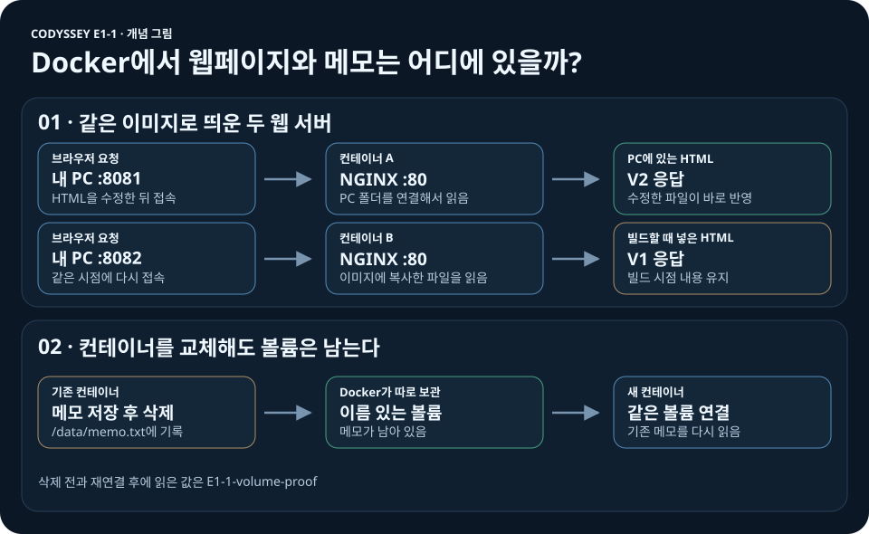

# Codyssey E1-1 · 개발 작업실

**내 PC에서 띄운 웹 서버를 다른 사람도 같은 방법으로 실행할 수 있게 만든 실습입니다.** Ubuntu에서 파일과 권한을 다루고, Docker로 NGINX를 실행한 뒤 접속·HTML 수정·데이터 보존을 확인했습니다.

[빠른 실행](#실행-환경과-빠른-실행) · [실습 결과](#본과제-실습과-검증-결과) · [문제 해결](#문제-해결) · [Compose 보너스](#보너스-1번--docker-compose-기초)

## 결과 한눈에 보기

| 확인한 것 | 실습에서 나온 결과 |
|---|---|
| **웹 접속** | 내 PC의 `8080`번을 컨테이너의 `80`번에 연결하니 브라우저에서 페이지가 열렸습니다. |
| **HTML 수정** | PC 파일을 직접 읽는 **8081은 V2**, 이미지에 복사한 파일을 읽는 **8082는 V1**을 보여줬습니다. |
| **데이터 보존** | 컨테이너를 교체한 뒤 같은 볼륨을 연결하니 `E1-1-volume-proof`가 다시 나왔습니다. |

## 실행 환경과 빠른 실행

| 구분 | 실습 환경 |
|---|---|
| 운영체제·터미널 | Windows 11 · Windows Terminal |
| 셸 | PowerShell · CMD · Ubuntu 컨테이너의 Bash |
| 도구 | Docker 29.9.2 · Compose 5.6.1 · Git 2.52.0 |

Docker Desktop을 켜고 PowerShell에서 아래 명령을 실행합니다.

```powershell
git clone https://github.com/gyungmini306-blip/codyssey-E1-1-dev-workstation.git
cd codyssey-E1-1-dev-workstation
docker compose -p e1-1-bonus up -d --build --wait
curl.exe -i http://127.0.0.1:8083/healthz
```

**정상 실행 결과:** 상태 확인 요청에 `HTTP/1.1 200 OK`와 본문 `ok`가 반환됩니다. 브라우저에서 `http://localhost:8083/`을 엽니다. 확인을 마치면 `docker compose -p e1-1-bonus down`으로 종료합니다.

위 명령은 복제한 저장소의 루트에서 실행합니다. `127.0.0.1`에 연결한 포트는 같은 PC에서 접속할 때 사용합니다. 이미 포트를 쓰는 서버가 있으면 `netstat -ano | findstr :8083`으로 점유 상태를 확인하고, `compose.yaml`에서 PC 쪽 포트만 빈 번호로 바꾼 뒤 접속 주소에도 같은 번호를 사용합니다.

## 수행 체크리스트

- [x] 터미널 조작과 파일·폴더 권한 변경
- [x] Docker 설치·점검, 이미지·컨테이너 운영, Ubuntu 셸 진입
- [x] Dockerfile 빌드·실행, 포트 접속, 바인드 마운트와 볼륨 검증
- [x] Git 설정·푸시 및 VS Code GitHub 연결
- [x] 보너스 Compose 단일 서비스 실행·종료

## 본과제 실습과 검증 결과

아래 명령과 결과는 실습 당시 기록에서 발췌했습니다. 전체 출력은 각 항목의 증거 문서에 있습니다.

### 1. Ubuntu에서 파일과 권한 다루기

서버에서 파일을 찾고 관리하는 기본기를 익히기 위해 Ubuntu 컨테이너에서 실습했습니다. 절대 경로 `/root/e1-1/guided-practice`는 루트부터, 상대 경로 `archive/memo-renamed.txt`는 현재 폴더부터 찾습니다.

| 확인할 것 | 실행한 명령 | 실제 결과 |
|---|---|---|
| 위치와 파일 생성 | `mkdir`, `cd`, `pwd`, `touch`, `ls -la`, `cat memo.txt` | 실습 폴더, 빈 파일과 숨김 파일, 메모 `E1-1 terminal practice`를 확인했습니다. |
| 복사·이동·삭제 | `cp memo.txt memo-copy.txt`, `mv memo-copy.txt archive/memo-renamed.txt`, `rm archive/memo-renamed.txt` | `ls -la archive`에 새 이름의 파일이 보였고, 삭제 후에는 해당 파일이 사라졌습니다. |
| 파일 권한 | `chmod 600 memo.txt` → `chmod 644 memo.txt`, 각 단계에서 `ls -l memo.txt` | `-rw-------` → `-rw-r--r--` |
| 폴더 권한 | `chmod 700 permissions-dir` → `chmod 755 permissions-dir`, 각 단계에서 `ls -ld permissions-dir` | `drwx------` → `drwxr-xr-x` |

권한 숫자는 읽기(4), 쓰기(2), 실행 또는 폴더 진입(1)을 더한 값입니다. [파일 조작과 권한 변경 전후의 실제 출력](docs/evidence/10-user-terminal.md)


*목록에서 파일의 644와 폴더의 755를, 마지막 `cat` 아래에서 메모 내용을 확인할 수 있습니다.*

### 2. NGINX 웹 서버 실행과 검증



*동작을 설명하는 개념 그림입니다. 실제 실습 결과는 아래에 있습니다.*

#### Docker 설치·운영과 셸

| 확인할 것 | 실행한 명령 | 실제 결과 |
|---|---|---|
| 엔진과 첫 실행 | `docker --version`, `docker info`, `docker run --name e1-1-hello hello-world`, `docker ps -a` | CLI와 엔진 29.9.2, `Hello from Docker!`, 종료 코드 `0`을 확인했습니다. |
| 이미지와 서버 상태 | `docker images`, `docker logs`, `docker stats` | 실습용 이미지, `/healthz` 요청의 HTTP 200, 조회 당시 메모리 `8.945MiB`를 확인했습니다. |
| 셸을 닫았을 때 | `docker exec`, `docker attach`, `docker inspect` | 추가 Bash를 닫아도 실행 상태가 유지됐고, 주 Bash를 종료하자 `exited`가 됐습니다. |

[Docker 첫 실행 출력](docs/evidence/05-hello-world.md) · [운영 명령과 셸 종료 출력](docs/evidence/13-user-operations.md)

#### 웹 서버에 접속

정적 HTML을 보내기 위해 기존 NGINX 이미지를 선택했습니다. Dockerfile에 HTML과 서버 설정을 담는 방법을 적고 `docker build`로 이미지를 만든 뒤, `docker run -d --name codyssey-web -p 127.0.0.1:8080:80 codyssey-workstation:1.0`으로 서버를 띄웠습니다. PC의 **8080번**으로 보낸 요청은 컨테이너 안의 **80번**으로 전달됩니다. 브라우저에서 페이지가 열렸고, 상태 확인 주소는 **`200 OK`와 `ok`**를 반환했습니다. [빌드·실행·접속 출력](docs/evidence/07-web-server.md)


*왼쪽은 기존 서버 `8080`의 V1, 오른쪽은 PC 파일을 연결한 `8081`의 V2입니다.*

#### HTML 수정 반영과 볼륨 보존

| 확인할 것 | 어떻게 비교했나 | 실제 결과 |
|---|---|---|
| PC에서 수정한 HTML이 반영되는지 | 같은 이미지로 `8081`과 `8082`를 띄우고, `8081`만 `--mount type=bind`로 PC 폴더를 연결했습니다. VS Code에서 HTML을 V2로 바꾼 뒤 두 주소에 `curl.exe`로 다시 요청했습니다. | 수정 전 둘 다 V1. 수정 후 **8081은 V2**, 이미지에 복사한 파일을 읽는 **8082는 V1**. |
| 컨테이너를 교체해도 메모가 남는지 | `docker volume create`로 만든 볼륨에 메모를 저장하고 `docker rm`으로 기존 컨테이너를 삭제했습니다. 새 컨테이너에 같은 볼륨을 연결해 `cat /data/memo.txt`로 읽었습니다. | 삭제 전과 재연결 후에 모두 **`E1-1-volume-proof`**가 나왔습니다. |

[바인드 마운트 실행과 수정 전후 출력](docs/evidence/11-user-bind.md) · [볼륨 생성·삭제·재연결 출력](docs/evidence/12-user-volume.md)


*두 `curl.exe` 응답에서 V2와 V1을 비교하고, 마지막 `cat` 아래에서 새 컨테이너가 읽은 메모를 확인할 수 있습니다.*

##### 현재 저장소로 HTML 변경을 재현하는 방법

비교에는 버전 번호 대신 **같은 내용에서 시작해 PC 쪽 문구만 바꾸는 방식**을 사용할 수 있습니다. 아래 명령은 PowerShell에서 실행합니다. 별도 Git 작업 폴더를 만들어 제출 파일의 수정본을 보호합니다. `18081`, `18082`가 이미 사용 중이면 다른 빈 호스트 포트로 바꾸고 요청 주소도 맞춥니다.

```powershell
# 저장소 루트에서 실행
$repo = (Get-Location).Path
$lab = Join-Path $repo 'e1-1-mount-demo'
git worktree add --detach $lab HEAD
Set-Location $lab
docker build -t e1-1-mount-demo .
$appPath = (Resolve-Path .\app).Path
docker run -d --name e1-1-demo-bind -p 127.0.0.1:18081:80 --mount "type=bind,source=$appPath,target=/usr/share/nginx/html,readonly" e1-1-mount-demo
docker run -d --name e1-1-demo-copy -p 127.0.0.1:18082:80 e1-1-mount-demo

# 수정 전 두 응답 확인
curl.exe -fsS http://127.0.0.1:18081/ | Select-String SIMPLE_PAGE
curl.exe -fsS http://127.0.0.1:18082/ | Select-String SIMPLE_PAGE

# PC 쪽 HTML만 수정하고 같은 두 주소를 다시 조회
$htmlPath = (Resolve-Path .\app\index.html).Path
$html = [IO.File]::ReadAllText($htmlPath)
[IO.File]::WriteAllText($htmlPath, $html.Replace('SIMPLE_PAGE_V2', 'SIMPLE_PAGE_HOST_EDIT').Replace('페이지 버전: 2', 'PC에서 수정한 페이지'))
curl.exe -fsS http://127.0.0.1:18081/ | Select-String SIMPLE_PAGE
curl.exe -fsS http://127.0.0.1:18082/ | Select-String SIMPLE_PAGE

# 실습용 컨테이너와 작업 폴더 정리
docker rm -f e1-1-demo-bind e1-1-demo-copy
git restore --worktree -- app/index.html
Set-Location $repo
git worktree remove $lab
```

이 절차를 별도 작업 폴더에서 다시 실행한 결과입니다. 두 서버는 같은 이미지로 시작했고 HTML 수정 후에는 재빌드 없이 응답을 확인했습니다.

| 주소 | 수정 전 응답 표식 | 수정 후 응답 표식 |
|---|---|---|
| `localhost:18081` · PC 폴더 연결 | `SIMPLE_PAGE_V2` | `SIMPLE_PAGE_HOST_EDIT` |
| `localhost:18082` · 이미지에 복사 | `SIMPLE_PAGE_V2` | `SIMPLE_PAGE_V2` |

### 3. Git으로 기록하고 GitHub에 공유하기

VS Code에서 HTML을 V2로 바꾸고 `git add`와 `git commit`으로 내 PC에 변경을 기록했습니다. `git push`로 GitHub에 올렸고, 실제 출력의 `58c49d9..d580e49  main -> main`으로 전송을 확인했습니다. `git config --local --list`에서 사용자 이름과 기본 브랜치를, VS Code 계정 메뉴에서 GitHub 로그인을 확인했습니다. [Git 설정·커밋·푸시의 실제 출력](docs/evidence/14-user-git.md)


*`git log`에 실습 커밋 `d580e49`, `git ls-remote`에 캡처 당시 원격 `main`의 커밋이 표시됩니다.*


*계정 메뉴에 `gyungmini306-blip (GitHub)`이 표시됩니다.*

## 문제 해결

캡처에는 명령과 결과를 함께 남기고, 브라우저 캡처에는 포트가 포함된 주소창을 넣습니다. 공개할 로그나 캡처에 토큰·비밀번호·개인키·인증 코드가 보이면 가린 뒤 올립니다.

| 문제 | 원인과 확인 | 해결 |
|---|---|---|
| 파일 목록 조회 실패 | `ls- la`를 입력해 셸이 `ls-`를 명령 이름으로 읽었습니다. `command not found`가 출력됐습니다. | `ls -la`로 고쳐 숨김 파일을 포함한 목록을 확인했습니다. |
| 바인드 마운트 실행 실패 | `--mount` 뒤 연결 설정이 빠져 `flag needs an argument: --mount`가 출력됐습니다. | 마운트 설정과 이미지 이름을 한 줄에 입력한 뒤 `docker ps`와 HTTP 응답을 확인했습니다. |

## 보너스 1번 · Docker Compose 기초

빌드 위치와 포트 연결을 `compose.yaml`에 저장했습니다. `services.web`은 웹 서버 한 개, `build: .`은 현재 폴더의 Dockerfile, `ports`는 **PC의 8083 → 컨테이너의 80** 연결을 뜻합니다. 같은 설정을 다시 입력하지 않고 서버를 띄울 수 있습니다.

| 실행한 명령 | 확인한 결과 |
|---|---|
| `docker compose -p e1-1-bonus up -d --build --wait` | 단일 웹 서버가 `healthy` 상태가 됐습니다. |
| `curl.exe -fsS -i http://127.0.0.1:8083/healthz` | `HTTP/1.1 200 OK`와 본문 `ok`를 받았습니다. |
| `docker compose -p e1-1-bonus down` | 종료 실습에서 컨테이너를 제거했고, 뒤이은 `ps -a`에는 표 제목만 남았습니다. |


*`docker compose ps` 아래의 포트·상태와 `curl.exe` 아래의 HTTP 200 응답을 확인할 수 있습니다. [Compose 시작·접속·종료 전체 출력](docs/evidence/16-compose-bonus.md)*
