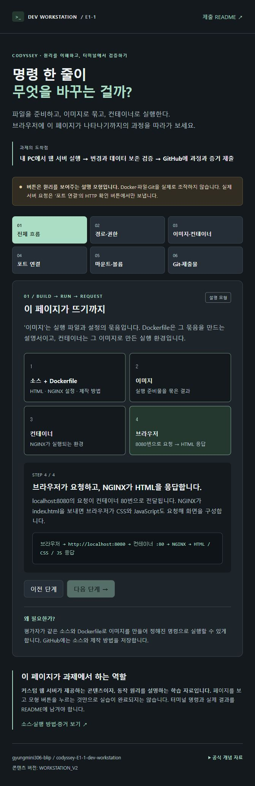

# 08. E1-1 원리 학습 페이지 V2

> 이후 첫 화면을 간단한 페이지로 바꾸고, 이 원리 설명은 `/principles.html`로 옮겼다. 현재 화면과 실행 기록은 [09. 간단한 페이지](09-simple-page.md)를 참고한다. 아래는 V2 제작 당시의 기록이다.

검증일: 2026-11-02 (Asia/Seoul). 사용자의 요청에 따라 소개 페이지를 여섯 가지 동작 원리를 탐색하는 학습 페이지로 변경했다. 아래 실제 검증은 보조 도구가 PC에서 수행한 결과다.

## 과제와의 관계

이 페이지는 NGINX 이미지에 정적 콘텐츠와 설정을 추가하는 과제 방식 A에 해당하는 콘텐츠다. 과제는 페이지 디자인이나 모형 조작만으로 완료되지 않으며 README에서 실제 수행 명령과 출력, 접속 화면, 마운트·볼륨 증거와 Git/VS Code 연동 등을 확인할 수 있어야 한다.

페이지의 여섯 영역은 전체 실행 흐름, 경로·권한, 이미지·컨테이너 수명, 포트 연결, 마운트·볼륨, Git·제출물이다. 각 영역에 원리와 실제 실습에서 필요한 증거를 안내했다. 아직 수행하지 않은 권한·마운트·볼륨 실습은 미완료 상태로 유지한다.

## 설명 모형과 실제 동작 구분

- 모형 버튼은 브라우저의 화면 상태만 변경한다. 실제 Docker 명령, 파일 변경, 컨테이너 삭제, 볼륨 삭제, Git 커밋·푸시를 수행하지 않는다.
- 포트 영역의 서버 응답 확인만 현재 페이지와 같은 서버의 `/healthz`에 실제 HTTP GET 요청을 보낸다. 이는 Docker 엔진 상태 전체를 조회하는 기능이 아니다.
- 페이지의 실습 기록 안내는 2026-11-02에 문서로 확인한 항목을 표시한다. 실시간 진행률이 아니다.

## COPY의 변경 반영 실제 관찰

호스트 소스를 V2로 수정한 직후에도 V1 컨테이너는 이전 내용을 응답했다.

```powershell
PS> curl.exe -s --max-time 10 http://localhost:8080/ | Select-String 'WORKSTATION_V1'
    <p class="marker" id="mount-marker">콘텐츠 버전: WORKSTATION_V1</p>

PS> Select-String -LiteralPath app/index.html -Pattern 'WORKSTATION_V2'
[호스트 HTML에서 WORKSTATION_V2가 포함된 줄 확인, 긴 줄은 생략]
```

이 컨테이너는 바인드 마운트가 없으며 빌드 시 COPY한 파일을 사용한다. 호스트 파일 수정이 기존 이미지·컨테이너에 자동 반영되지 않음을 관찰했다. 이후 새 이미지를 빌드하고 컨테이너를 재생성했다. 이는 바인드 마운트 실습 성공 증거와는 별개다.

## 실제 빌드와 서버 교체

아래 Docker 명령은 실제 실행 시 설치된 Docker CLI의 절대 경로로 호출했고, 읽기 쉽게 docker로 표기했다.

```powershell
PS> docker build --progress=plain -t codyssey-workstation:2.0 .
[중간 출력 생략]
#8 [3/3] COPY app/ /usr/share/nginx/html/
#8 DONE 0.0s
#9 naming to docker.io/library/codyssey-workstation:2.0 done
#9 DONE 0.1s

PS> docker rename codyssey-web codyssey-web-v1
PS> docker stop codyssey-web-v1
codyssey-web-v1
PS> docker run -d --name codyssey-web -p 127.0.0.1:8080:80 codyssey-workstation:2.0
73861d498b87bcb0db05aebddb51620700cc0b8aa1b9c86f4419e643dd8392d3
```

권한 예시에 600/700 → 644/755 전후 비교 절차를 보완한 뒤 같은 2.0 태그로 다시 빌드했다. 이번에 생성한 미리보기 컨테이너의 ID와 연결된 마운트가 0개임을 확인한 뒤 해당 컨테이너만 재생성했다. 기존 V1 컨테이너는 중지 상태로 보존했다.

```powershell
PS> docker stop codyssey-web
codyssey-web
PS> docker rm codyssey-web
codyssey-web
PS> docker run -d --name codyssey-web -p 127.0.0.1:8080:80 codyssey-workstation:2.0
0ce27da15275b1a036b308ed03bad5dc99b2edc70649544a555359226d30b2c7

PS> docker image inspect codyssey-workstation:2.0 --format '{{.Id}}'
sha256:8c59d743332c77cb67bc5054a5a76630b8c1e4ecbfc275023773c8712b4da7a6
```

[최종 V2 빌드의 실제 전체 출력](web-build-v2.log). 베이스는 V1과 동일한 `nginx:stable-alpine@sha256:0e52bd054126cdc040b1276c0af347aeb02a41b9cfe305d6094767ac30e97949`였다. 기존 V1 빌드·실행 로그는 [07](07-web-server.md)에 당시 기록으로 보존한다.

## 브라우저 기능 확인

실제 브라우저에서 버튼과 입력을 조작해 다음 결과를 확인했다. 이 표의 모형 검증은 실제 권한 변경이나 볼륨 영속성 실습을 대신하지 않는다.

| 확인 항목 | 관찰 결과 |
|---|---|
| 실행 단계 | 다음 단계를 눌러 이미지 제작 → 컨테이너 실행 → 브라우저 요청·응답 설명과 명령이 변경됨 |
| 상대 경로 | 현재 위치를 /root/e1-1로 바꾸면 etc/os-release가 /root/e1-1/etc/os-release로 해석됨 |
| 권한 계산 | 디렉토리 755 프리셋은 rwxr-xr-x, 소유자 실행 해제 시 655 / rw-r-xr-x |
| 컨테이너 수명 | 빌드·실행·중지·재시작·삭제 순서가 동작하며, 컨테이너 삭제 후 이미지 상태는 남음 |
| 포트 모형 | 컨테이너 쪽 8080 선택과 연결 해제 시 요청 실패 원인이 표시됨 |
| 실제 HTTP 확인 | HTTP 200 · ok를 실제 응답으로 표시 |
| COPY 모형 | 호스트 문구 수정만으로 표시 내용이 바뀌지 않고 재빌드·재생성 버튼 후 바뀜 |
| bind 모형 | 호스트 문구 수정 시 연결된 내용이 바뀜 |
| 볼륨 모형 | 쓰기 → 컨테이너 삭제 → 같은 볼륨으로 재생성 후 내부는 비고 볼륨 내용은 남음 |
| Git 모형 | 수정 → add → commit → push에 따라 단계별 의미가 바뀜 |
| 브라우저 오류 | 확인 시 오류 로그 없음 |
| 화면 폭 | 검증 당시 viewport 671px와 document content 671px로 가로 넘침 없음 |

HTML/CSS/JavaScript 응답을 로컬 소스의 SHA-256과 비교해 모두 HTTP 200 및 일치를 확인했다. JavaScript 구문 검사 `node --check app/app.js`도 통과했다.

최종 제공 파일의 응답과 해시 비교 결과:

```text
index.html HTTP 200 MATCH
styles.css HTTP 200 MATCH
app.js HTTP 200 MATCH
```

```powershell
PS> docker inspect codyssey-web --format '{{.Config.Image}} | {{.State.Health.Status}} | mounts={{len .Mounts}}'
codyssey-workstation:2.0 | healthy | mounts=0

PS> docker ps -a --filter name=codyssey-web --format '{{.Names}} | {{.Image}} | {{.Status}} | {{.Ports}}'
codyssey-web | codyssey-workstation:2.0 | Up About a minute (healthy) | 127.0.0.1:8080->80/tcp
codyssey-web-v1 | codyssey-workstation:1.0 | Exited (0) 8 minutes ago |
```



이 캡처는 브라우저 콘텐츠만 포함한다. 과제의 주소창 포함 증거는 별도 수집 대상이다.

## 개념 확인에 사용한 공식 자료

- [Docker 이미지](https://docs.docker.com/get-started/docker-concepts/the-basics/what-is-an-image/)
- [포트 게시](https://docs.docker.com/get-started/docker-concepts/running-containers/publishing-ports/)
- [바인드 마운트](https://docs.docker.com/engine/storage/bind-mounts/)
- [볼륨](https://docs.docker.com/engine/storage/volumes/)
- [Git 변경 기록](https://git-scm.com/book/en/v2/Git-Basics-Recording-Changes-to-the-Repository)
