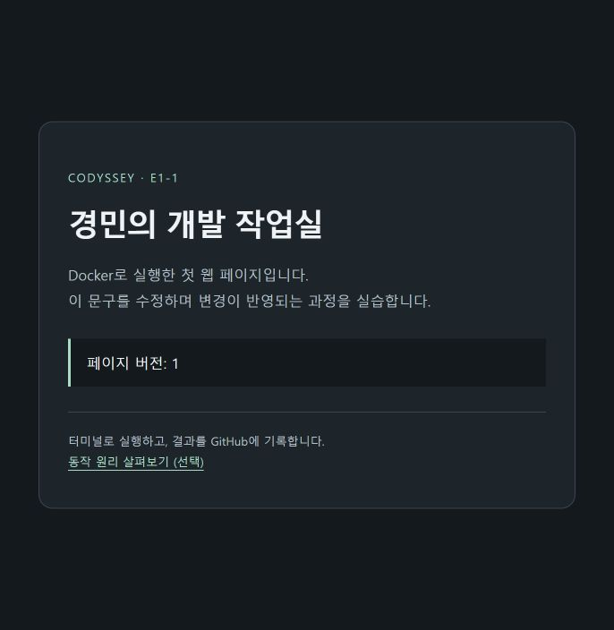

# 09. 간단한 실습 페이지 V3

검증일: 2026-11-02 (Asia/Seoul). 사용자 요청에 따라 첫 화면을 제목·소개·페이지 버전만 있는 간단한 HTML로 변경했다. 앞으로 실제 파일 수정과 바인드 마운트 실습에 사용할 출발점이다. 보조 도구가 실제 수행한 결과를 기록한다.

기존 대화형 원리 자료는 `app/principles.html`로 보존했으며 첫 화면의 선택 링크로 접근한다. 홈페이지 자체는 JavaScript 없이 동작한다. 권한·바인드 마운트·볼륨 영속성은 아직 실습 완료로 표시하지 않는다.

## 실제 빌드 및 컨테이너 실행

설치된 Docker CLI를 절대 경로로 호출했고, 아래에서는 docker로 축약 표기했다. 교체 대상 컨테이너 ID와 mounts=0을 확인한 뒤 이번 실습 서버만 재생성했다.

```powershell
PS> docker build --progress=plain -t codyssey-workstation:3.0 .
[중간 출력 생략]
#9 naming to docker.io/library/codyssey-workstation:3.0 done
#9 DONE 0.4s

PS> docker stop codyssey-web
codyssey-web
PS> docker rm codyssey-web
codyssey-web
PS> docker run -d --name codyssey-web -p 127.0.0.1:8080:80 codyssey-workstation:3.0
998efe0a81d8a473cf0c2351b397e3d45a50b4dd955fce544c32f594b84ae1ec

PS> curl.exe -s --max-time 10 http://localhost:8080/healthz
ok
```

[전체 빌드 출력](web-build-v3.log). 빌드 출력에 기록된 최종 이미지 manifest list는 `sha256:7ec0b8a7ebd6493f2d915f10b63b4216650d11957545c378407b5f72433d87aa`다.

## HTTP 및 브라우저 확인

검증 도구로 응답 바이트와 호스트 소스를 비교했다.

```text
index.html HTTP 200 MATCH
principles.html HTTP 200 MATCH
```

브라우저를 새로고침해 제목 ‘경민의 개발 작업실’, 소개, ‘페이지 버전: 1’, 원리 자료 선택 링크를 확인했다. 콘텐츠의 버전 1은 앞으로 문구 변경 실습에 사용할 표시이며 Docker 이미지의 태그 3.0과는 별개다.



이 이미지는 콘텐츠 캡처다. 과제의 주소창 포함 접속 증거는 별도로 수집해야 한다.
