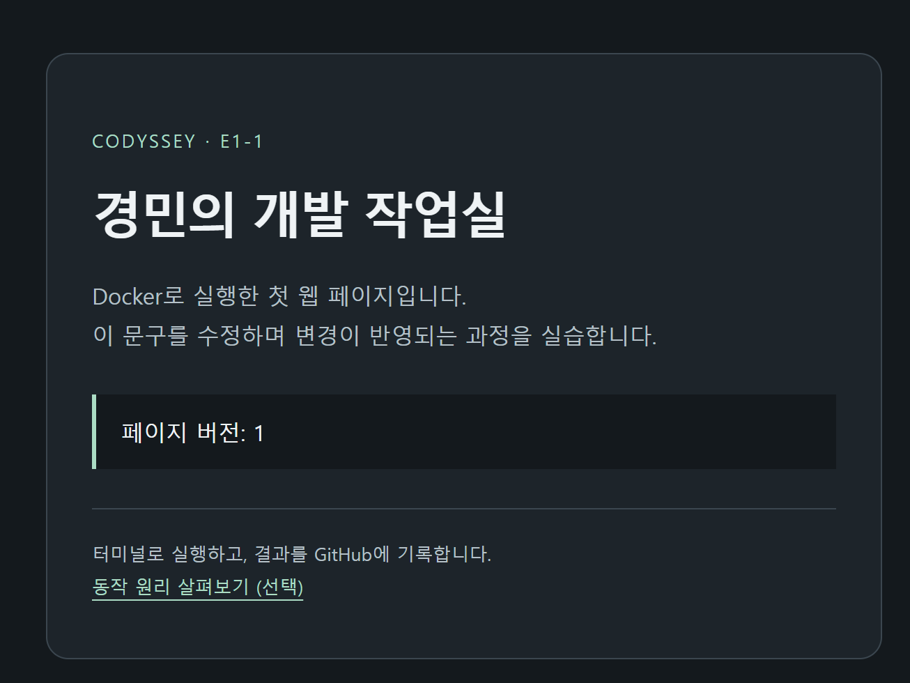

# 11. 사용자 직접 빌드·파일 수정 반영 실습

실습일: 2026-11-03 (Asia/Seoul). 사용자가 직접 실행해 제공한 실제 명령과 출력이다. 반복되는 Windows 개인 경로·프롬프트는 줄였고, 긴 줄의 화면 줄바꿈은 읽기 쉽게 정리했다. 보조 도구는 받은 결과를 문서화했다.

## 11-A. Dockerfile과 현재 소스 확인

PowerShell에서 기존 로컬 저장소 루트로 이동한 뒤 실행했다. 이 PC의 폴더명은 dev-workstation-lab_Codyssey11이며, 원격 저장소 이름과 다르다.

```powershell
PS> Get-Content .\Dockerfile
FROM nginx:stable-alpine

LABEL org.opencontainers.image.title="Codyssey E1-1 Workstation Lab"
LABEL org.opencontainers.image.description="A personal development workstation practice server"

COPY nginx.conf /etc/nginx/conf.d/default.conf
COPY app/ /usr/share/nginx/html/

EXPOSE 80
HEALTHCHECK --interval=10s --timeout=3s --start-period=5s --retries=3 \
    CMD wget -q -O /dev/null http://127.0.0.1/healthz || exit 1

PS> Select-String -LiteralPath .\app\index.html -Pattern 'SIMPLE_PAGE'
app\index.html:27:    <p class="version" id="mount-marker" data-version="SIMPLE_PAGE_V1">페이지 버전: 1</p>
```

V1 HTML을 빌드 재료로 사용했음을 확인했다. 이 조회는 호스트 파일 내용 확인이며, 아직 바인드 마운트 검증 결과는 아니다.

## 11-B. 사용자 직접 이미지 빌드

```powershell
PS> docker build --progress=plain -t codyssey-workstation:student-1 .
[중간 출력 생략, 전체 출력은 아래 로그 링크 참고]
#7 [2/3] COPY nginx.conf /etc/nginx/conf.d/default.conf
#7 CACHED
#8 [3/3] COPY app/ /usr/share/nginx/html/
#8 CACHED
#9 naming to docker.io/library/codyssey-workstation:student-1 done
#9 unpacking to docker.io/library/codyssey-workstation:student-1 done
#9 DONE 0.1s
```

[사용자 제공 실제 빌드 전체 출력](user-student-build.log).

- 베이스 이미지: nginx:stable-alpine, digest `sha256:0e52bd054126cdc040b1276c0af347aeb02a41b9cfe305d6094767ac30e97949`.
- 결과 태그: codyssey-workstation:student-1.
- 실제 빌드 출력의 manifest list: `sha256:03847c26e8e83398a7c3f265fefa6a22a0a1f8353a4da63fdd059baf00134f30`.
- CACHED는 같은 입력의 이전 빌드 결과를 재사용했음을 뜻한다. 오류가 아니다. 최종 태그 지정과 내보내기 완료를 확인했다.

## 11-C. COPY/bind 컨테이너 생성과 입력 오류 해결

다음은 사용자 제공 명령과 핵심 출력의 발췌다. 오류 뒤 Docker가 표시한 일반 도움말은 생략했다.

```powershell
PS> docker run -d --name e1-1-copy-guide -p 127.0.0.1:8082:80 codyssey-workstation:student-1
5e144b9a442f062a6bc7e4a0130863bb85866f327bc17a38ea88642c5c038665

PS> $appPath = (Resolve-Path .\app).Path
PS> docker run -d --name e1-1-bind-guide -p 127.0.0.1:8081:80 ==mount
docker: invalid reference format

PS> docker run -d --name e1-1-bind-guide -p 127.0.0.1:8081:80 --mount
flag needs an argument: --mount

PS> "type=bind,source=$appPath,target=/usr/share/nginx/html,readonly" codyssey-workstation:student-1
식 또는 문에서 예기치 않은 'codyssey-workstation:student-1' 토큰입니다.
[ParserError / UnexpectedToken: 위치 표시 등 중간 출력 생략]

PS> $appPath = (Resolve-Path .\app).Path
PS> docker run -d --name e1-1-bind-guide -p 127.0.0.1:8081:80 --mount "type=bind,source=$appPath,target=/usr/share/nginx/html,readonly" codyssey-workstation:student-1
9fdf6ee013be8740e6d2e557f52e9ece75de503524217568cef9416bb83ff45d

PS> docker ps --filter name=guide
CONTAINER ID   IMAGE                            COMMAND                   CREATED              STATUS                        PORTS                    NAMES
9fdf6ee013be   codyssey-workstation:student-1   "/docker-entrypoint.…"   15 seconds ago       Up 14 seconds (healthy)       127.0.0.1:8081->80/tcp   e1-1-bind-guide
5e144b9a442f   codyssey-workstation:student-1   "/docker-entrypoint.…"   About a minute ago   Up About a minute (healthy)   127.0.0.1:8082->80/tcp   e1-1-copy-guide
```

--mount 철자와 인자 누락, 명령을 두 번으로 나눠 입력한 오류를 거쳐 전체 명령을 한 번에 입력해 해결했다. 최종 실행에서는 두 서버 모두 healthy이며, 각각 8081/8082 포트가 컨테이너의 80으로 연결되었다.

## 11-D. 수정 전 응답과 한글 표시 문제

사용자 직접 실행한 결과다. 깨진 문자는 당시 출력을 그대로 기록했고, 화면 줄바꿈은 정리했다.

```powershell
PS> curl.exe -s --max-time 10 http://localhost:8081/ | Select-String 'SIMPLE_PAGE'
    <p class="version" id="mount-marker" data-version="SIMPLE_PAGE_V1">
?섏씠吏 踰꾩쟾: 1</p>

PS> curl.exe -s --max-time 10 http://localhost:8082/ | Select-String 'SIMPLE_PAGE'
    <p class="version" id="mount-marker" data-version="SIMPLE_PAGE_V1">
?섏씠吏 踰꾩쟾: 1</p>
```

두 응답 모두 ASCII 식별자 SIMPLE_PAGE_V1을 확인했다. 아직 호스트 파일을 수정하지 않은 기준 결과다.

보조 도구가 원본 HTTP 바이트를 별도로 UTF-8로 읽고 호스트 파일과 비교한 실제 결과:

```text
8081: HTTP 200; UTF-8 decode OK; source matches=True
<p class="version" id="mount-marker" data-version="SIMPLE_PAGE_V1">페이지 버전: 1</p>
8082: HTTP 200; UTF-8 decode OK; source matches=True
<p class="version" id="mount-marker" data-version="SIMPLE_PAGE_V1">페이지 버전: 1</p>
```

HTML 원본과 서버 응답의 UTF-8 내용은 정상이다. 사용자 PowerShell의 외부 명령 출력 해석 과정에서 인코딩이 맞지 않는 것으로 판단했다. 별도의 Windows PowerShell에서 `[Console]::OutputEncoding = [System.Text.Encoding]::UTF8`을 적용한 뒤 같은 curl 파이프라인을 실행해 한글이 정상 표시됨을 확인했다. 이는 보조 도구의 검증이며 사용자 세션에 적용한 결과는 아직 받지 않았다.

## 11-E. 사용자 세션의 출력 설정 수정 및 HTML 편집

사용자가 제공한 실제 명령과 핵심 출력이다. 설정 명령 뒤에 다음 명령 이름 code를 붙여 입력한 첫 시도는 실패했고, 두 명령을 나눠 입력해 해결했다.

```powershell
PS> [Console]::OutputEncoding = [System.Text.Encoding]::UTF8code
"OutputEncoding"을(를) 설정하는 동안 예외가 발생했습니다. "값은 null일 수 없습니다.
매개 변수 이름: value"
[위치 표시 및 부가 예외 정보 생략]

PS> [Console]::OutputEncoding = [System.Text.Encoding]::UTF8
PS> code .\app\index.html
```

보조 도구가 저장소의 실제 git diff로 확인한 사용자 수정은 다음 한 줄이다. 파일을 새로 덮어쓰거나 대신 수정하지 않았다.

```diff
-    <p class="version" id="mount-marker" data-version="SIMPLE_PAGE_V1">페이지 버전: 1</p>
+    <p class="version" id="mount-marker" data-version="SIMPLE_PAGE_V2">페이지 버전: 2</p>
```

## 11-F. 재빌드·컨테이너 재생성 없이 수정 후 비교 성공

사용자가 이어서 실행해 제공한 결과다. 화면의 긴 줄 줄바꿈은 정리했다.

```powershell
PS> curl.exe -s --max-time 10 http://localhost:8081/ | Select-String 'SIMPLE_PAGE'
    <p class="version" id="mount-marker" data-version="SIMPLE_PAGE_V2">
페이지 버전: 2</p>

PS> curl.exe -s --max-time 10 http://localhost:8082/ | Select-String 'SIMPLE_PAGE'
    <p class="version" id="mount-marker" data-version="SIMPLE_PAGE_V1">
페이지 버전: 1</p>
```

| 비교 대상 | 수정 전 | 호스트 HTML만 수정한 뒤 | 관찰 |
|---|---|---|---|
| 8081 / e1-1-bind-guide | SIMPLE_PAGE_V1 | SIMPLE_PAGE_V2 | 연결된 호스트 폴더의 수정 내용이 반영됨 |
| 8082 / e1-1-copy-guide | SIMPLE_PAGE_V1 | SIMPLE_PAGE_V1 | 기존 이미지에 COPY된 내용이 유지됨 |

두 응답에서 한글도 정상 표시되어 사용자 PowerShell의 출력 설정 수정 결과까지 확인했다. 이 비교 과정의 사용자 기록에는 재빌드·컨테이너 재생성 명령이 없고, 기존 두 서버의 응답 차이로 파일 수정 반영을 검증했다.

## 사용자 제공 화면



첨부 이미지는 페이지 버전 1의 콘텐츠를 보여준다. 주소창이 없어 포트나 해당 컨테이너를 특정할 수 없다. 8081/8082의 실제 비교 근거는 위 명령과 출력이다. 이후 사용자가 제출한 [주소창 포함 비교 캡처](15-browser.md)에는 8080의 기존 COPY 서버와 8081의 바인드 서버가 보인다.

## 현재 수행 상태

사용자 직접 이미지 빌드, 두 서버 실행, 수정 전 V1/V1 조회, 호스트 HTML 수정, 수정 후 V2/V1 비교와 한글 정상 표시를 확인했다. 바인드 마운트 변경 반영은 실제 로그로 검증했다. 이후 [브라우저 캡처](15-browser.md)와 [볼륨 영속성 실습](12-user-volume.md)도 완료했다.

이 단계의 문서화 시에는 수정한 app/index.html을 사용자 작업 트리에 남기고 증거 문서만 커밋했다. 이후 사용자가 d580e49 커밋으로 HTML 수정본을 직접 커밋·푸시했으며, 실제 결과는 [14-D](14-user-git.md#14-d-사용자-직접-html-수정본-검토스테이징커밋푸시)에 기록했다.
