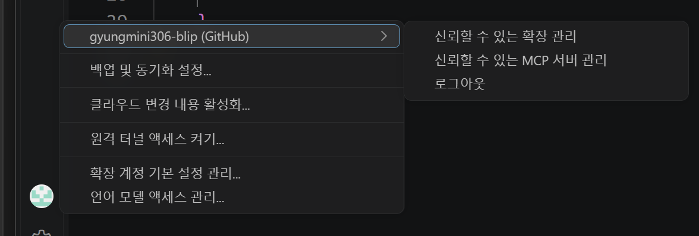

# 14. 사용자 직접 Git 설정·VS Code 연동·최종 제출 확인

실습일: 2026-11-03 (Asia/Seoul). 사용자가 제공한 실제 출력과 화면을 정리했다. 개인 PC 경로는 생략하고, 반복된 pager 도움말은 핵심 부분만 발췌했다.

## 14-A. Git 버전 및 저장소별 설정

이번 출력의 셸은 명령 프롬프트(CMD)다. 이전 Docker 실습의 Windows PowerShell과 구분한다.

```text
Microsoft Windows [Version 10.0.26200.9711]
```

```console
CMD> git --version
git version 2.52.0.windows.1
CMD> git config --local --list
core.repositoryformatversion=0
core.filemode=false
core.bare=false
core.logallrefupdates=true
core.symlinks=false
core.ignorecase=true
core.autocrlf=input
remote.origin.url=https://github.com/gyungmini306-blip/codyssey-E1-1-dev-workstation.git
remote.origin.fetch=+refs/heads/*:refs/remotes/origin/*
branch.main.remote=origin
branch.main.merge=refs/heads/main
init.defaultbranch=main
user.email=gyungmini306-blip@users.noreply.github.com
user.name=gyungmini306-blip
credential.https://github.com.username=gyungmini306-blip
```

계정·커밋 이메일·기본 브랜치 설정·원격 저장소 설정을 실제 출력에서 확인했다. 기본 브랜치 설정과 현재 체크아웃된 브랜치는 구분하므로, 현재 브랜치는 별도 명령으로 다시 조회한다.

## 14-B. less 보기 화면에서 후속 명령 입력

설정 출력 뒤 다음과 같은 내용이 반복됐다.

```text
...skipping...
                   SUMMARY OF LESS COMMANDS
  q  :q  Q  :Q  ZZ     Exit.
[중간 도움말 반복 생략]
log file: ionTable.PSVersion.ToString()
```

출력을 보여주는 less가 열려 있는 상태에서 후속 셸 명령의 키 입력이 전달되어 도움말·로그 파일 입력 화면으로 이동한 것으로 판단했다. 이 기록에서 git branch, remote, status 및 PowerShell 버전 조회의 실제 실행 결과는 확인되지 않는다.

보조 도구는 tatus --short라는 미추적 파일을 발견하고, 내용을 확인해 less 도움말 로그임을 식별했다. 원본을 삭제하지 않고 Git에서 제외되는 work/less-help-log-20261103.txt로 이동해 보관했다. 이 보관 로그는 공개 증거 파일로 추가하지 않는다.

복구 안내는 현재 파일 이름 입력을 Ctrl+C로 취소하고 q로 보기 화면을 종료한 뒤, CMD라면 powershell -NoProfile로 PowerShell을 여는 것이다. 이후 git --no-pager로 남은 명령을 조회한다. 사용자 재조회 성공은 아래 14-C에서 확인했다. Ctrl+C/q 키 입력 자체의 화면 기록은 별도로 제공되지 않아 실제 입력 로그로 덧붙이지 않았다.

참고: [Git --no-pager 공식 설명](https://git-scm.com/docs/git#Documentation/git.txt---no-pager).

## 14-C. PowerShell에서 현재 브랜치·원격·작업 상태 확인

사용자가 이어서 제공한 실제 명령과 출력이다. Windows 개인 경로는 생략했다.

```powershell
PS> powershell -NoProfile
Windows PowerShell
Copyright (C) Microsoft Corporation. All rights reserved.

PS> git --no-pager branch --show-current
main
PS> git --no-pager remote -v
origin  https://github.com/gyungmini306-blip/codyssey-E1-1-dev-workstation.git (fetch)
origin  https://github.com/gyungmini306-blip/codyssey-E1-1-dev-workstation.git (push)
PS> git --no-pager status --short
 M app/index.html
PS> $PSVersionTable.PSVersion.ToString()
5.1.26100.9711
```

### 관찰

- main 브랜치를 사용하고, fetch/push가 모두 최종 제출 저장소를 가리킨다.
- 상태의 M은 사용자 HTML 수정이 작업 트리에 있고 아직 스테이징되지 않았음을 뜻한다.
- 사용자 Windows PowerShell의 실제 버전은 5.1.26100.9711이다.
- --no-pager 조회에서는 less 화면에 머무르지 않고 각 명령의 출력과 다음 명령을 확인했다.

## 14-D. 사용자 직접 HTML 수정본 검토·스테이징·커밋·푸시

사용자가 실제 실행한 결과다. 동일 diff를 두 번 조회한 기록은 한 번으로 줄였고, HTML 변경 내용은 [11-E의 실제 diff](11-user-bind.md#11-e-사용자-세션의-출력-설정-수정-및-html-편집)와 같다.

```powershell
PS> git --no-pager diff -- app/index.html
warning: in the working copy of 'app/index.html', CRLF will be replaced by LF the next time Git touches it
[V1 → V2 한 줄 변경의 diff 본문 생략: 위 링크 참고]

PS> git add app/index.html
warning: in the working copy of 'app/index.html', CRLF will be replaced by LF the next time Git touches it
PS> git --no-pager diff --cached --stat
 app/index.html | 2 +-
 1 file changed, 1 insertion(+), 1 deletion(-)
PS> git commit -m "Update practice page to version 2"
[main d580e49] Update practice page to version 2
 1 file changed, 1 insertion(+), 1 deletion(-)
PS> git push
Enumerating objects: 7, done.
Counting objects: 100% (7/7), done.
Delta compression using up to 8 threads
Compressing objects: 100% (4/4), done.
Writing objects: 100% (4/4), 386 bytes | 386.00 KiB/s, done.
Total 4 (delta 3), reused 0 (delta 0), pack-reused 0 (from 0)
remote: Resolving deltas: 100% (3/3), completed with 3 local objects.
To https://github.com/gyungmini306-blip/codyssey-E1-1-dev-workstation.git
   58c49d9..d580e49  main -> main
PS> git status --short --branch
## main...origin/main
```

### 관찰

- diff에서 버전 식별자와 화면 문구의 V1→V2 변경을 검토했다.
- add로 해당 파일을 선택하고 d580e49 커밋을 만들었다.
- push 결과에서 원격 main이 d580e49로 갱신됐고, 최종 상태에는 작업 트리 수정 표시가 없다.
- CRLF→LF는 저장소의 텍스트 줄바꿈 정규화 안내다. 이후 커밋·푸시가 실제 성공했으며 해당 안내는 실패 오류가 아니다.
- d580e49는 사용자 본인이 직접 만든 실습 커밋이다. 이후 증거 문서 갱신 커밋과 구별해 기록한다.

## 현재 수행 상태

사용자 직접 Git 설정 확인, 변경 검토, 스테이징, 로컬 커밋, 원격 푸시와 깨끗한 작업 상태를 확인했다. [주소창 포함 브라우저 캡처](15-browser.md)도 수집했다.

## 14-E. VS Code GitHub 계정 연결 확인

사용자가 PowerShell에서 아래 명령을 실행해 GitHub Pull Requests 확장 v0.174.0을 설치했다.

```powershell
code --install-extension GitHub.vscode-pull-request-github
```

사용자가 제공한 설치 완료 출력이다.

```text
Extension 'github.vscode-pull-request-github' v0.174.0 was successfully installed.
```

로그인 후 VS Code 계정 메뉴에 `gyungmini306-blip (GitHub)`과 로그아웃 항목이 표시됐다. 계정 이름은 과제 저장소 소유자와 일치한다.


