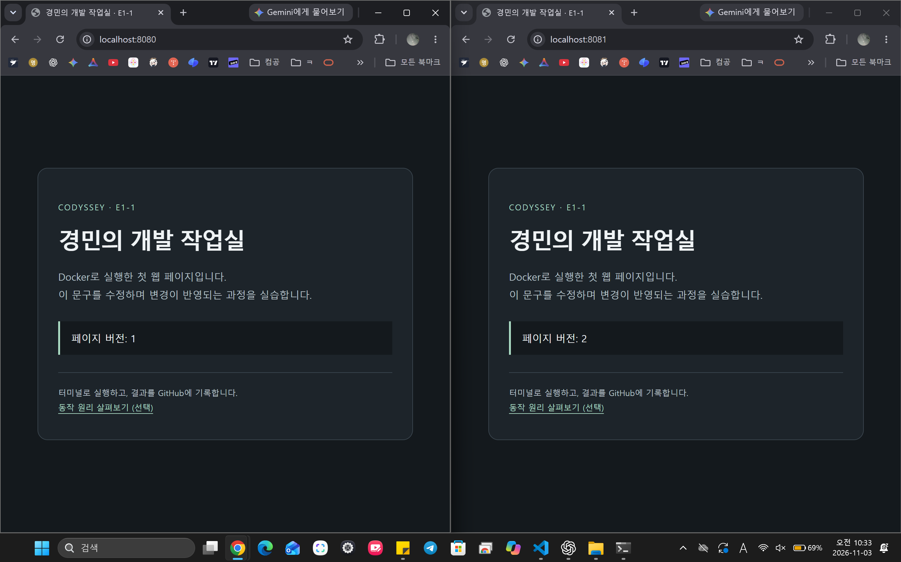

# 15. 사용자 직접 브라우저 접속 증거

2026-11-03 사용자가 제공한 원본 캡처다. 두 Chrome 창의 주소창과 실제 페이지 버전이 함께 보인다.

| 화면 | 접속 주소 | 기존 실행 기록에 따른 서버 | 화면 결과 |
|---|---|---|---|
| 왼쪽 | http://localhost:8080/ | codyssey-web / codyssey-workstation:3.0 / 이미지에 COPY한 파일 | 페이지 버전: 1 |
| 오른쪽 | http://localhost:8081/ | e1-1-bind-guide / codyssey-workstation:student-1 / 호스트 app 폴더 바인드 마운트 | 페이지 버전: 2 |

브라우저 캡처 자체가 보여주는 사실은 주소와 페이지 내용이다. 위 컨테이너 이름·이미지·마운트 방식은 기존 실행 명령 및 컨테이너 목록 기록과 연결한 설명이다.

호스트 HTML을 V2로 수정한 결과가 8081에서 보이며, 기존 이미지에 포함된 V1을 제공하는 8080과 차이가 난다. 이 캡처의 왼쪽 포트는 **8080**이다. 같은 student-1 이미지로 실행한 COPY 서버 **8082**와 바인드 서버 **8081**의 비교는 [11-F의 실제 HTTP 출력](11-user-bind.md#11-f-재빌드컨테이너-재생성-없이-수정-후-비교-성공)으로 별도 확인했다.

이 결과로 주소창을 포함한 브라우저 접속 증거 항목을 완료했다. VS Code GitHub 연동은 [별도 진행 기록](14-user-git.md)에서 관리한다.
