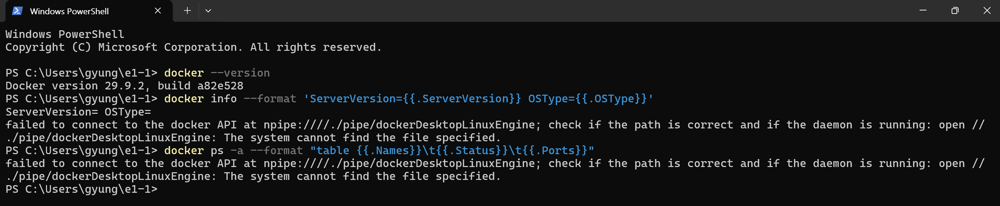
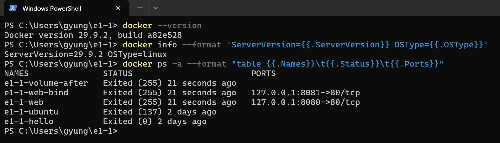

# Docker 엔진 연결 실패와 복구

사용자가 제공한 두 PowerShell 캡처에 근거한 기록입니다. PowerShell의 개인 경로는 아래 텍스트 발췌에서 생략했습니다. Docker Desktop 시작은 보조 도구가 수행했고, 시작 전후 조회는 사용자가 직접 실행했습니다.

## 시작 전



```console
PS> docker --version
Docker version 29.9.2, build a82e528
PS> docker info --format 'ServerVersion={{.ServerVersion}} OSType={{.OSType}}'
ServerVersion= OSType=
```

위 명령과 이어 실행한 docker ps에서 dockerDesktopLinuxEngine 파이프를 찾지 못했다는 오류가 표시됐습니다.

## Docker Desktop 시작 후



```console
PS> docker info --format 'ServerVersion={{.ServerVersion}} OSType={{.OSType}}'
ServerVersion=29.9.2 OSType=linux
```

docker ps -a에서도 컨테이너 목록이 표시됐습니다. 이때 웹 서버는 Exited 상태였으므로, 이 화면은 엔진 연결 성공과 목록 조회의 증거입니다.
