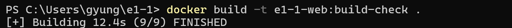
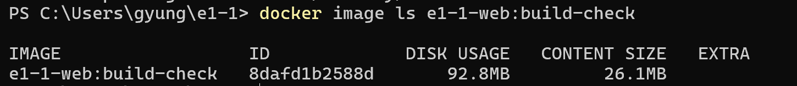

# 사용자 이미지 빌드 실행결과

사용자가 제공한 [빌드 전체 캡처](images/06-ref-02-user-build-full.png)에서 명령과 핵심 결과를 옮겼습니다. 다운로드 진행률·긴 해시·중간 단계 출력은 생략했습니다.



```text
PS> docker build -t e1-1-web:build-check .
[+] Building 12.4s (9/9) FINISHED
```



```text
PS> docker image ls e1-1-web:build-check
IMAGE                  ID             DISK USAGE   CONTENT SIZE
e1-1-web:build-check    8dafd1b2588d   92.8MB       26.1MB
```

빌드 완료 표시와 생성된 이미지 이름을 확인했습니다. `PS>`는 프롬프트이고 `FINISHED` 행은 실행 결과이므로, 재실행할 때는 명령 부분만 입력합니다.

## 추가 원본 기록

다운로드·해시를 포함한 기록은 [전체 캡처](images/06-ref-02-user-build-full.png)에 보관했습니다. 별도로 수행한 `codyssey-workstation:student-1` 빌드는 [실제 빌드 로그](11-user-bind.md#11-b-사용자-직접-이미지-빌드)와 [전체 출력](user-student-build.log)에서 확인할 수 있습니다.
