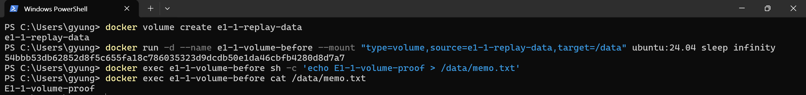

# 볼륨 생성·연결과 삭제 전 데이터 확인

사용자가 README와 같은 볼륨·컨테이너 이름으로 실습해 제공한 실제 캡처입니다.



## 명령과 실제 출력

프롬프트의 개인 경로와 긴 컨테이너 ID는 생략했습니다.

```text
PS> docker volume create e1-1-replay-data
e1-1-replay-data
PS> docker run -d --name e1-1-volume-before --mount "type=volume,source=e1-1-replay-data,target=/data" ubuntu:24.04 sleep infinity
[긴 컨테이너 ID 생략]
PS> docker exec e1-1-volume-before sh -c 'echo E1-1-volume-proof > /data/memo.txt'
PS> docker exec e1-1-volume-before cat /data/memo.txt
E1-1-volume-proof
```

이 캡처는 첫 컨테이너에서 메모를 기록·확인한 삭제 전 단계의 증거입니다. 볼륨은 `e1-1-replay-data`, 연결 위치는 `/data`, 저장한 파일은 `/data/memo.txt`입니다.
