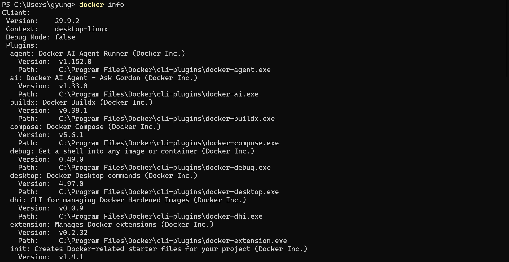
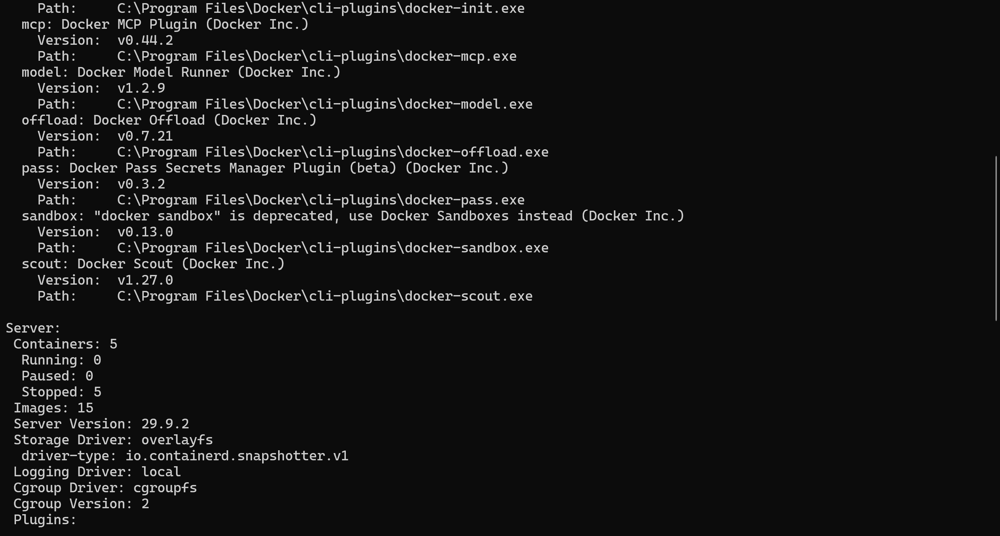
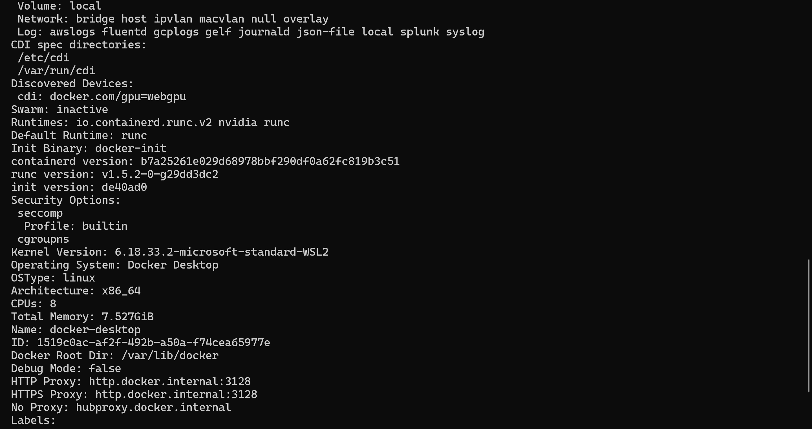
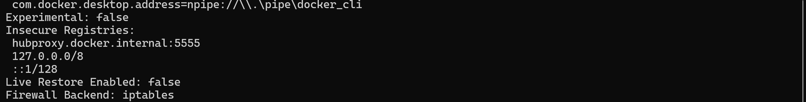

# docker info 실행결과

사용자가 다시 촬영한 캡처 네 장을 출력 순서대로 배치했습니다. 각 ‘원본 보기’ 링크에서 저장된 원본 크기로 확인할 수 있습니다.

## 1. 명령 입력과 클라이언트 정보



[원본 보기](35-docker-info-01.png)

## 2. 클라이언트 정보 계속 · Docker 엔진 정보



[원본 보기](35-docker-info-02.png)

## 3. Docker 엔진 정보 계속



[원본 보기](35-docker-info-03.png)

## 4. 출력 마지막 부분



[원본 보기](35-docker-info-04.png)

## 핵심 출력 발췌

아래는 위 캡처의 버전·실행 환경 항목만 옮긴 것입니다. 중간 플러그인 목록과 나머지 서버 설정은 생략했습니다.

```text
PS> docker info
Client:
 Version:    29.9.2
 Context:    desktop-linux
Server:
 Server Version: 29.9.2
 Operating System: Docker Desktop
 OSType: linux
```

서버 버전과 Linux 실행 환경이 출력돼 엔진 연결을 확인했습니다. 이 캡처에서는 컨테이너 5개가 모두 중지 상태였으므로, 웹 서버의 실행·접속 성공은 README 6절의 별도 증거에서 확인합니다.
