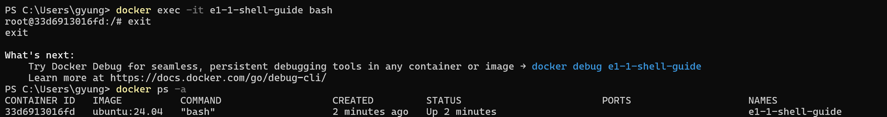

# exec의 추가 Bash 종료 후 컨테이너 유지

사용자가 PowerShell에서 실행해 제공한 캡처의 명령·출력을 옮겼습니다. 프롬프트의 개인 경로, Docker Debug 안내, 다른 컨테이너의 목록 행은 생략했습니다.



```text
PS> docker exec -it e1-1-shell-guide bash
root@33d6913016fd:/# exit
exit
PS> docker ps -a
CONTAINER ID   IMAGE          COMMAND   CREATED         STATUS         PORTS   NAMES
33d6913016fd   ubuntu:24.04   "bash"    2 minutes ago   Up 2 minutes           e1-1-shell-guide
```

`exit` 후에도 같은 컨테이너의 상태가 `Up`이었습니다. `exec`로 추가한 Bash는 종료됐지만 원래 주 프로세스인 Bash가 실행 중이어서 컨테이너가 유지됐습니다.

목록은 `docker ps -a`로 조회했으며, 캡처와 위 텍스트에서는 이번 실습 대상 행만 남겼습니다.
