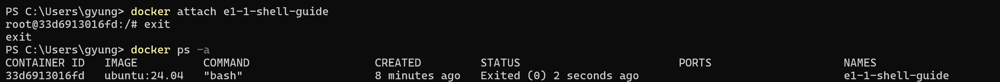

# attach의 주 Bash 종료 후 컨테이너 종료

사용자가 PowerShell에서 실행해 제공한 캡처의 명령·출력을 옮겼습니다. 프롬프트의 개인 경로와 다른 컨테이너 목록 행은 생략했습니다.



```text
PS> docker attach e1-1-shell-guide
root@33d6913016fd:/# exit
exit
PS> docker ps -a
CONTAINER ID   IMAGE          COMMAND   CREATED         STATUS                     PORTS   NAMES
33d6913016fd   ubuntu:24.04   "bash"    8 minutes ago   Exited (0) 2 seconds ago           e1-1-shell-guide
```

같은 ID의 컨테이너가 [exec 실습](36-user-exec.md)에서는 `Up`이었고, 이번에는 `Exited (0)`이었습니다. `attach`로 연결한 원래 주 프로세스인 Bash를 `exit`로 종료해 컨테이너도 정상 종료됐습니다.

목록은 `docker ps -a`로 조회했으며, 캡처와 위 텍스트에서는 이번 실습 대상 행만 남겼습니다.
