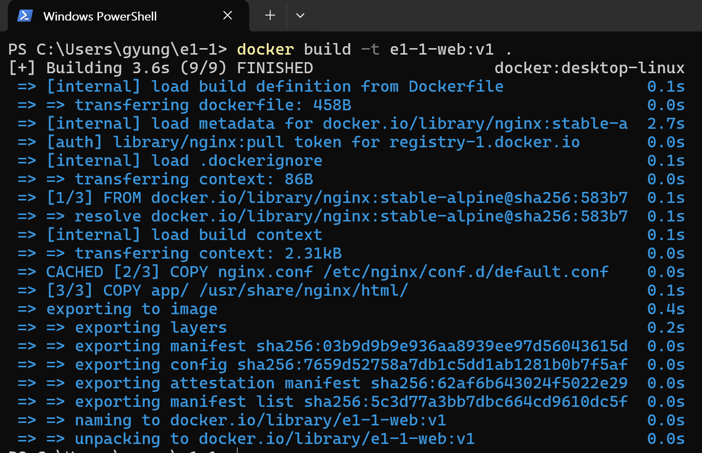

# e1-1-web:v1 이미지 빌드 실행결과

사용자가 제공한 실제 PowerShell 캡처입니다. 저장소 폴더 `C:\Users\gyung\e1-1`에서 README와 같은 이미지 이름·태그로 빌드했습니다.



[원본 이미지 보기](images/06-ref-03-user-v1-build.png)

## 핵심 명령·출력 발췌

```text
PS> docker build -t e1-1-web:v1 .
[+] Building 3.6s (9/9) FINISHED
 => [3/3] COPY app/ /usr/share/nginx/html/
 => => naming to docker.io/library/e1-1-web:v1
 => => unpacking to docker.io/library/e1-1-web:v1
```

진행률·긴 해시·중간 단계와 단계별 시간 열은 생략했습니다. `FINISHED`와 `e1-1-web:v1` 태그 지정·내보내기 결과로 이미지 빌드 완료를 확인했습니다.
