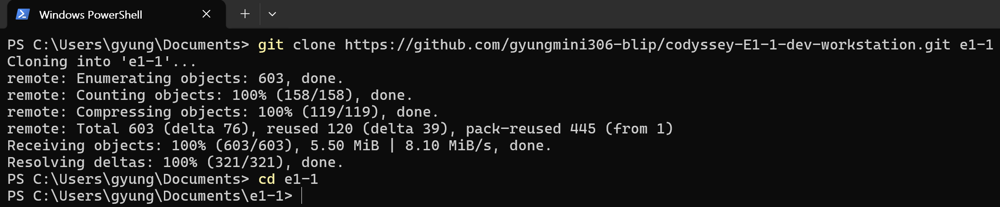

# 저장소 다운로드와 저장소 루트 이동

사용자가 `C:\Users\gyung\Documents`의 PowerShell에서 실행해 제공한 실제 캡처입니다.



[원본 이미지 보기](images/06-ref-04-user-clone.png)

## 실제 명령과 출력

프롬프트는 짧게 표기하고, 마지막 위치를 확인할 수 있는 프롬프트는 그대로 남겼습니다.

```text
PS> git clone https://github.com/gyungmini306-blip/codyssey-E1-1-dev-workstation.git e1-1
Cloning into 'e1-1'...
remote: Enumerating objects: 603, done.
remote: Counting objects: 100% (158/158), done.
remote: Compressing objects: 100% (119/119), done.
remote: Total 603 (delta 76), reused 120 (delta 39), pack-reused 445 (from 1)
Receiving objects: 100% (603/603), 5.50 MiB | 8.10 MiB/s, done.
Resolving deltas: 100% (321/321), done.
PS> cd e1-1
PS C:\Users\gyung\Documents\e1-1>
```

다운로드 완료 출력과 마지막 프롬프트를 통해 저장소를 받은 뒤 그 루트 폴더로 이동한 것을 확인했습니다. 이 캡처의 경로는 `Documents\e1-1`이며, 기존 웹 서버 실습 폴더인 `C:\Users\gyung\e1-1`과는 별도의 복제본입니다.
