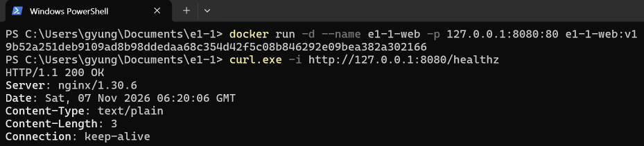

# 웹 서버 실행과 PC 포트 접속 확인

사용자가 `C:\Users\gyung\Documents\e1-1`의 PowerShell에서 실행해 제공한 실제 캡처입니다. 이미 빌드한 `e1-1-web:v1` 이미지로 컨테이너를 실행했습니다.



## 위 캡처의 명령과 응답

프롬프트의 개인 경로와 긴 컨테이너 ID는 생략했습니다.

```text
PS> docker run -d --name e1-1-web -p 127.0.0.1:8080:80 e1-1-web:v1
[긴 컨테이너 ID 생략]
PS> curl.exe -i http://127.0.0.1:8080/healthz
HTTP/1.1 200 OK
Server: nginx/1.30.6
Date: Sat, 07 Nov 2026 06:20:06 GMT
Content-Type: text/plain
Content-Length: 3
Connection: keep-alive
```

PC의 8080번으로 보낸 요청에 NGINX가 HTTP 200을 반환했습니다. 이 캡처에서는 응답 본문이 보이지 않으므로, 캡처에서 `ok`까지 확인했다고 기록하지 않았습니다.

## 기존 사용자 응답 기록 · 2026-11-04

아래는 사용자가 이전에 채팅으로 제공한 실제 출력의 발췌입니다. 위의 새 캡처와 구분하며, 상태·서버·본문을 남기고 나머지 헤더는 생략했습니다.

```text
PS> curl.exe -i http://127.0.0.1:8080/healthz
HTTP/1.1 200 OK
Server: nginx/1.30.6

ok
```
