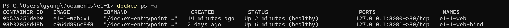

# 두 웹 서버의 포트 연결

사용자가 제공한 `docker ps -a` 캡처에서 명령·표 제목·두 웹 서버 행을 잘라 원래 순서대로 이어 붙였습니다. 다른 컨테이너 행만 제외했으며, 남긴 행의 이름·이미지·상태·포트 값은 바꾸지 않았습니다.



## 실제 명령과 출력 발췌

개인 경로와 COMMAND·CREATED 열을 생략했습니다.

```text
PS> docker ps -a
CONTAINER ID   IMAGE          STATUS                   PORTS                    NAMES
9b52a251deb9   e1-1-web:v1   Up 2 minutes (healthy)   127.0.0.1:8080->80/tcp   e1-1-web
98b32056d48b   c96dd896c8f8   Up 6 minutes (healthy)   127.0.0.1:8081->80/tcp   e1-1-web-bind
```

이 화면은 각각의 호스트 포트 8080·8081이 각 컨테이너의 80번에 연결된 것을 확인하는 자료입니다. 표시된 이미지 태그·ID도 원본 그대로이며, 이 화면을 같은 이미지 사용 여부의 증거로 삼지는 않습니다.
