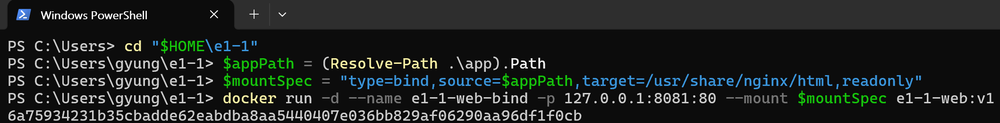

# 바인드 마운트 설정과 웹 서버 생성

사용자가 PowerShell에서 README의 세 명령을 실행해 제공한 실제 캡처입니다. 현재 위치는 `C:\Users\gyung\e1-1`이며, 연결한 폴더는 그 안의 `app`입니다.



## 실제 명령과 출력

프롬프트의 개인 경로와 긴 컨테이너 ID는 생략했습니다.

```text
PS> cd "$HOME\e1-1"
PS> $appPath = (Resolve-Path .\app).Path
PS> $mountSpec = "type=bind,source=$appPath,target=/usr/share/nginx/html,readonly"
PS> docker run -d --name e1-1-web-bind -p 127.0.0.1:8081:80 --mount $mountSpec e1-1-web:v1
[긴 컨테이너 ID 생략]
```

`e1-1-web:v1`을 사용해 `e1-1-web-bind`를 만들면서 PC의 `app` 폴더를 컨테이너의 `/usr/share/nginx/html`에 읽기 전용으로 연결했습니다. 첫 두 변수 대입 명령은 출력이 없고, 마지막 실행 명령에서 컨테이너 ID가 출력됐습니다.
