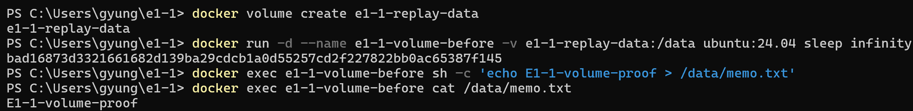
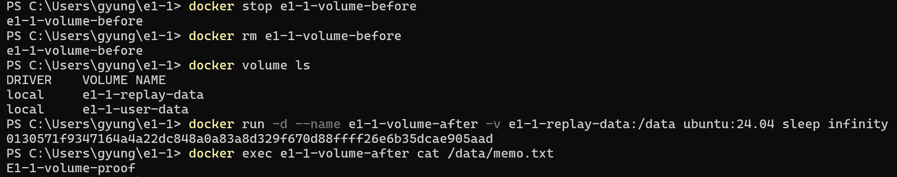

# 사용자 볼륨 생성·삭제 전후 데이터 유지 기록

사용자가 제공한 PowerShell 캡처의 명령과 출력을 옮겼습니다. 긴 컨테이너 ID는 생략했으며, 아래 출력은 새로 실행하거나 생성한 예시가 아닙니다.

## 볼륨 생성과 삭제 전 메모 확인



```text
PS> docker volume create e1-1-replay-data
e1-1-replay-data
PS> docker run -d --name e1-1-volume-before -v e1-1-replay-data:/data ubuntu:24.04 sleep infinity
[긴 컨테이너 ID 생략: bad16873d332로 시작]
PS> docker exec e1-1-volume-before sh -c 'echo E1-1-volume-proof > /data/memo.txt'
PS> docker exec e1-1-volume-before cat /data/memo.txt
E1-1-volume-proof
```

## 컨테이너 삭제와 새 컨테이너에서 메모 재확인



```text
PS> docker stop e1-1-volume-before
e1-1-volume-before
PS> docker rm e1-1-volume-before
e1-1-volume-before
PS> docker volume ls
DRIVER    VOLUME NAME
local     e1-1-replay-data
local     e1-1-user-data
PS> docker run -d --name e1-1-volume-after -v e1-1-replay-data:/data ubuntu:24.04 sleep infinity
[긴 컨테이너 ID 생략: 0130571f9347로 시작]
PS> docker exec e1-1-volume-after cat /data/memo.txt
E1-1-volume-proof
```

`before`를 삭제해도 `e1-1-replay-data`가 목록에 남았습니다. 새 `after` 컨테이너에 같은 볼륨을 연결하자, 메모를 다시 쓰지 않고도 삭제 전과 동일한 `E1-1-volume-proof`가 출력됐습니다.

`/data`는 볼륨을 연결한 경로이므로 그 아래의 `memo.txt`에 쓰는 내용은 볼륨에 저장됩니다. 이 연결이 컨테이너의 모든 파일을 볼륨에 저장한다는 뜻은 아닙니다.

## 캡처 원본

[사용자가 제공한 전체 캡처](images/07-ref-03-user-volume-full.png). README에 사용한 두 이미지는 이 원본에서 삭제 전과 삭제 후 부분을 잘라낸 것으로, 명령이나 출력 내용을 바꾸지 않았습니다.
