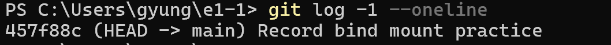

# 사용자 최근 커밋 확인

사용자가 제공한 PowerShell 캡처입니다.



```text
PS C:\Users\gyung\e1-1> git log -1 --oneline
457f88c (HEAD -> main) Record bind mount practice
```

`HEAD -> main`은 현재 체크아웃한 브랜치가 `main`임을 표시합니다. 이 출력에서는 최근 커밋 번호와 메시지를 확인할 수 있으며, 원격 업로드 성공 여부까지 보여주는 것은 아닙니다. 기존 사용자 푸시 성공 기록은 [Git 원본 로그](14-user-git.md#14-d-사용자-직접-html-수정본-검토스테이징커밋푸시)에 별도로 남아 있습니다.
