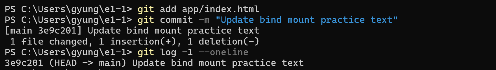

# 사용자 HTML 선택·커밋·결과 확인

사용자가 PowerShell에서 실행하고 직접 촬영한 화면의 명령과 실제 출력입니다.



```text
PS C:\Users\gyung\e1-1> git add app/index.html
PS C:\Users\gyung\e1-1> git commit -m "Update bind mount practice text"
[main 3e9c201] Update bind mount practice text
 1 file changed, 1 insertion(+), 1 deletion(-)
PS C:\Users\gyung\e1-1> git log -1 --oneline
3e9c201 (HEAD -> main) Update bind mount practice text
```

HTML 파일 하나의 한 줄을 바꾼 내용이 `3e9c201` 커밋으로 기록됐습니다. `git log`에서 동일한 번호와 메시지가 나오는 것으로 커밋 생성 결과를 확인했습니다. 이 캡처에는 `git push`가 없으므로 새 커밋의 원격 업로드 성공 증거로 사용하지 않습니다.
