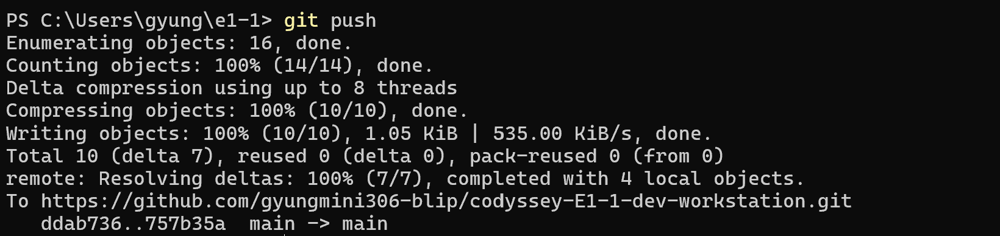

# 사용자 GitHub 업로드 성공

사용자가 과제 폴더의 PowerShell에서 `git push`를 실행하고 직접 촬영한 화면입니다.



```text
PS C:\Users\gyung\e1-1> git push
Enumerating objects: 16, done.
Counting objects: 100% (14/14), done.
Delta compression using up to 8 threads
Compressing objects: 100% (10/10), done.
Writing objects: 100% (10/10), 1.05 KiB | 535.00 KiB/s, done.
Total 10 (delta 7), reused 0 (delta 0), pack-reused 0 (from 0)
remote: Resolving deltas: 100% (7/7), completed with 4 local objects.
To https://github.com/gyungmini306-blip/codyssey-E1-1-dev-workstation.git
   ddab736..757b35a  main -> main
```

`main -> main`과 `ddab736..757b35a`는 원격 `main`이 새 커밋으로 갱신됐음을 보여줍니다. 앞서 사용자가 만든 [HTML 수정 커밋](46-user-git-add-commit.md)을 기존 실습 커밋 및 GitHub의 최신 문서 이력과 합친 뒤 업로드했습니다. 따라서 이 화면의 최종 번호 `757b35a`는 앞선 HTML 수정 커밋 번호 `3e9c201`과 다릅니다.
