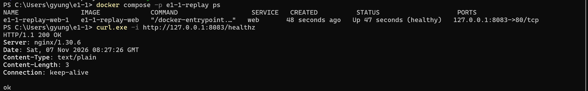
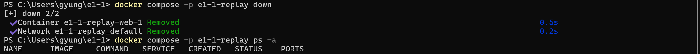

# 사용자 Compose 실행 상태·HTTP 응답·정리 결과

사용자가 PowerShell에서 실행해 직접 촬영한 화면입니다. HTTP 응답에 표시된 시각은 2026-11-07 08:27:26 GMT입니다. 컨테이너 목록은 COMMAND와 CREATED 열을 생략하고 발췌했습니다.

## 실행 상태와 HTTP 응답



```text
PS C:\Users\gyung\e1-1> docker compose -p e1-1-replay ps
NAME                 IMAGE             SERVICE   STATUS                    PORTS
e1-1-replay-web-1    e1-1-replay-web   web       Up 47 seconds (healthy)   127.0.0.1:8083->80/tcp
PS C:\Users\gyung\e1-1> curl.exe -i http://127.0.0.1:8083/healthz
HTTP/1.1 200 OK
Server: nginx/1.30.6
Date: Sat, 07 Nov 2026 08:27:26 GMT
Content-Type: text/plain
Content-Length: 3
Connection: keep-alive

ok
```

`healthy`는 컨테이너가 상태 점검을 통과했음을 나타냅니다. PC의 8083 포트로 보낸 요청에 HTTP `200 OK`와 본문 `ok`가 반환됐습니다.

## 프로젝트 정리와 빈 목록 확인



```text
PS C:\Users\gyung\e1-1> docker compose -p e1-1-replay down
[+] down 2/2
 ✔ Container e1-1-replay-web-1 Removed  0.5s
 ✔ Network e1-1-replay_default Removed  0.2s
PS C:\Users\gyung\e1-1> docker compose -p e1-1-replay ps -a
NAME      IMAGE     COMMAND   SERVICE   CREATED   STATUS    PORTS
```

컨테이너와 네트워크에 `Removed`가 표시됐고, 후속 `ps -a`에는 표 제목만 남아 해당 프로젝트의 컨테이너가 정리됐음을 확인했습니다.

[사용자가 제공한 전체 캡처](48-user-compose-full.png). README의 두 이미지는 이 원본에서 실행·접속 부분과 정리 부분을 나눠 자른 것이며, 명령과 출력 내용은 변경하지 않았습니다.
