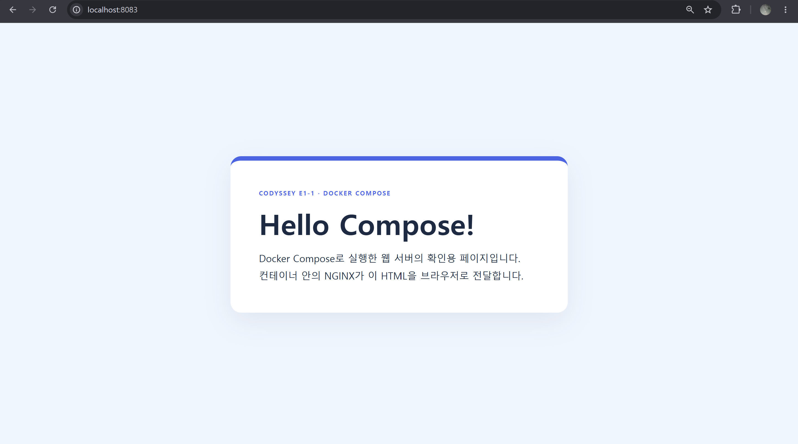

# 사용자 Compose 웹페이지 접속 결과

사용자가 직접 촬영한 브라우저 화면입니다.

## 캡처에서 확인한 결과

- 주소창: `localhost:8083`
- 페이지 제목 문구: `Hello Compose!`
- 페이지 본문: `Docker Compose로 실행한 웹 서버의 확인용 페이지입니다.`
- 추가 본문: `컨테이너 안의 NGINX가 이 HTML을 브라우저로 전달합니다.`

주소창과 응답 화면이 함께 보이므로 PC의 8083 포트에서 HTML 화면을 확인한 증거입니다. 서버 실행 상태와 포트 연결, HTTP 응답은 [사용자가 직접 실행한 Compose 명령과 출력](48-user-compose.md)에서 별도로 확인할 수 있습니다. Compose 실행 설정은 [compose.yaml](../../compose.yaml), 제공한 HTML은 [app/compose.html](../../app/compose.html)에 있습니다.
