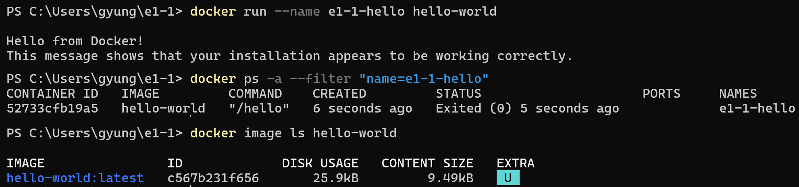

# 사용자 hello-world 실행·종료·이미지 조회 결과

사용자가 직접 제공한 두 캡처의 명령과 출력입니다. README에서는 각 입력 명령과 해당 결과를 남기고, hello-world의 긴 안내문과 이미지 조회 캡처 오른쪽 안내 영역을 잘라 같은 폭으로 이어 붙였습니다. 남긴 명령과 출력 내용은 변경하지 않았습니다. 서로 다른 캡처를 연결한 이미지입니다.



## 실행과 정상 종료

아래는 [기존 실행·종료 캡처](29-user-hello-world.png)의 발췌입니다. 인사말 이후의 안내문은 생략했습니다.

```text
PS C:\Users\gyung\e1-1> docker run --name e1-1-hello hello-world

Hello from Docker!
This message shows that your installation appears to be working correctly.
[이후 안내문 생략]

PS C:\Users\gyung\e1-1> docker ps -a --filter "name=e1-1-hello"
CONTAINER ID   IMAGE         COMMAND    CREATED         STATUS                    PORTS   NAMES
52733cfb19a5   hello-world   "/hello"   6 seconds ago   Exited (0) 5 seconds ago           e1-1-hello
```

## PC에 이미지가 있는지 확인

[사용자가 제공한 이미지 조회 원본](50-user-hello-image-list.png)입니다. 오른쪽의 안내 표시를 제외한 표를 발췌했습니다.

```text
PS C:\Users\gyung\e1-1> docker image ls hello-world
IMAGE                ID             DISK USAGE   CONTENT SIZE   EXTRA
hello-world:latest   c567b231f656   25.9kB       9.49kB         U
```

`hello-world:latest`와 이미지 ID가 목록에 나오므로 해당 이미지가 PC의 Docker 환경에 있음을 확인했습니다. `U`는 사용 중임을 나타내는 표시입니다.

처음 실행할 때 이미지를 다운로드한 기록은 [기존 hello-world 원본 로그](05-hello-world.md)에 보관되어 있습니다.
